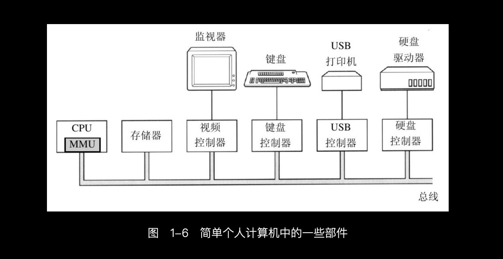

# 输入输出设备(I/O设备)
> 学习:   [007.BOOKs/现代操作系统.epub](../../007.BOOKs/现代操作系统.epub)#1.3.5 I/O 设备 （部分翻译有问题，参考:[007.BOOKs/现代操作系统（第4版）英文.pdf](../../007.BOOKs/现代操作系统（第4版）英文.pdf)学习）   - [001.UNIX-DOCS/000.内存管理/023.MMIO(内存映射IO)](../../001.UNIX-DOCS/000.内存管理/023.MMIO(内存映射IO))

- 如上图，I/O设备一般包括两个部分：设备控制器 和 设备本身
  + 设备控制器：控制器是插在电路板上的一块芯片或一组芯片，这块电路板物理地控制设备。它从操作系统接收命令，例如，从设备读数据，并且完成数据的处理。
    - 控制器的任务是为操作系统提供一个简单的接口: CPU通过「设备驱动程序（device driver）每类设备控制器都是不同的，所以，需要不同的软件进行控制。专门与控制器对话，发出命令并接收响应的软件，称为设备驱动程序（device driver）」来和「设备控制器」交流（发送请求），由控制器来控制设备来执行任务
    - 操作系统看到的是对控制器的接口(**每个设备控制器都有少量的用于通信的寄存器**操作系统只需通过设备驱动程序向磁盘控制器的寄存器写入一条高层命令(“从 2 号盘读 11206 号扇区”)，控制器芯片内嵌的一颗微控制器便运行厂商固件，把这条命令翻译成换算扇区号、寻道、读取、校验、组字入内存等一整套物理操作——机械细节全部被控制器消化，操作系统完全看不到；在此期间 CPU 不必空等，驱动程序启动设备后即返回，操作系统转去调度别的进程；控制器传送完毕后，经由中断控制器向 CPU 发出中断并报上设备编号，CPU 保存现场、切入内核态，按设备编号查中断向量找到该设备驱动程序中的中断处理程序，由它读取设备状态、把数据交给被阻塞的调用者，一次 I/O 至此完成(大块数据可交由 DMA 芯片代为搬运，完成后同样以中断通知))
  + 设备自身: 设备本身有个相对简单的接口，这是因为接口既不能做很多工作，又已经被标准化了。标准化是有必要的，这样任何一个IDE磁盘控制器就可以适应任一种IDE磁盘
