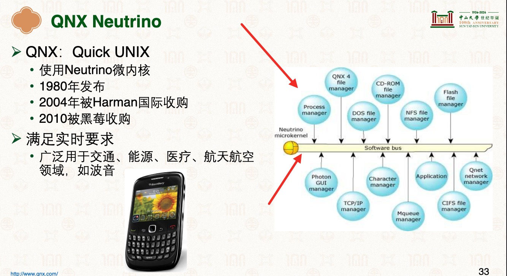

# 分布式软总线
> 借助: OpenHarmony （或 HarmonyOS NEXT）   - [2021HDC-HarmonyOS-2-7.pdf](./999.REFS/2021HDC-HarmonyOS-2-7.pdf)

打破单一设备的物理边界，让多台不同的设备（手机、平板、电视、音箱、IoT设备等）在逻辑上组合成一台“超级虚拟终端”，就像它们通过一根无形的“导线”连接在同一个主板上一样。
> 结合: [Firmware-Engineer](https://github.com/Berries-Wang/Firmware-Engineer) 中的I2C总线硬总线（Hard Bus） 理解: 将设备挂在到总线上，再数据传输

## 微内核中的「总线：进程通信抽象」
> 摘自 [037.内核基础](../037.内核基础/README.md) 内核分类-微内核

- [操作系统结构](../001.操作系统课程/000.中山大学-操作系统2025/1-0227-struct.pdf) P33:“总线：进程通信抽象”：所有应用都挂在到一根总线上(主要描述的是 应用之间通过软总线(微内核)进行通信)    - 结合P23 P24 理解

|总线类型|说明|备注|
|-|-|-|
|- 硬总线（Hard Bus）|- 在你的电脑主板上，CPU、内存、硬盘是通过物理铜线（总线）连接的。因为有这根线，CPU 访问内存的速度极快且非常稳定。|-|
|-|-|-|
|- 分布式软总线（Soft Bus|- 在多设备环境下，并没有物理线缆。软总线通过 Wi-Fi、蓝牙、P2P 等无线技术，在软件层模拟出了一根“总线”。|- 手机想用平板的屏幕，或者电视想调取手机的麦克风，就像访问自己内部的组件一样简单、快速|
|-|-|-|