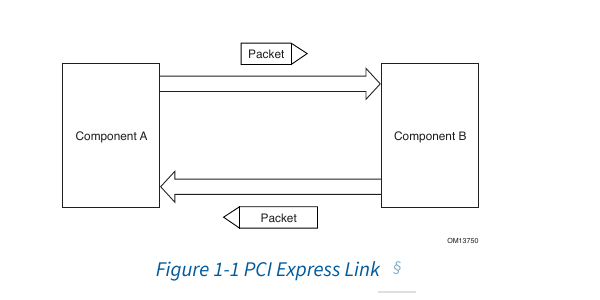
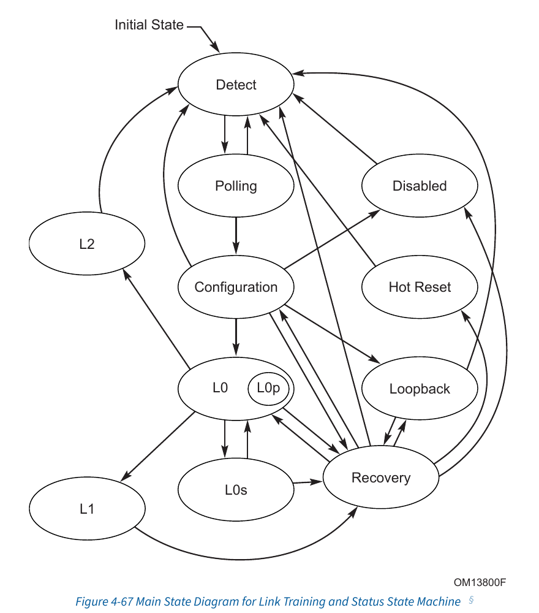
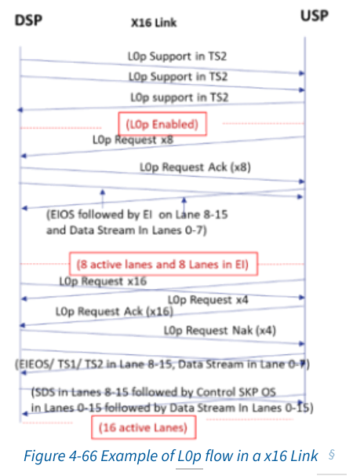
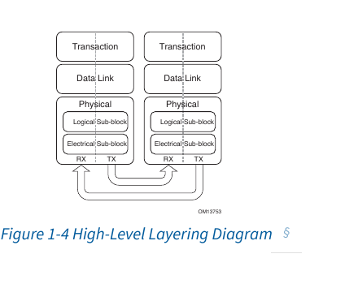
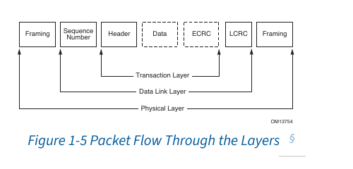
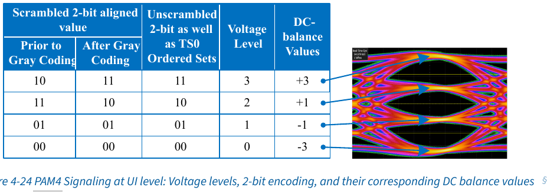
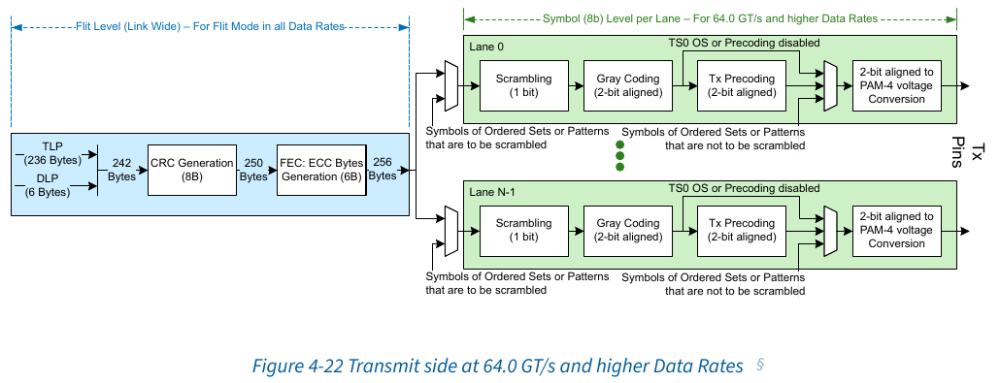
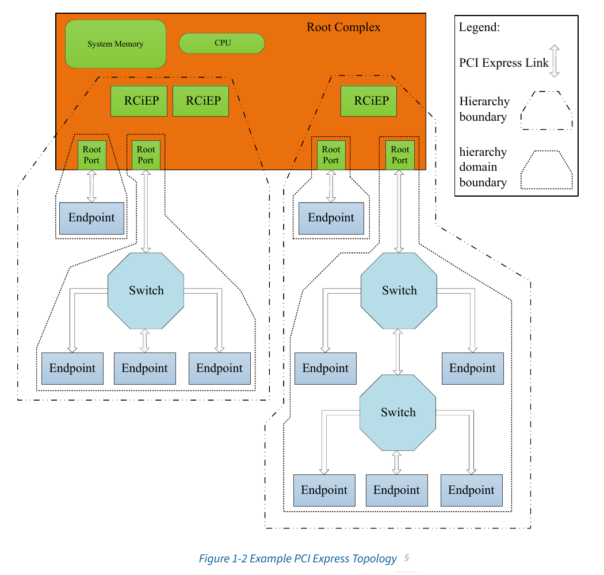
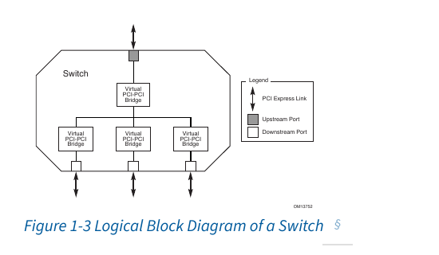

# PCI Express 7.0 学习笔记：Lane / 拓扑 / 速率 / 桌面 AI 中心组装

> 主资料源：[PCI Express® Base Specification Revision 7.0](../PCI%20Express®%20Base%20Specification%20Revision%207.0.pdf)（PCI-SIG, 2025-06-05, 7.0-1.0-PUB, 2276 页）
>
> 阅读约定：
> - **「原文」= 规范英文原文摘录**，逐段标注 §章节号 / PDF 页码（`p.N` 即 PDF 第 N 页，与页脚页码一致）。引文内的 `...` 表示有省略；规范网页版的交叉引用符号 `§` 在引文内从略。
> - **「译文」= 本人翻译**。
> - 标注【工程整理】/【换算】的内容为本人推导与实践知识。平台、主板、GPU 厂商行为**不在 Base Spec 范围内**，涉及处均注明依据，装机前请按具体型号的手册核实。
> - 规范插图原样摘录至 `./imgs/`，来源页码见图注。
> - 全部「原文」已用脚本与规范逐段比对、页码逐条核对。

## 目录

- [第一部分 · Lane 与链路基础](#第一部分--lane-与链路基础) —— 1.1 Link / 1.2 Lane / 1.3 GT/s / 1.4 链路初始化与 LTSSM / 1.5 极性反转 / 1.6 分层 / 1.7 PAM4·Flit·FEC
- [第二部分 · PCIe 拓扑：RC / Switch / Endpoint](#第二部分--pcie-拓扑rc--switch--endpoint) —— 2.1 树形 fabric / 2.2 RC / 2.3 EP / 2.4 Switch / 2.5 端口拆分与 crosslink / 2.6 小结 / 2.7 树的边界与 UIO
- [第三部分 · 速率与带宽](#第三部分--速率与带宽) —— 3.1 逐链路协商 / 3.2 寄存器 / 3.3 换算表 / 3.4 拓扑带宽核算 / 3.5 小结
- [第四部分 · 桌面 AI 中心组装实践](#第四部分--桌面-ai-中心组装实践) —— 4.1 思路 / 4.2 lane 预算 / 4.3 方案对比 / 4.4 P2P / 4.5 系统特性 / 4.6 硬件风险 / 4.7 验收清单 / 4.8 档位推荐 / 4.9 未覆盖范围
- [附录 · 速查与术语页码](#附录--速查与术语页码)

---

# 第一部分 · Lane 与链路基础

> 回答的问题：**Lane 是什么？Link 是什么？一根"线"里到底有几根线？速率是怎么一代代翻倍的？**

## 1.1 Link（链路）：两个部件之间的双单工通道

> **§1.2 PCI Express Link（原文, p.140）**
>
> "A Link represents a dual-simplex communications channel between two components. The fundamental PCI Express Link consists of two, low-voltage, differentially driven signal pairs: a Transmit pair and a Receive pair."

**译文**：Link（链路）表示两个部件之间的双单工通信通道。最基本的 PCI Express Link 由两对低压差分驱动信号对组成：一对发送（Transmit pair）和一对接收（Receive pair）。

> **术语表 Link（原文, p.122）**
>
> "The collection of two Ports and their interconnecting Lanes. A Link is a dual-simplex communications path between two components."

**译文**：链路是两个端口（Port）及其互连 Lane 的集合。链路是两个部件之间的一条双单工通信通路。

规范 Figure 1-1（摘自 p.140）——一个 Link 就是"一发一收"两对差分线，包（Packet）双向流动：



要点（本人整理）：
- **dual-simplex（双单工）= 全双工**：收、发各走各的差分线对，同时双向传输，互不抢占。
- 一条链路的两端各有一个 **Port（端口）**：

> **术语表 Port（原文, p.125）**
>
> "1. Logically, an interface between a component and a PCI Express Link. 2. Physically, a group of Transmitters and Receivers located on the same chip that define a Link."

**译文**：1. 逻辑上，是部件与 PCIe 链路之间的接口；2. 物理上，是位于同一芯片上、共同定义一条链路的一组发送器与接收器。

## 1.2 Lane（通道）：链路的最小物理单位

> **§1.2（原文, p.141）**
>
> "Lanes - A Link must support at least one Lane - each Lane represents a set of differential signal pairs (one pair for transmission, one pair for reception). To scale bandwidth, a Link may aggregate multiple Lanes denoted by xN where N may be any of the supported Link widths. ... This specification describes operations for x1, x2, x4, x8, and x16 Lane widths."

**译文**：Lane（通道）——一条链路必须至少支持一个 Lane；每个 Lane 代表一组差分信号对（一对用于发送，一对用于接收）。为了扩展带宽，一条链路可以聚合多个 Lane，记作 **xN**，N 可以是任何受支持的链路宽度。本规范描述 x1、x2、x4、x8、x16 五种链路宽度的操作。

> **术语表 Lane（原文, p.121）**
>
> "A set of differential signal pairs, one pair for transmission and one pair for reception. A by-N Link is composed of N Lanes."

**译文**：一组差分信号对，一对用于发送、一对用于接收。一个 "by-N" 链路（即 xN 链路）由 N 个 Lane 组成。

> **§1.2（原文, p.141）—— 对称性**
>
> "Symmetry - Each Link must support a symmetric number of Lanes in each direction, (i.e., a x16 Link indicates there are 16 differential signal pairs in each direction)."

**译文**：对称性——每条链路在两个方向上必须支持相同数量的 Lane（即一条 x16 链路意味着每个方向各有 16 对差分信号）。

> **术语表 Physical Lane Number（原文, p.125）**
>
> "Physical Lane Number: Lane Number which is assigned in an implementation specific manner and is invariant to Link width and Lane reversal negotiation. Physical lane numbers must be unique and sequential. For example, each Lane of a x16 Link must be assigned a unique Lane number from 0 to 15."

**译文**：物理通道号：以实现相关的方式分配、且不随链路宽度和 Lane 反转协商而变化的通道号。物理通道号必须唯一且连续。例如 x16 链路的每个 Lane 必须分配 0~15 中唯一的通道号。

**心智模型与单位（本人整理）**：
- **xN 的单位是 Lane（条）**：`x16` 读作"16 条 Lane"。"x" 只是规范规定的记号（即乘号 ×，表示"倍"），N 是纯数字（1/2/4/8/16），本身不带物理单位。真正带单位的是它修饰的对象——Lane：看到 `x16` 就读成"16 ×（每条 Lane）"，即 16 条 Lane、16 份单 Lane 带宽。类比 "8× 速光盘" 的 8×：数字说"几倍"，单位在后面。
- **1 条 Lane = 1 个发送差分对 + 1 个接收差分对 = 2 对差分线 = 4 根信号线**（每对差分线由 D+、D- 两根走线组成）。
- 换算表：

  | 记号 | Lane 数 | 差分对总数 | 数据信号线总数（根） |
  |---|---|---|---|
  | x1 | 1 | 2（1 发 + 1 收） | 4 |
  | x4 | 4 | 8（4 发 + 4 收） | 16 |
  | x8 | 8 | 16（8 发 + 8 收） | 32 |
  | x16 | 16 | 32（16 发 + 16 收） | 64 |

  （插槽触点数远多于上表，因为还包含供电、地、边带时钟/复位等引脚——引脚机械定义属 CEM 等机电规范，不在 Base Spec 范围内。）
- **带宽换算关系**：`链路单向带宽 = 单 Lane 单向带宽 × N`。如 x16 Gen4 = 1.97 GB/s × 16 ≈ 31.5 GB/s（见第三部分 §3.3）。
- 主板上说的 "x16 插槽" = 这个插槽的 Port 最多能协商到 x16 宽度（16 条 Lane）；实际跑多宽，取决于两端协商（见 §1.4 与第三部分）。
- 槽里的卡可以是 x4（如 NVMe）、x8（网卡）、x16（GPU），协商后按两者较小宽度运行。

## 1.3 GT/s 与有效数据率

> **术语表 GT/s（原文, p.120）**
>
> "The number of encoded bits transferred in a second on a direction of a Lane. Short for Giga Transfers per Second."

**译文**：一条 Lane 的一个方向上每秒传输的编码后比特数。Giga Transfers per Second（每秒十亿次传输）的缩写。

> **§1.2（原文, p.141）**
>
> "The term GT/s is used to refer to the number of encoded bits transferred in a second on a direction of a Lane. The actual effective data rate is dependent on a combination of modulation method, encoding method, and data rate."

**译文**：GT/s 表示一条 Lane 一个方向上每秒传输的**编码后比特数**。实际有效数据率取决于调制方式、编码方式和数据率的组合。

> **Table 1-1 PCIe Signaling Characteristics（原文, p.141；表格转为 Markdown 排版，内容同原文）**
>
> | Data Rate | Modulation | Encoding | Effective Data Rate (after removing Encoding overhead) | 7.x | 6.x | 5.x | 4.x | 3.x | 2.x | 1.x |
> |---|---|---|---|---|---|---|---|---|---|---|
> | 2.5 GT/s | NRZ | 8b/10b | 2 Gbit/s | ✓ | ✓ | ✓ | ✓ | ✓ | ✓ | ✓ |
> | 5.0 GT/s | NRZ | 8b/10b | 4 Gbit/s | ✓ | ✓ | ✓ | ✓ | ✓ | ✓ | |
> | 8.0 GT/s | NRZ | 128b/130b | ~8 Gbit/s | ✓ | ✓ | ✓ | ✓ | ✓ | | |
> | 16.0 GT/s | NRZ | 128b/130b | ~16 Gbit/s | ✓ | ✓ | ✓ | ✓ | | | |
> | 32.0 GT/s | NRZ | 128b/130b | ~32 Gbit/s | ✓ | ✓ | ✓ | | | | |
> | 64.0 GT/s | PAM4 | 1b/1b | 64 Gbit/s | ✓ | ✓ | | | | | |
> | 128.0 GT/s | PAM4 | 1b/1b | 128 Gbit/s | ✓ | | | | | | |

表的三种编码：

> **术语表 8b/10b（原文, p.115）**
>
> "The data encoding scheme used in the PCI Express Physical Layer for 5.0 GT/s and below."

**译文**：PCI Express 物理层用于 5.0 GT/s 及以下速率的数据编码方案。

- 8b/10b：每 8 bit 数据编成 10 bit 线上信号，效率 80%（所以 2.5 GT/s → 2 Gbit/s）。
- 128b/130b：每 128 bit 数据加 2 bit 开销，效率 ≈98.46%（Gen3~Gen5）。
- 1b/1b：不再做线路编码，靠扰码 + Flit 内的 CRC/ECC 保证可靠性（Gen6/Gen7，见 §1.7）。

> **提示（本人核对）**：规范 p.115 术语表把 128b/130b 这一条印成了 "128b/120b"，属规范自身的笔误——正文 Table 1-1 与编码章节均为 128b/130b，阅读时以正文为准。

> **规范脚注 2（原文, p.141）—— "Gen" 这个叫法有歧义**
>
> "Terms like “PCIe Gen3” are ambiguous and should be avoided. For example, “gen3” could mean (1) compliant with Base 3.0, (2) compliant with Base 3.1 (last revision of 3.x), (3) compliant with Base 3.0 and supporting 8.0 GT/s, (4) compliant with Base 3.0 or later and supporting 8.0 GT/s, …."

**译文**：像 "PCIe Gen3" 这样的术语有歧义，应当避免。例如 "gen3" 可能指：(1) 符合 Base 3.0，(2) 符合 Base 3.1（3.x 的最后一个修订版），(3) 符合 Base 3.0 且支持 8.0 GT/s，(4) 符合 Base 3.0 或更新且支持 8.0 GT/s……

**本人整理**：本文为口语方便仍用 Gen1~Gen7，但严格写法是"速率 + 规范修订版"，例如 "16.0 GT/s / Base 6.x"。本文的 GenN 一律指**速率代**（Gen3 = 8 GT/s … Gen7 = 128 GT/s），不指规范修订版。

> **§1.1（原文, p.139）—— 性能扩展的两根杠杆**
>
> "Scalable performance via aggregated Lanes and signaling frequency"

**译文**：通过聚合的 Lane 数与信号频率来扩展性能。

> **§1.2（原文, p.141）—— Flit 模式**
>
> "Support of Data Stream in Non-Flit Mode is mandatory, while support of Data Stream in Flit Mode is mandatory only if a data rate that exceeds 32.0 GT/s is supported."

**译文**：Non-Flit 模式为强制支持；仅当支持超过 32.0 GT/s（即 64/128 GT/s）的速率时，才强制要求支持 Flit 模式。

> **术语表 Flit（原文, p.119）**
>
> "Flow Control Unit"

**译文**：流控单元。

**记忆口诀（本人整理）**：Gen1/2 编码损耗大（8b/10b），Gen3 起 128b/130b 几乎无损，Gen6/7 改用 PAM4（一个符号 2 bit）并把包切成固定长度的 Flit：
`Gen1=0.25 → Gen2=0.5 → Gen3≈0.985 → Gen4≈1.97 → Gen5≈3.94 → Gen6=8 → Gen7=16 GB/s（每 lane 每方向，仅扣编码开销）`
（完整换算表见第三部分 §3.3；Gen6/7 扣除 Flit 结构开销后的数值见 §1.7。）

## 1.4 链路初始化：宽度和速率是"训练"出来的

> **§1.2（原文, p.141）—— Initialization**
>
> "Initialization - During hardware initialization, each PCI Express Link is set up following a negotiation of Link width, data rate, and Flit mode by the two agents at each end of the Link. No firmware or operating system software is involved."

**译文**：初始化——在硬件初始化阶段，每条 PCIe 链路由链路两端的两个代理通过协商确定链路宽度、数据速率和 Flit 模式来建立。**不需要固件或操作系统软件参与。**

协商由 **LTSSM（链路训练与状态状态机）** 完成。开机必经的三个状态：

> **§4.2.6.1 Detect Overview（原文, p.521）**
>
> "The purpose of this state is to detect when a far end termination is present."

**译文**：Detect 状态的目的是检测对端是否存在端接（即插槽里有没有卡）。

> **§4.2.6.2 Polling Overview（原文, p.521）**
>
> "The Port transmits training Ordered Sets and responds to the received training Ordered Sets. In this state, bit lock and Symbol lock are established and Lane polarity is configured."

**译文**：Polling 状态下，端口发送训练序列（Ordered Sets）并响应收到的训练序列；在此状态下建立比特锁与符号锁，并配置 Lane 极性。

> **§4.2.6.3 Configuration Overview（原文, p.522）**
>
> "In Configuration, both the Transmitter and Receiver are sending and receiving data at the negotiated data rate. The Lanes of a Port configure into a Link through a width and Lane negotiation sequence. Also, Lane-to-Lane de-skew must occur, scrambling can be disabled if permitted, the N_FTS is set, and the Disabled or Loopback states can be entered."

**译文**：Configuration 状态下，收发双方以协商出的速率收发数据；端口的各 Lane 通过宽度与通道号协商序列组成一条链路；同时完成 Lane 间去偏斜（de-skew），允许时关闭扰码，设置 N_FTS，并可进入 Disabled 或 Loopback 状态。

规范 Figure 4-67（摘自 p.535）——LTSSM 主状态机，即链路"训练"的完整状态流转：



图中其余状态的含义（规范各 Overview 小节的原文首句 + 译文）：

| 状态 | 原文 | 译文 | 页 |
|---|---|---|---|
| Recovery | "Recovery allows a configured Link to change the data rate of operation if desired, re-establish bit lock, Symbol lock or Block alignment, and Lane-to-Lane de-skew." | 已配置好的链路可在 Recovery 中改速率、重建比特锁/符号锁/块对齐、重新去偏斜 | p.522 |
| L0 | "L0 is the normal operational state where data and control packets can be transmitted and received." | 正常工作态，收发数据与控制包；所有电源管理状态都从这里进入 | p.522 |
| L0s | "L0s allows a Link to quickly enter and recover from a power conservation state without going through Recovery." | 省电态，进出快、不用经过 Recovery | p.522 |
| L0p | "L0p enables a Link to have some Lanes active while the remaining Lanes will be in electrical idle state." | L0 的子状态：部分 Lane 工作、其余 Lane 电气空闲 | p.522 |
| L1 | "The L1 state allows an additional power savings over L0s at the cost of additional resume latency." | 比 L0s 更省电，代价是恢复更慢 | p.531 |
| L2 | "Power can be aggressively conserved in L2. Most of the Transmitter and Receiver may be shut off." | 主电源可关，仅保留辅助电源 | p.531 |
| Disabled | "The intent of the Disabled state is to allow a configured Link to be disabled as long as directed or until Electrical Idle is exited (i.e., due to a hot removal and insertion) after entering Disabled." | 让已配置的链路被禁用（典型场景：热拔插期间） | p.532 |
| Loopback | "Loopback is intended for test and fault isolation use." | 测试与故障隔离用 | p.532 |
| Hot Reset | "The intent of the Hot Reset state is to allow a configured Link and associated downstream device to be reset using in-band signaling." | 用带内信号复位链路及其下游设备 | p.533 |

与多卡/省电最相关的是 **L0p**（部分 Lane 休眠，带宽随负载收缩）：

> **§4.2.6.7 L0p Overview（原文, p.522）**
>
> "L0p is a part of the L0 state and intended as a power savings state. L0p is supported only in Flit Mode, for all data rates. L0p support is optional but strongly recommended for Ports. ... L0p enables a Link to have some Lanes active while the remaining Lanes will be in electrical idle state. With Flit Mode, Link Upconfigure, which performs dynamic link width adjustment through the state transition L0 → Recovery → Configuration → L0, is not supported."
>
> "L0p is symmetric in width. All legal widths (x1, x2, x4, x8, x16) up to the configured Link width must be supported by Ports that support L0p. When the Link is in L0p, at least one Lane in each direction must be active."

**译文**：L0p 是 L0 状态的一部分，用作省电状态。L0p 仅在 Flit 模式下受支持（适用于所有速率）。L0p 的支持是可选的，但强烈建议端口支持。……L0p 使链路可以只让一部分 Lane 保持活动，其余 Lane 处于电气空闲。在 Flit 模式下，不支持 Link Upconfigure（即经由 L0 → Recovery → Configuration → L0 的动态链路宽度调整）。
L0p 在宽度上是对称的。支持 L0p 的端口必须支持到已配置链路宽度为止的所有合法宽度（x1、x2、x4、x8、x16）。链路处于 L0p 时，每个方向至少要有 1 条 Lane 活动。

规范 Figure 4-66（摘自 p.531）——x16 链路上的 L0p 流程：16 条 Lane 活动 → 收缩到 8 条 → 再回到 16 条：



**工程理解（本人整理）**：开机瞬间每条插槽都在跑这套"握手"，所以——
- 插一半、金手指脏污 → Detect 阶段失败 → 设备消失或降速；
- 协商出的宽度/速率可以在 `lspci -vv` 的 `LnkSta` 里直接看到（见第三部分 §3.2）；
- 速率变更（升速/降速）走 **Recovery** 状态，不需要重新枚举设备——所以"链路跑到一半自己降速"在系统看来只是静默的一次 Recovery。

## 1.5 Lane 极性反转：接反了也能工作

> **§4.2.5.5 Lane Polarity Inversion（原文, p.514）**
>
> "During the training sequence in Polling, the Receiver looks at Symbols 6-15 of the TS1 and TS2 Ordered Sets as the indicator of Lane polarity inversion (D+ and D- are swapped). If Lane polarity inversion occurs, the TS1 Symbols 6-15 received will be D21.5 as opposed to the expected D10.2. Similarly, if Lane polarity inversion occurs, Symbols 6-15 of the TS2 Ordered Set will be D26.5 as opposed to the expected D5.2. This provides the clear indication of Lane polarity inversion."
>
> "If polarity inversion is detected the Receiver must invert the received data. The Transmitter must never invert the transmitted data. Support for Lane Polarity Inversion is required on all PCI Express Receivers across all Lanes independently."

**译文**：在 Polling 阶段的训练序列中，接收方查看 TS1/TS2 有序集的符号 6-15 来判断是否发生了 Lane 极性反转（即 D+ 与 D- 被调换）。若发生极性反转，收到的 TS1 符号 6-15 将是 D21.5 而非期望的 D10.2；同理，TS2 有序集的符号 6-15 将是 D26.5 而非期望的 D5.2。这就给出了极性反转的明确指示。
检测到极性反转后，**接收方必须对接收数据取反；发送方则永远不得主动反转发送数据**。所有 PCIe 接收器必须对每条 Lane **独立地**支持极性反转。

**工程理解（本人整理）**：PCB 走线/转接卡上某条 lane 的 D+/D- 接反是常见错误，规范靠协议自动纠正，所以"差分对接反"通常不致命，而**整条 lane 接错位/断针**才会表现为掉 lane、降宽。

## 1.6 分层模型（一句话背景）

> **§1.5（原文, p.147）**
>
> "This document specifies the architecture in terms of three discrete logical layers: the Transaction Layer, the Data Link Layer, and the Physical Layer."

**译文**：本规范以三个离散逻辑层描述体系结构：事务层（Transaction Layer）、数据链路层（Data Link Layer）和物理层（Physical Layer）。

规范 Figure 1-4 / 1-5（摘自 p.147）——分层与 TLP 包在各层的封装流转：

| Figure 1-4 高层分层图 | Figure 1-5 包流经各层 |
|---|---|
|  |  |

本文讨论的 Lane/链路训练/PAM4 都在**物理层**；第四部分 §4.5.4~§4.5.5 的 MPS、事务属性在**事务层**。

## 1.7 PAM4 / Flit / FEC：64 GT/s 以上的三件事

Gen6/Gen7（64、128 GT/s）相对 Gen5 有三个结构性变化，Table 1-1 里的 "PAM4 / 1b/1b" 就对应这里。

**① 调制：NRZ → PAM4（一个符号传 2 bit）**

> **§4.2.3.1.1 PAM4 Signaling（原文, p.396）**
>
> "PAM4 stands for Pulse Amplitude Modulation 4-levels. It is a signaling mechanism where 4 levels (2 bits) are encoded in same Unit Interval (UI) resulting in 3 eyes, as shown in Figure 4-24. It is deployed only for 64.0 GT/s or higher Data Rates. As described in Chapter 8, PAM4 helps with the channel loss as it has half the Nyquist frequency as NRZ (e.g., the Nyquist frequency for 32.0 GT/s and 64.0 GT/s Data Rates are 16 GHz)."

**译文**：PAM4 即 4 电平脉冲幅度调制。它是一种在**同一个单位间隔（UI）内编码 4 个电平（2 个比特）**的信号机制，形成 3 个"眼"，如图 4-24。它仅用于 64.0 GT/s 及以上速率。如第 8 章所述，PAM4 有助于应对通道损耗，因为它的奈奎斯特频率只有 NRZ 的一半（例如 32.0 GT/s 与 64.0 GT/s 的奈奎斯特频率都是 16 GHz）。

规范 Figure 4-24（摘自 p.397）——4 个电压档位对应 2 bit 编码（NRZ 只有 2 个档位、1 bit）：



**② 纠错：加 FEC，因而必须用固定长度的 Flit**

> **§4.2.3.1.1 PAM4 Signaling（原文·续, p.397）**
>
> "A Forward Error Correction (FEC) mechanism is used to deal with the high FBER in the Data Stream. Since FEC works on fixed sized code words, Flit (flow control unit) will be used for sending/ receiving TLPs and DLLPs in a data stream. A low-overhead FEC will be used to keep the latency low. This will be augmented with a strong CRC at Flit level for high reliability. Link level retry will be deployed at the Flit level in Flit Mode."

**译文**：用前向纠错（FEC）机制应对数据流中较高的首比特错误率（FBER）。由于 FEC 作用于固定长度的码字，数据流中的 TLP 与 DLLP 将以 **Flit（流控单元）**为单位收发。采用低开销 FEC 以保持低延迟，并在 Flit 级别辅以强 CRC 以保证高可靠性。Flit 模式下，链路级重传也在 Flit 级别进行。

**③ 封装：256 字节的 Flit**

> **§4.2.3.3 Data Stream in Flit Mode（原文, p.406）**
>
> "The flit size is 256 Bytes, allocated as follows:"
> - "236 Bytes for TLPs (Bytes 0 through 235 in the Flit, ...)"
> - "6 Bytes for Data Link Layer Payload (DLP in Bytes 236 through 241 in the Flit, ...)"
> - "8 Bytes for CRC (Bytes 242 through 249 in the Flit, ...), and"
> - "6 Bytes for ECC (Bytes 250 through 255 arranged as 3 groups of ECC0[0:1], ECC1[0:1], ECC2[0:1], ...)."

**译文**：Flit 大小为 256 字节，划分如下：236 字节给 TLP；6 字节给数据链路层负载（DLP）；8 字节 CRC；6 字节 ECC（分为 3 组，每组 2 字节）。

规范 Figure 4-22（摘自 p.396）——64 GT/s 及以上的发送端：TLP+DLP → 加 CRC（8B）→ 加 FEC/ECC（6B）凑成 256B Flit → 逐 Lane 扰码 → 格雷编码 → 预编码 → 转 PAM4 电平：



**对带宽的实际影响【换算】**：Table 1-1 的 Effective Data Rate 只扣了编码开销，64/128 GT/s 行还要再扣 Flit 结构开销（TLP 区只占 236/256）：

| | 64 GT/s（Gen6） | 128 GT/s（Gen7） |
|---|---|---|
| 编码后比特率（每 Lane 每方向） | 64 Gbit/s | 128 Gbit/s |
| Table 1-1：仅扣编码开销 | 64 Gbit/s = 8 GB/s | 128 Gbit/s = 16 GB/s |
| 再乘 TLP 区占比 236/256 | 59.0 Gbit/s ≈ 7.38 GB/s | 118 Gbit/s ≈ 14.75 GB/s |

（上表尚未扣除 TLP 头、流控帧等协议层开销，与 Gen3~Gen5 行的口径一致。）

**对桌面 AI 中心的意义【工程整理】**：Flit 模式只在 64 GT/s 及以上强制（§1.3 引文），目前桌面平台普遍是 Gen5（32 GT/s）及以下，跑的都是 Non-Flit 模式。所以 Flit/FEC/L0p/UIO 这些机制对当下装机是"了解趋势"，不是"立即可用"。

---

# 第二部分 · PCIe 拓扑：RC / Switch / Endpoint

## 2.1 总纲：Fabric 是一棵树，不是一条总线

> **§1.3 PCI Express Fabric Topology（原文, p.141）**
>
> "A fabric is composed of point-to-point Links that interconnect a set of components ... This figure illustrates a single fabric instance with two Hierarchies composed of a Root Complex (RC), multiple Endpoints, and multiple Switches, interconnected via PCI Express Links."

**译文**：一个 fabric（互连结构）由点对点链路互连一组部件构成。图中展示了一个 fabric 实例：它包含两个层次结构（Hierarchy），每个 Hierarchy 由一个根复合体（RC）、多个端点（Endpoint）和多个交换器（Switch）组成，通过 PCIe 链路互连。

规范 Figure 1-2（摘自 p.142）——示例拓扑：橙色 RC 域内含 System Memory/CPU/RCiEP/Root Port，每个 Root Port 向下派生一个层次域（hierarchy domain），域内可级联 Switch：



图中两个边界概念的规范定义：

> **术语表 Hierarchy（原文, p.120）**
>
> "A PCI Express I/O interconnect topology, wherein the Configuration Space addresses, referred to as the tuple of Bus/Device/Function Numbers (or just Bus/Function Numbers, for ARI cases), are unique. These addresses are used for Configuration Request routing, Completion routing, some Message routing, and for other purposes. In some contexts a Hierarchy is also called a Segment, and in Flit Mode, the Segment number is sometimes also included in the ID of a Function."

**译文**：Hierarchy 是一种 PCI Express I/O 互连拓扑，其中配置空间地址（即 Bus/Device/Function 三元组，ARI 情况下简称 Bus/Function 号）是唯一的。这些地址用于配置请求路由、完成包路由、部分消息路由及其他用途。在某些语境下 Hierarchy 也称为 Segment；Flit 模式下，Segment 号有时也包含在 Function 的 ID 中。

> **术语表 hierarchy domain（原文, p.121）**
>
> "The part of a Hierarchy originating from a single Root Port."

**译文**：层次域是 Hierarchy 中由**单个 Root Port** 派生出来的那一部分。

**【工程整理】怎么区分这两个词**：一个 Hierarchy 以一个 RC 为根（Linux 里的 "PCI domain"/segment 就对应它）；RC 上每多一个 Root Port，就多一个 hierarchy domain。Figure 1-2 里画的是 2 个 Hierarchy，每个里面各有 2 个 hierarchy domain。

**【工程整理】为什么必须是树？** 因为 PCIe 链路是点对点独占的（没有共享介质），要一对多只能靠 Switch 分叉。把 PCIe 想成网络设备视角：**RC ≈ 汇聚路由器，Switch ≈ 接入交换机，EP ≈ 终端主机，Link ≈ 直连网线**，整台服务器/主机就是一张树形的"机内网络"。（树的局限与 7.0 的方向见 §2.7。）

## 2.2 Root Complex（RC）：树的根

> **术语表 Root Complex, RC（原文, p.127）**
>
> "A defined System Element that includes at least one Host Bridge, Root Port, or Root Complex Integrated Endpoint."

**译文**：RC 是一种已定义的系统元素，至少包含一个 Host Bridge、Root Port 或 RC 集成端点（RCiEP）。

> **§1.3.1 Root Complex（原文, p.142）**
>
> "An RC denotes the root of an I/O hierarchy that connects the CPU/memory subsystem to the I/O."
>
> "an RC may support one or more PCI Express Ports. Each interface defines a separate hierarchy domain. Each hierarchy domain may be composed of a single Endpoint or a sub-hierarchy containing one or more Switch components and Endpoints."

**译文**：
- RC 表示一个 I/O 层次结构的根，它把 CPU/内存子系统连接到 I/O。
- 一个 RC 可以支持一个或多个 PCIe 端口（Root Port）。每个接口定义一个独立的层次域。每个层次域可以只挂一个 Endpoint，也可以是包含一个或多个 Switch 和 Endpoint 的子层次结构。

> **§1.3.1（原文, p.142-143）—— RC 的 P2P 能力是可选的**
>
> "The capability to route peer-to-peer transactions between hierarchy domains through an RC is optional and implementation dependent. An RC is permitted to 'take ownership' of Requests that pass peer-to-peer between Root Ports, reforming and potentially splitting a Request such that it may appear to the ultimate Completer that the RC was the origin of the Request, and subsequently the RC must reform the Completion(s) being returned to the original Requester. Alternately, an RC implementation may incorporate a real or virtual Switch internally within the Root Complex to enable full peer-to-peer support in a software transparent way."

**译文**：通过 RC 在不同层次域之间路由点对点（peer-to-peer）事务的能力是**可选的、实现相关的**。RC 允许"接管"（take ownership）在 Root Port 之间点对点传递的请求——重组（并可能拆分）请求，使最终完成者看到的请求发起者是 RC，RC 随后也必须重组返回给原始请求者的完成包。另一种做法是 RC 内部实现一个真实或虚拟的 Switch，以软件透明的方式提供完全的点对点支持。

**【工程整理】这段对 AI 多卡机极其重要**：
- 两块 GPU 各挂在不同 Root Port 上时，GPU→GPU 的 P2P 要么被 RC 直接转发，要么被 RC "接管"后经主机内存中转（拷贝两次，速度骤降）。具体行为取决于芯片组/固件/ACS 配置。
- 注意规范说的是"层次域之间（= 同一 RC 的不同 Root Port 之间）"；**跨 RC**（双路 CPU）的情形 Base Spec 没有给出保证条款，见 §4.4.1 的三层范围表。

> **§1.3.1（原文, p.143）—— RC 的拆包特权**
>
> "Unlike the rules for a Switch, an RC is generally permitted to split a packet into smaller packets when routing transactions peer-to-peer between hierarchy domains ... For example, an RC is permitted to split a single packet with a 256-byte payload into two packets of 128 bytes payload each."

**译文**：与 Switch 的规则不同，RC 在层次域之间路由点对点事务时，通常允许把一个包拆分成更小的包（例如 256 字节负载拆成两个 128 字节）。（对比记忆：Switch **不允许**拆包，见 §2.4。）

## 2.3 Endpoint（EP）：树的叶子

> **术语表 Endpoint（原文, p.119）**
>
> "One of several defined System Elements. A Function that has a Type 00h Configuration Space header."

**译文**：Endpoint 是一种已定义的系统元素，指配置空间头为 Type 00h 的 Function。

> **§1.3.2（原文, p.143）**
>
> "Endpoint refers to a type of Function that can be the Requester or Completer of a PCI Express transaction either on its own behalf or on behalf of a distinct non-PCI Express device ..., e.g., a PCI Express attached graphics controller or a PCI Express-USB host controller. Endpoints are classified as either legacy, PCI Express, or Root Complex Integrated Endpoints (RCiEPs)."

**译文**：Endpoint 指这样一类 Function：它可以代表自己或代表某个独立的非 PCIe 设备，作为 PCIe 事务的请求者（Requester）或完成者（Completer），例如 PCIe 图形控制器、PCIe-USB 主控。端点分为三类：传统端点（Legacy）、PCI Express 端点、RC 集成端点（RCiEP）。

**与我们最相关的两条规则**：

> **§1.3.2.2（原文, p.144）**
>
> "A PCI Express Endpoint is required to support MSI or MSI-X or both if an interrupt resource is requested."
>
> "It is strongly recommended for each Memory BAR in a PCI Express component to be 64 bits wide."

**译文**：PCIe 端点若申请中断资源，必须支持 MSI 或 MSI-X（或两者都支持）；强烈建议 PCIe 部件的每个内存 BAR 都是 64 位宽。

> **§1.3.2.3（原文, p.144-145）—— RCiEP**
>
> "A Root Complex Integrated Endpoint (RCiEP) is implemented on internal logic of Root Complexes that contains the Root Ports." ... "An RCiEP must not appear in Switches."

**译文**：RCiEP 实现在包含 Root Port 的 RC 内部逻辑中（如某些平台的集成设备）。RCiEP 绝不能出现在 Switch 中。

## 2.4 Switch：树枝分叉点

> **术语表 Switch（原文, p.128）**
>
> "A defined System Element that connects two or more Ports to allow Packets to be routed from one Port to another. To configuration software, a Switch appears as a collection of virtual PCI-to-PCI Bridges."

**译文**：Switch 是一种已定义的系统元素，连接两个或更多端口，使包能从一个端口路由到另一个端口。对配置软件而言，Switch 表现为一组虚拟 PCI-to-PCI 桥。

> **§1.3.3 Switch（原文, p.145）**
>
> "A Switch is defined as a logical assembly of multiple virtual PCI-to-PCI Bridge devices as illustrated in Figure 1-3." ... "Switches appear to configuration software as two or more logical PCI-to-PCI Bridges."

**译文**：Switch 被定义为多个**虚拟 PCI-to-PCI 桥**设备的逻辑集合。对配置软件而言，Switch 呈现为两个或更多个逻辑 PCI-to-PCI 桥。

规范 Figure 1-3（摘自 p.145）——Switch 逻辑框图：1 个上游端口（实心）+ N 个下游端口（空心），内部都是虚拟桥：



> **§1.3.3（原文, p.145）—— 转发规则（多卡 P2P 的法理基础）**
>
> "A Switch forwards transactions using PCI Bridge mechanisms; e.g., address-based routing (except when engaged in a Multicast)."
>
> "Except as noted in this document, a Switch must forward all types of Transaction Layer Packets (TLPs) between any set of Ports."
>
> "A Switch is not allowed to split a packet into smaller packets."

**译文**：
- Switch 用 PCI 桥的机制转发事务，例如基于地址的路由（多播除外）。
- 除特别说明外，Switch **必须在任意端口集合之间转发所有类型的 TLP**。
- Switch **不允许**把包拆小（RC 可以，Switch 不行）。

> **术语表 Routing Element（原文, p.127）**
>
> "A term referring to a Root Complex, Switch, or Bridge in regard to its ability to route, multicast, or block TLPs."

**译文**：路由元素是一个统称，指 Root Complex、Switch 或 Bridge，强调它们路由、多播或阻塞 TLP 的能力。

**【工程整理】两条推论**：
1. "必须在任意端口之间转发 TLP" 就是 GPU 卡间 P2P 经过 Switch 直达的法理基础——同一 Switch 下游的 A、B 两卡互访不经过主机内存、也不占用上行带宽。
2. 上行带宽是物理事实而非协议问题：规范只保证"转发"，不保证"带宽"。Switch 下行各端口带宽之和通常远大于上行端口带宽（**过载比/oversubscription**），见第三部分 §3.4 的核算方法。

> **§1.4（原文, p.147）—— Root Port 也是虚拟桥**
>
> "Each PCI Express Link is mapped through a virtual PCI-to-PCI Bridge structure and has a Logical Bus associated with it. The virtual PCI-to-PCI Bridge structure may be part of a PCI Express Root Complex Port, a Switch Upstream Port, or a Switch Downstream Port. A Root Port is a virtual PCI-to-PCI Bridge structure that originates a PCI Express hierarchy domain from a PCI Express Root Complex."

**译文**：每条 PCIe 链路都通过一个虚拟 PCI-to-PCI 桥结构映射，并关联一个逻辑总线号。该虚拟桥结构可以属于 RC 的 Root Port、Switch 的上游端口（USP）或下游端口（DSP）。**Root Port 就是从 RC 派生出一个 PCIe 层次域的虚拟 PCI-to-PCI 桥结构。**

> **术语表 Root Port, RP（原文, p.127）**
>
> "A PCI Express Port on a Root Complex that maps a portion of a Hierarchy through an associated virtual PCI-PCI Bridge."

**译文**：Root Port 是 RC 上的一个 PCIe 端口，通过一个关联的虚拟 PCI-PCI 桥映射 Hierarchy 的一部分。

**【工程整理】`lspci -t` 看到的树里，每一个 Bridge 节点就是这些"虚拟桥"**：Root Port（如 `00:01.0`）、Switch 的 USP/DSP（PLX/Broadcom 芯片）全都是 PCI 桥，软件枚举一棵树即可，这也是 PCIe 完全兼容 PCI 软件模型的原因。

## 2.5 其他拓扑成员与特殊连接

### 2.5.1 RCEC（RC 事件收集器）

> **§1.3.4（原文, p.146）**
>
> "A Root Complex Event Collector (RCEC) provides support for terminating error and PME messages from RCiEPs."
>
> "Root Complex Event Collectors are optional."

**译文**：RCEC 提供对来自 RCiEP 的错误消息和 PME 消息的终结支持。RCEC 是可选的。

### 2.5.2 PCIe→PCI/PCI-X 桥

> **§1.3.5（原文, p.146）**
>
> "A PCI Express to PCI/PCI-X Bridge provides a connection between a PCI Express fabric and a PCI/PCI-X hierarchy."

**译文**：PCIe→PCI/PCI-X 桥在 PCIe fabric 与传统 PCI/PCI-X 层次结构之间提供连接。

### 2.5.3 端口拆分（bifurcation 的规范依据）

> **§4.2.5.11.1 Required and Optional Port Behavior（原文, p.519）**
>
> "The ability for a xN Port to form a xN Link as well as a x1 Link (where N can be 16, 8, 4, 2, and 1) is required."
>
> "The ability to split a Port into two or more Links is optional. An example of this behavior would be a x16 Port that may be able to configure two x8 Links, four x4 Links, or 16 x1 Links."
>
> "Support for Lane reversal is optional. If implemented, Lane reversal must be done for both the Transmitter and Receiver of a given Port for a multi-Lane Link."

**译文**：
- xN 端口必须能形成 xN 链路和 x1 链路（N 可为 16/8/4/2/1）。
- **端口拆分为两条或多条链路是可选能力**：例如 x16 端口可配置为 2 条 x8、4 条 x4 或 16 条 x1。
- Lane 反转（本端 Lane0 接对端 Lane N-1）为可选；若实现，必须对该端口多 Lane 链路的收发双方同时反转。

**【工程整理】这就是主板 BIOS 里 "PCIe bifurcation / 拆分" 功能的出处**：
- x16 插槽 → x8+x8（双 GPU 一槽）、x4+x4+x4+x4（一槽装 4 盘 NVMe 转接卡）都是"Port 拆分为多条 Link"。
- 规范说"可选"，所以**能否拆分完全取决于 CPU Root Port 和主板 BIOS**，消费级平台支持参差不齐，HEDT/服务器平台普遍支持。
- 转接卡/线序设计错位则依赖"Lane reversal"或"极性反转"兜底：极性反转是强制的（§1.5），Lane reversal 是可选的——买 riser 卡时要确认与主板线序匹配。

### 2.5.4 Crosslink（端口"对倒"连接）

> **§4.2.5.11.1（原文, p.519）**
>
> "Support for formation of a crosslink is optional. In this context, a Downstream Port connected to a Downstream Port or an Upstream Port connected to an Upstream Port is a crosslink."

**译文**：crosslink（交叉链路）的形成是可选的：**DSP 接 DSP 或 USP 接 USP** 就构成 crosslink。

**【工程整理】** 正常拓扑是"上级 DSP → 下级 USP"；crosslink 允许两个"同侧"端口直连（如两台独立机箱的 Switch 互连、板卡间背板直连），训练状态机里有专门的随机超时机制决定谁当 Downstream 角色。DIY 外置 GPU 扩展坞互联时可能遇到。

## 2.6 本章小结

| 角色 | 规范身份 | 通俗类比 | 关键规则 |
|---|---|---|---|
| RC | I/O 层次结构的根（含 Host Bridge / Root Port / RCiEP） | 汇聚路由器 | Root Port 之间的 P2P 转发可选，可"接管"请求经内存中转，可拆包 |
| Root Port | 派生 hierarchy domain 的虚拟 PCI-PCI 桥 | 路由器物理口 | 每个 RP 一个 hierarchy domain |
| Switch | 虚拟 PCI-PCI 桥的集合 | 接入交换机 | 任意端口间必须转发 TLP；不许拆包 |
| USP/DSP | Switch 上/下游端口 | 上联口/下联口 | 带宽过载发生在 USP |
| Endpoint | Type 00h 的 Function | 终端主机 | 必须支持 MSI/MSI-X，BAR 建议 64 位 |
| RCiEP | RC 内部端点 | 板载设备 | 不出现在 Switch 里 |
| Port 拆分 | 可选能力 | 一分二/一分四 | bifurcation 的规范依据 |
| Crosslink | DSP-DSP / USP-USP 直连 | 对倒线 | 可选 |

## 2.7 树的边界：单路径的限制与 UIO / 非树形拓扑

前文说 PCIe "必须是一棵树"。这棵树有一个代价：**任意一对源和目的之间只有一条路径**。对多 GPU 系统来说，这意味着两卡之间要么直连（同一 Switch 下），要么所有流量挤过上游那条链路。PCI-SIG 官方材料对此的表述（`PCI-SIG PCIe 7.0 Webinar_Rev5_FINAL.pdf`，第 21 页）：

> "Challenge 2: Tree hierarchy – one path source-destination" … "GPU/ Accelerators need multiple links to deliver performance"

规范的应对是 **UIO（Unordered I/O，无序 I/O）**：

> **术语表 Unordered I/O, UIO（原文, p.130）**
>
> "A set of Request/Completion Types used with supporting Virtual Channel(s) to support a Requester-managed ordering model."

**译文**：一组配合特定虚拟通道（VC）使用的请求/完成类型，用来实现"由请求方自己管理排序"的排序模型。

> **§6.34 Unordered I/O (UIO)（原文, p.1026）**
>
> "Unordered I/O (UIO) is an optional capability, intended to address the limitations of the PCI/PCIe fabric-enforced ordering rules. UIO enables fabrics with multiple paths between a source and destination to be supported, and more closely matches the semantics of common IO fabrics (including on-die fabrics). UIO is suitable for all combinations of Requesters and Completers including Host-to-Device, Device-to-Host, and Device-to-Device (P2P)."
>
> "UIO provides the ability for hardware to maintain full backwards compatibility with the PCI/PCIe producer-consumer model, shifting the responsibility for enforcing the observed ordering from the fabric to the Requester. All UIO Requests have corresponding UIO Completions, and the UIO Completions provide the Requester with the ability (and responsibility) to enforce ordering requirements. UIO can be used only when the entire path from Requester to Completer uses Flit Mode, supports UIO, and has UIO enabled."

**译文**：
- UIO 是一种**可选能力**，旨在解决 PCI/PCIe "由 fabric 强制排序"规则的局限。**UIO 使"源与目的之间存在多条路径"的 fabric 得以支持**，并更贴近常见 I/O fabric（包括片上 fabric）的语义。UIO 适用于所有请求者与完成者的组合，包括主机到设备、设备到主机、设备到设备（P2P）。
- UIO 让硬件得以保持与 PCI/PCIe 生产者-消费者模型的完全向后兼容，同时**把"保证顺序"的责任从 fabric 转移给请求方**。所有 UIO 请求都有对应的 UIO 完成，UIO 完成让请求方有能力（也有责任）去保证顺序要求。**UIO 只有在请求方到完成方的整条路径都使用 Flit 模式、都支持并启用了 UIO 时才能使用。**

> **§6.34.1 UIO Rules（原文, p.1026-1027）**
>
> "For the path between a UIO Requester and Completer, UIO must be enabled end-to-end through all intermediate routing elements."
>
> "Non-tree topologies and multi-path support are permitted for UIO."
>
> "The mechanism used to enable and manage such topologies is outside the scope of this specification."
>
> "A tree topology must exist as a subset of any non-tree topologies for enumeration and configuration operations and other non-UIO traffic."

**译文**：
- 对 UIO 请求方与完成方之间的路径，UIO 必须在所有中间路由元素上端到端启用。
- **对 UIO 而言，允许非树形拓扑和多路径支持。**
- 启用并管理此类拓扑的机制不在本规范范围内。
- 任何非树形拓扑中都必须包含一棵树形拓扑作为子集，用于枚举、配置操作以及其他非 UIO 流量。

**【工程整理】三个结论**：
1. **今天你能装出来的 PCIe 一定是一棵树**：非树形/多路径只在 UIO 下被"允许"，其管理机制明确划在规范之外（PCI-SIG 材料中标注为 "still WIP"）。规划桌面 AI 中心时按树来算带宽，不要假设有多路径冗余。
2. **UIO 是多卡 P2P 的带宽解锁器**：传统 PCIe 在整条路径上强制生产者-消费者排序，P2P 流量容易被别的流量"顶住"；UIO 把排序责任交给请求方，中间 fabric 不再为排序负责。这对多 GPU/加速器系统是主要收益点。
3. **门槛很高**：UIO 要求整条路径（GPU、Switch、RC）都跑 Flit 模式，即 64 GT/s 及以上代际，且都要支持并启用 UIO。Gen5 及以下的桌面平台用不上。

---

# 第三部分 · 速率与带宽

> 回答的问题：**不同拓扑下，每一段链路的速率怎么定、怎么算、怎么查？**

## 3.1 每条链路的速率是"逐链路独立协商"的

> **§1.2（原文, p.141）**
>
> "Initialization - During hardware initialization, each PCI Express Link is set up following a negotiation of Link width, data rate, and Flit mode by the two agents at each end of the Link. No firmware or operating system software is involved."

**译文**：初始化时，每条 PCIe 链路由链路两端代理协商链路宽度、数据速率与 Flit 模式来建立，不涉及固件或 OS。

**推论【工程整理】**：速率/宽度是 **per-Link** 属性，不是全局属性。同一台机器里：
`CPU↔GPU` 可以是 x16 Gen5，`CPU↔PCH` 可以是 x8 Gen4，`PCH↔NVMe` 可以是 x4 Gen5，各跑各的。
"不同拓扑速率怎样"的答案就在这句话里——**拓扑的每一段（root port→switch→EP）各自独立协商**。

## 3.2 端口能力与协商结果：哪些寄存器说了算

> **§7.5.3.6 Link Capabilities Register（原文, p.1117）—— Max Link Speed**
>
> "Max Link Speed - This field indicates the maximum Link speed of the associated Port."

**译文**：Max Link Speed 字段指示该端口支持的最大链路速率（编码值指向 Link Capabilities 2 寄存器中 Supported Link Speeds Vector 的对应位）。

> **§7.5.3.6（原文, p.1117）—— Maximum Link Width（注意措辞！）**
>
> "Maximum Link Width - This field indicates the maximum Link width (xN - corresponding to N Lanes) implemented by the component. This value is permitted to exceed the number of Lanes routed to the slot (Downstream Port), adapter connector (Upstream Port), or in the case of component-to-component connections, the actual wired connection width."

**译文**：Maximum Link Width 指示部件实现的最大链路宽度（xN）。**该值允许超过实际布线到插槽（下游端口）、连接器（上游端口）或部件间互连的真实线宽。**

**【工程整理】这就是"协商后降宽"的寄存器根源**：GPU 芯片是 x16，但差分线只引出 8 条到卡槽，或主板上只布了 8 条线，链路就只可能协商到 x8——芯片能力 ≠ 实际带宽。

> **Link Capabilities 2 Register（原文, p.1150）—— 速率向量**
>
> "Supported Link Speeds Vector - This field indicates the supported Link speed(s) of the associated Port. For each bit, a value of 1b indicates that the corresponding Link speed is supported; otherwise, the Link speed is not supported."
>
> "Bit definitions within this field are:"
>
> ```
> Bit 0   2.5 GT/s
> Bit 1   5.0 GT/s
> Bit 2   8.0 GT/s
> Bit 3   16.0 GT/s
> Bit 4   32.0 GT/s
> Bit 5   64.0 GT/s
> Bit 6   128.0 GT/s or higher. See Supported Link Speeds Vector 2 for details.
> ```

**译文**：Supported Link Speeds Vector 指示端口支持的速率集合，某位为 1 表示支持对应速率。bit0~bit6 依次对应 2.5/5/8/16/32/64/128 GT/s（bit6 为 128 GT/s 或更高，详见 Supported Link Speeds Vector 2）。

> **Link Status Register（原文, p.1128-1129）—— 协商结果**
>
> "Current Link Speed - This field indicates the negotiated Link speed of the given PCI Express Link. The encoded value specifies a Bit Location in the Supported Link Speeds Vector (in the Link Capabilities 2 Register) or the Supported Link Speeds Vector 2 (in the 128.0 GT/s Capabilities Register) that corresponds to the current Link speed."
>
> "Negotiated Link Width - This field indicates the negotiated width of the given PCI Express Link. This includes the Link Width determined during initial link training as well changes that occur after initial link training (e.g., L0p)."

**译文**：
- **Current Link Speed**（链路状态寄存器 bit 3:0）指示该链路协商出的速率，编码值指向 Supported Link Speeds Vector 中对应当前速率的那一位。
- **Negotiated Link Width**（bit 9:4）指示协商出的链路宽度，包含初始链路训练确定的宽度，以及初始训练之后发生的变化（例如 L0p）。

**验证方法【工程整理】**（需要 root）：
```bash
sudo lspci -vv | grep -E "LnkCap|LnkSta"
# LnkCap: Port #0, Speed 16GT/s, Width x16, ASPM ...   ← 能力上限（Max Link Speed / Maximum Link Width）
# LnkSta: Speed 16GT/s (ok), Width x16 (ok)            ← 实际协商值（Current Link Speed / Negotiated Link Width）
# 括号里出现 (downgraded) = 实际值低于能力上限，两端按较低的一方运行
```

## 3.3 各代速率总表

（规范原文 Table 1-1 见第一部分 §1.3。）

**【换算】单 Lane 单方向有效带宽**（依据 Table 1-1 的 Effective Data Rate ÷ 8）：

| 代际 | 数据率 | 调制/编码 | 单 lane 单向有效带宽 |
|---|---|---|---|
| Gen1 | 2.5 GT/s | NRZ 8b/10b | 2 Gbit/s = **0.25 GB/s** |
| Gen2 | 5.0 GT/s | NRZ 8b/10b | 4 Gbit/s = **0.5 GB/s** |
| Gen3 | 8.0 GT/s | NRZ 128b/130b | ~8 Gbit/s ≈ **0.985 GB/s** |
| Gen4 | 16.0 GT/s | NRZ 128b/130b | ~16 Gbit/s ≈ **1.97 GB/s** |
| Gen5 | 32.0 GT/s | NRZ 128b/130b | ~32 Gbit/s ≈ **3.94 GB/s** |
| Gen6 | 64.0 GT/s | PAM4 1b/1b | 64 Gbit/s = **8 GB/s**（再扣 Flit 开销后 ≈7.38，见 §1.7） |
| Gen7 | 128.0 GT/s | PAM4 1b/1b | 128 Gbit/s = **16 GB/s**（再扣 Flit 开销后 ≈14.75，见 §1.7） |

**【换算】常见链路宽度 × 代际 → 单方向带宽（GB/s，粗算，Gen3/4/5 已含 128b/130b 开销，未扣协议层 TLP 开销）**：

| 宽度 \ 代际 | Gen3 | Gen4 | Gen5 | Gen6 |
|---|---|---|---|---|
| x1 | ~0.99 | ~1.97 | ~3.94 | 8 |
| x4 | ~3.94 | ~7.88 | ~15.75 | 32 |
| x8 | ~7.88 | ~15.75 | ~31.5 | 64 |
| x16 | ~15.75 | ~31.5 | ~63 | 128 |

> **§1.2（原文, p.141）—— 原文的算例**
>
> "A x8 Link operating at the 2.5 GT/s data rate represents an aggregate bandwidth of 20 Gbits/s of raw bandwidth in each direction."

**译文**：一条工作在 2.5 GT/s 的 x8 链路，每个方向代表 20 Gbit/s 的原始聚合带宽（= 8 lane × 2.5 Gbit/s）。

**注意【工程整理】**：
- 上表是"单向、物理层有效"带宽；**应用层实测要再扣 TLP 头/流控/DLLP 等开销**。经验值：Gen3 x16 单向实测约 12~13 GB/s，Gen5 x16 约 55~60 GB/s 量级。
- PCIe 全双工，"双向"是单向的两倍，但行业口头说的带宽几乎都指**单向**。

## 3.4 拓扑视角的带宽核算（重点）

### 3.4.1 直连拓扑

```
CPU Root Port ──x16 Gen5──→ GPU
```
- 每张卡独享一条 Root Port，卡间带宽互不影响。
- 需要大量 lane：一张 x16 卡吃掉 16 条；4 卡直连 = 64 条 lane，已超出多数桌面平台的能力（lane 数量是平台属性，见第四部分 §4.2）。

### 3.4.2 Switch 拓扑与"过载比"（oversubscription）

```
CPU Root Port ──x16 Gen4──→ Switch
                              ├──x16→ GPU0   （总下行 5×16=80 lane）
                              ├──x16→ GPU1
                              ├──x16→ GPU2
                              ├──x16→ GPU3
                              └──x16→ 网卡/NVMe
```

> **§1.3.3（原文, p.145）**
>
> "a Switch must forward all types of Transaction Layer Packets (TLPs) between any set of Ports."

**译文**：Switch 必须在任意端口集合之间转发所有类型的 TLP。（协议只保证"能转发"，不保证"不拥塞"。）

**【工程整理】带宽核算三板斧**：
1. **下行总需求** = Σ(各下行端口宽度 × 代际带宽)。例：5×x16 Gen4 = 5 × 31.5 = 157.5 GB/s 潜在需求。
2. **上行供给** = 上行端口宽度 × 代际带宽。例：x16 Gen4 = 31.5 GB/s。
3. **过载比** = 下行总需求 ÷ 上行供给。例：157.5 ÷ 31.5 = **5:1**。
   - 所有下游同时满负荷跑"上行流量"（读主机内存、加载模型权重）时，每个设备平均只能拿到上行带宽的 1/5。
   - **Switch 内部 P2P 流量不过上行**（同下游两卡互访只在 Switch 内部交换），所以"卡间通信"不挤上行，"卡↔主机内存"才挤上行。（但用不支持 P2P 的卡时，"卡间通信"会退化成两次经过主机的传输——见 §4.4.1。）
   - 缓解手段：加宽上行；按流量类型分流（卡间大流量走 NVLink 等 GPU 专用互联）；或提高上行代际。

### 3.4.3 多 RC 拓扑（双路 CPU）

> **§1.3.1（原文, p.142-143）**
>
> "The capability to route peer-to-peer transactions between hierarchy domains through an RC is optional and implementation dependent."

**译文**：通过 RC 在层次域之间路由 P2P 事务的能力是可选的、实现相关的。

**【工程整理】双路平台的带宽与路径代价**：
- 双路机器有**两个 RC、两个 Hierarchy**。GPU0 挂 CPU0 的 RC、GPU4 挂 CPU1 的 RC，两卡通信要穿越 CPU 间互联（UPI / Infinity Fabric），延迟更高、有效带宽更低，还有 NUMA 内存访问不均的问题。Base Spec 对跨 RC 的 P2P 没有保证条款（见 §4.4.1）。
- 因此多卡任务规划的基本原则是**CPU-GPU 亲和性**：让互相通信频繁的卡落在同一个 RC 下，进程/数据落在同一个 NUMA 节点。

### 3.4.4 速查：一台 AI 主机里各段链路应该跑多快

| 链路段 | 期望协商 | 判据 |
|---|---|---|
| CPU Root Port → GPU | x16 Gen4/Gen5（视 CPU/主板） | `lspci -vv` LnkSta 应无 downgraded |
| CPU → PCH（DMI，规范上是普通 PCIe 链路） | x8 Gen4 级别 | 所有 PCH 设备共享，勿把大流量设备挂 PCH |
| PCH → NVMe/M.2 | x4 Gen4/Gen5 | 单盘极限 ≈ 7.9 / 15.8 GB/s |
| Switch 下行 → GPU | x16 | 若卡是 x16 而协商出 x8，先查主板布线和 BIOS |
| Switch 上行 | 至少与聚合流量同量级 | 过载比核算（§3.4.2） |

## 3.5 本章小结

- 速率/宽度是**每条链路独立协商**的硬件行为（LTSSM），OS 不参与。
- 端口"最大宽度"允许大于实际布线宽度 → 对比 `LnkCap`（能力）与 `LnkSta`（实际，字段名 Current Link Speed / Negotiated Link Width）定位降宽原因。
- 单 lane 带宽口诀：Gen1=0.25, Gen2=0.5, Gen3≈1, Gen4≈2, Gen5≈4, Gen6=8, Gen7=16 GB/s（Gen6/7 再乘 236/256）。
- Switch 拓扑必须做过载比核算；真正的 P2P 不占上行，经主机中转的流量占。
- 跨 RC（跨 CPU）的 P2P 没有规范保证，多卡规划要讲亲和性。

---

# 第四部分 · 桌面 AI 中心组装实践

> 标注【工程整理】的小节为实践知识（平台/主板/GPU 行为属各自产品文档范畴，超出 Base Spec）。
> 目标：自己组装一台多 GPU 的"桌面 AI 中心"，从 PCIe 视角不踩坑。

## 4.1 顶层思路：先画树，再买件

PCIe 拓扑是一棵树：`CPU(RC) → Root Port → (Switch) → GPU/网卡/NVMe`。组装前先在纸上画完整棵树，标出每段的 **宽度×代际**，再算一遍过载比（§3.4.2）。
机箱内部就是一张"点对点独享带宽的机内网络"：lane 是网线，Switch 是接入交换机，RC 是汇聚路由器。
树画错了，不会报错、不写日志，只会静默合法地偷走带宽。

## 4.2 平台 lane 预算【工程整理】

下表为**典型值**，具体以 CPU 型号与主板手册为准：

| 平台档次 | CPU 直出 lane（典型） | 芯片组（PCH）补充 | 适合的 GPU 数量（x16） |
|---|---|---|---|
| 消费级（AMD AM5 / Intel LGA1851 等） | 约 20~28（x16 显卡 + x4 M.2 + 芯片组上行等） | 另有约 20 条，但全部共享一条上行（通常 x4） | 1 张全宽；2 张需拆成 x8+x8 |
| HEDT/工作站（Threadripper / Xeon W） | 48~128（PRO 型号可达 128） | 较少 | 2~4 张全宽直连 |
| 单路服务器（EPYC / Xeon-SP） | 48~128（EPYC SP5 为 128） | 无/少量 | 4~8 张（常配 Switch） |
| 双路服务器 | 2×CPU | — | 8 卡机型，注意跨 socket 问题 |

**要点**：
- "消费级主板第二个 x16 外形的插槽"大多从**芯片组（PCH）**出线、实际只有 x4，或与 M.2 共用 lane。PCH 本身只通过一条 x4（部分平台 x8 Gen4）链路上行到 CPU，PCH 下所有设备（第二张 GPU、NVMe、网卡、USB）**共享这条上行**——把第二张卡挂 PCH 是新手最贵的错误之一。
- EPYC/Threadripper 这类大 lane 数平台，多数 Root Port 可在 BIOS 里拆分（bifurcation），适合 x8+x8 双卡或 x4×4 NVMe 转接卡。
- 规范依据见 §2.5.3（端口拆分为可选能力，x16 端口可配 2×x8 / 4×x4 / 16×x1）。

## 4.3 拓扑方案对比【工程整理】

| 方案 | 结构 | 优点 | 代价 | 适用 |
|---|---|---|---|---|
| A. 全宽直连 | 每 GPU 一条 Root Port x16 | 带宽最大、P2P 路径最短、无过载 | 需要 CPU lane 多、主板贵 | 2~4 卡 HEDT/工作站 |
| B. CPU bifurcation | 一个 x16 槽拆 x8+x8（或 x4×4） | 不买 Switch、零转发延迟 | 每卡带宽减半；BIOS 支持是前提 | 双卡消费级/HEDT |
| C. PCIe Switch 卡 | RC → Switch(x16 上行) → 多 x16 下行 | lane 复用、卡间 P2P 在 Switch 内直达 | **上行过载**（§3.4.2）；卡价高、发热大 | lane 不够的多卡扩展 |
| D. GPU 专用互联（NVLink 等） | GPU-GPU 直连，不经 RC/Switch | 带宽远超 PCIe、延迟低 | 只连 GPU；仅部分卡型支持（见 §4.4.3） | 多卡训练首选 |

**过载比速算示例**：Switch x16 Gen4 上行，下挂 4×x16 Gen4 GPU + 1×x16 网卡：
潜在下行 5×31.5 = 157.5 GB/s，上行 31.5 GB/s，过载比 **5:1**。所有卡同时向主机内存灌数据时，每卡平均只分到 1/5 上行带宽——训练初始化、数据加载、P2P 回退（fallback 到经内存中转）都会撞上这堵墙。

## 4.4 GPU 间通信路径：P2P 是多卡机的灵魂

### 4.4.1 P2P 的规范范围与三个前提【规范 + 工程整理】

> **术语表 P2P（原文, p.123）**
>
> "Peer-to-peer."

**译文**：对等（peer-to-peer，简称 P2P）。

【工程整理】在 PCIe 语境下，P2P 指一个端点直接访问另一个端点的地址空间，数据不经过主机内存中转。

先厘清规范管到哪一层（依据 §1.3.1、§1.3.3 与 §6.12）：

| 两张卡的位置关系 | 规范术语 | 规范是否保证可达 |
|---|---|---|
| 同一 Root Port 下（直连同一 Switch 或级联 Switch） | 同一 hierarchy domain | **保证**（Switch 必须在任意端口间转发 TLP） |
| 同一 RC 的不同 Root Port 下 | 同一 Hierarchy、不同 hierarchy domain | **可选**（"optional and implementation dependent"） |
| 分属两个 RC（双路 CPU） | 不同 Hierarchy（Segment） | Base Spec 未给出保证条款，走 CPU 间互联，属平台范畴 |

P2P 真正生效还需要三个条件【工程整理】：
1. **路径上的每个路由元素都支持并允许 P2P**（上表第 2 行起不再有规范保证）；
2. **ACS 没有把 P2P 请求重定向到 RC**（见 §4.5.2）；
3. **驱动/设备本身支持 P2P**——见下面的"消费级 GeForce 卡的现状"与 §4.4.5，这一条最容易踩坑。

**消费级 GeForce 卡的现状（NVIDIA 官方回复原文见 §4.4.5）**：NVIDIA 员工在官方论坛明确回复，RTX 4090 与 RTX 50 系（GeForce）不支持 GPU↔GPU P2P。用这类卡组多卡时，卡间通信**必然经主机内存中转**（上行一次 + 下行一次）——此时"卡间通信"同样挤占上行带宽，§3.4.2 的过载比核算比在数据中心卡上更要紧。其他卡型以官方文档为准。

**`nvidia-smi topo -m` 图例**（下列英文为本机 `nvidia-smi topo -m` 的实际输出，驱动 580.178.04；不同驱动版本措辞可能不同，以你机器上的输出为准）：

```
  X    = Self
  SYS  = Connection traversing PCIe as well as the SMP interconnect between NUMA nodes (e.g., QPI/UPI)
  NODE = Connection traversing PCIe as well as the interconnect between PCIe Host Bridges within a NUMA node
  PHB  = Connection traversing PCIe as well as a PCIe Host Bridge (typically the CPU)
  PXB  = Connection traversing multiple PCIe bridges (without traversing the PCIe Host Bridge)
  PIX  = Connection traversing at most a single PCIe bridge
  NV#  = Connection traversing a bonded set of # NVLinks
```

| 标记 | 直译 | 通俗理解【工程整理】 |
|---|---|---|
| NV# | 经过 # 条绑定的 NVLink | 最快 |
| PIX | 最多经过 1 个 PCIe 桥 | 好（典型：挂在同一个 PCIe Switch 下的设备之间） |
| PXB | 经过多个 PCIe 桥，但没过 PCIe Host Bridge | 好~中 |
| PHB | 还经过了 PCIe Host Bridge（通常就是 CPU） | 中~差（经 CPU 的 Root Port 上去再下来） |
| NODE | 同一 NUMA 节点内、经过 PCIe Host Bridge 之间的互联 | 差 |
| SYS | 经过 NUMA 节点间的 SMP 互联（如 QPI/UPI） | 最差（跨 socket），需做 NUMA 亲和 |

注意：这张矩阵描述的是**两卡之间的 PCIe 路径**，不代表 P2P 是否被驱动支持。P2P 支持情况要另查：

```
nvidia-smi topo -p2p r        # 本机驱动 580.178.04 的图例：
  X    = Self
  OK   = Status Ok
  CNS  = Chipset not supported     ← 芯片组不支持
  GNS  = GPU not supported         ← GPU 不支持
  TNS  = Topology not supported    ← 拓扑不支持
  NS   = Not supported
  U    = Unknown
```

满屏 SYS/NODE，或 P2P 矩阵满屏 GNS/CNS，都说明这台机器的多卡拓扑或选型需要重新考虑：能改插卡位置就改位置，不能改就把通信量大的进程对放到同一侧，并接受经主机中转的带宽代价。

### 4.4.2 跨 RC 的代价

> **§1.3.1（原文, p.142-143）**
>
> "The capability to route peer-to-peer transactions between hierarchy domains through an RC is optional and implementation dependent."

**译文**：通过 RC 在层次域之间路由 P2P 事务的能力是可选的、实现相关的。

【工程整理】双路平台上跨 socket 的卡间流量要穿 CPU 间互联总线（UPI / Infinity Fabric），带宽与延迟都明显劣于同侧 P2P；且这条互联总线同时还承载着内存一致性流量。

### 4.4.3 GPU 专用互联（NVLink）与 PCIe 的关系【工程整理】

- NVLink 是 GPU 间专用高速通道：不占 PCIe lane、不过 RC/Switch、点对点直连。
- 但它**替代不了 PCIe**：
  1. 只连 GPU——网卡（NCCL 的 NIC 后端、RDMA）、NVMe、CPU 访问 GPU 全都还要走 PCIe；
  2. 作用范围限于板级/机柜内线缆，不像以太网/InfiniBand 那样可以任意跨机架组网；
  3. 上电初始化、驱动加载、显存映射、互联握手本身仍先走 PCIe。
- 结论：**PCIe 是底盘，GPU 专用互联是加速器**；底盘带宽不足时（加载/存储/网络路径），加速器再快也要等。
- **对桌面 AI 中心最关键的一点**：GeForce RTX 40 系、RTX 50 系都**不提供 NVLink**（最后一款带 NVLink 的 GeForce 是 RTX 3090；以 NVIDIA 官网产品规格页为准）。桌面多卡方案里，卡间通信只能走 PCIe。

### 4.4.4 AtomicOp（原子操作）：多卡同步的隐性依赖

> **§6.15 Atomic Operations (AtomicOps)（原文, p.887）**
>
> "AtomicOps are architected for device-to-host, device-to-device, and host-to-device transactions. In each case, the Requester, Completer, and all intermediate routing elements must support the associated AtomicOp capabilities."
>
> "Routing elements (Switches, as well as Root Complexes supporting peer-to-peer access between Root Ports) require AtomicOp routing capability in order to route AtomicOp Requests."

**译文**：
- AtomicOp 面向设备到主机、设备到设备、主机到设备的事务。无论哪种情况，**请求方、完成方以及所有中间路由元素都必须支持相应的 AtomicOp 能力**。
- 路由元素（Switch，以及支持 Root Port 之间 P2P 访问的 RC）必须具备 AtomicOp 路由能力才能路由 AtomicOp 请求。

**【工程整理】** 多 GPU 同步（跨卡的标志位、计数器、信号量）大量依赖原子操作（FetchAdd / CAS / Swap）。它与 P2P 一样是"全路径都要支持"的特性：路径上任何一环不支持，原子操作就无法直达。部分消费级/入门平台并不转发 AtomicOp，买前用下面的命令在目标平台上确认，或查阅平台文档：

```bash
sudo lspci -vv | grep -iE "AtomicOp"     # 关注 GPU、Root Port、Switch 端口的 AtomicOpsCap / AtomicOpsCtl
```

### 4.4.5 消费级 GeForce 的 P2P 现状（NVIDIA 官方口径）

> NVIDIA 员工在 NVIDIA 开发者论坛的回复（原文，2023-02-21，关于 RTX 4090）：
>
> "Feedback from Engineering is that Peer to Peer is not supported on 4090. The applications/driver should not report this configuration as peer to peer capable."

**译文**：工程团队的反馈是 4090 不支持点对点。应用/驱动不应把这种配置报告为具备 P2P 能力。

> NVIDIA 员工在 NVIDIA 开发者论坛的回复（原文，2025-03-13，关于 RTX 5090）：
>
> "RTX 50-series are Geforce GPU series, and p2p is not supported for GPU<->GPU P2P. For GPU lists that can support p2p, there are mainly 2 series, Quadro RTX and Data Center GPUs."

**译文**：RTX 50 系属于 GeForce 系列，不支持 GPU↔GPU 的 P2P。支持 P2P 的 GPU 主要有 2 个系列：Quadro RTX（NVIDIA RTX 专业卡）和数据中心 GPU。

来源链接见 [附录 A.3](#a3-参考资料)。这两条是 2023/2025 年的论坛回复，驱动与产品线会变化，**装机前请按你选定的卡型重新确认**。

## 4.5 必开/必查的系统特性

### 4.5.1 Resizable BAR（大 BAR / "SAM"）

> **§7.8.6 Resizable BAR Extended Capability（原文, p.1303）**
>
> "The Resizable BAR Extended Capability is an optional capability that allows hardware to communicate resource sizes, and system software, after determining the optimal size, to communicate this optimal size back to the hardware. Hardware communicates the resource sizes that are acceptable for operation via the Resizable BAR Capability and Control registers. Hardware must support at least one size in the range from 1 MB to 512 GB."

**译文**：Resizable BAR 是一种可选的扩展能力，允许硬件上报其支持的资源大小集合，系统软件确定最优大小后再编程回硬件。硬件通过 Resizable BAR Capability/Control 寄存器告知哪些资源大小可用于运行。硬件必须至少支持 1 MB~512 GB 范围中的一个尺寸。

> **同节（原文, p.1304）**
>
> "The Resizable BAR Capability and Control registers are permitted to indicate the ability to operate at 4 GB or greater only if the associated BAR is a 64-bit BAR."

**译文**：只有当对应 BAR 是 64 位 BAR 时，Resizable BAR 才允许指示 ≥4GB 的能力。

【工程整理】GPU 显存动辄几十 GB，而传统 BAR 只有 256MB：CPU 每次 DMA 读显存都要在 256MB 窗口内挪动指针。开 ReBAR（BIOS: Above 4G Decoding + Resizable BAR）后 CPU 可直接映射全部显存，对推理服务的 CPU↔GPU 小块传输、内存映射加载都有实际收益。**Above 4G Decoding 与 ReBAR 通常要一起开。**

### 4.5.2 ACS / IOMMU（虚拟化与 P2P 隔离）

> **§6.12 Access Control Services (ACS)（原文, p.865-866）**
>
> "ACS defines a set of control points within a PCI Express topology to determine whether a TLP is to be routed normally, blocked, or redirected. ACS is applicable to RCs, Switches, and Multi-Function Devices."
>
> "ACS provides the following types of access control: ACS Source Validation / ACS Translation Blocking / ACS P2P Request Redirect / ACS P2P Completion Redirect / ACS Upstream Forwarding / ACS P2P Egress Control / ACS Direct Translated P2P / ..."
>
> "ACS hardware functionality is disabled by default, and is enabled only by ACS-aware software."

**译文**：ACS 在 PCIe 拓扑内定义了一组控制点，决定 TLP 是被正常路由、阻断还是重定向。适用于 RC、Switch 和多功能设备。控制点包括源校验、转换阻断、P2P 请求/完成重定向、上行转发、P2P 出口控制、直接转换后 P2P 等。**ACS 硬件功能默认关闭，仅由感知 ACS 的软件开启。**

ACS 里与多卡 P2P 直接冲突的一项：

> **§6.12.1.1 ACS Downstream Ports（原文, p.867）**
>
> "ACS P2P Request Redirect: must be implemented by Root Ports that support peer-to-peer traffic with other Root Ports; must be implemented by Switch Downstream Ports."
>
> "When ACS P2P Request Redirect is enabled in a Switch Downstream Port, peer-to-peer Requests must be redirected Upstream towards the RC."

**译文**：支持与其他 Root Port 之间 P2P 流量的 Root Port 必须实现 ACS P2P Request Redirect；Switch 下游端口也必须实现。**当 Switch 下游端口启用了 ACS P2P Request Redirect 后，P2P 请求必须被重定向、上行送往 RC。**（即卡间直达被打断。）

【工程整理】两个方向的取舍：
- **GPU 直通给虚拟机**：Linux 用 ACS 能力判断设备之间能否隔离；缺少 ACS 时，同一桥下的设备会被归入同一个 IOMMU group，无法单独直通其中一张卡。**选主板时确认 Root Port / Switch 端口具备 ACS 能力**（`sudo lspci -vv` 看各端口的 `ACSCap`）。
- **裸机多卡 P2P**：ACS P2P Request Redirect 会把 P2P 流量改道 RC，性能下降甚至使 P2P 不可用——用 `nvidia-smi topo -p2p r` 确认，必要时在 BIOS 中关闭相关 ACS 选项（前提是你不需要设备直通）。

### 4.5.3 中断：MSI/MSI-X

> **§1.3.2.2（原文, p.144）**
>
> "A PCI Express Endpoint is required to support MSI or MSI-X or both if an interrupt resource is requested."

**译文**：PCIe 端点若申请中断资源，必须支持 MSI 或 MSI-X（或两者）。

【工程整理】多卡高吞吐推理（如 vLLM/Triton 高并发）中断频率高，确认驱动走 MSI-X 且中断亲和（`/proc/interrupts` 观察）分布合理，避免全部挤到 CPU0。

### 4.5.4 Max_Payload_Size（MPS）：单个 TLP 最多带多少数据

> **Device Capabilities Register — Max_Payload_Size Supported（原文, p.1104）**
>
> "Max_Payload_Size Supported - This field indicates the maximum payload size that the Function can support for TLPs. This field MUST@FLIT indicate a minimum of 512 bytes."

**译文**：该字段指示 Function 的 TLP 所能支持的最大负载大小。对支持 Flit 模式的组件，此字段必须至少指示为 512 字节（MUST@FLIT 的含义见下）。

> **术语表 MUST@FLIT（原文, p.123）**
>
> "MUST@FLIT features are mandatory for components that support Flit Mode (the Flit Mode Supported bit is Set). MUST@FLIT features are strongly recommended for all other components."

**译文**：MUST@FLIT 特性对支持 Flit 模式的组件是强制要求；对其他所有组件则强烈建议。

编码（原文同页）：

```
000b   128 bytes max payload size
001b   256 bytes max payload size
010b   512 bytes max payload size
011b   1024 bytes max payload size
100b   2048 bytes max payload size
101b   4096 bytes max payload size
```

> **Device Control Register — Max_Payload_Size（原文, p.1109）**
>
> "Max_Payload_Size - For specified cases, this field determines the maximum TLP payload size (the MPS setting) for the Function. Values permitted to be programmed are indicated by the Max_Payload_Size Supported field."
>
> "As a Transmitter, the Function must not generate TLPs with payloads exceeding the MPS setting, ..."

**译文**：该字段决定该 Function 的最大 TLP 负载大小（即 MPS 设定值），可编程的取值由 Max_Payload_Size Supported 字段给出。作为发送方，Function 不得产生负载超过 MPS 设定的 TLP。

**【工程整理】** 每个 TLP 除数据外还要带头部、CRC 等固定开销，所以 MPS 越大，大块 DMA 的效率越高；但路径上的设备（含 RC、Switch）要彼此兼容。查看与核对：

```bash
sudo lspci -vv | grep -E "DevCap:|DevCtl:" | grep -i payload    # DevCap 为能力上限，DevCtl 为当前设定
```

当前桌面平台上 GPU/网卡常见设定为 256 bytes；大于 256 bytes 的档位属于 7.0 扩展，需整条路径支持。

### 4.5.5 事务属性：No Snoop / Relaxed Ordering / ID-Based Ordering

> **§2.2.6.3 Transaction Descriptor - Attributes Field（原文, p.206）**
>
> "Attributes are hints that allow, but do not require, optimizations in the handling of traffic. The level of optimization support is dependent on the target applications of particular PCI Express peripherals and platform building blocks."

**译文**：属性是**提示（hints）**——它允许、但不强制对流量处理做优化。优化支持的程度取决于具体 PCIe 外设与平台构件的目标应用。

> **§2.2.6.5 No Snoop Attribute（原文, p.207）**
>
> "Table 2-13 defines the states of the No Snoop attribute field. Note that the No Snoop attribute does not alter Transaction ordering."
>
> | No Snoop Attribute (b) | Cache Coherency Management Type (b) | Coherency Model |
> |---|---|---|
> | 0 | Default | "Hardware enforced cache coherency expected" |
> | 1 | No Snoop | "Hardware enforced cache coherency not expected" |

**译文**：No Snoop 属性为 0（默认）时，期望硬件保证缓存一致性；为 1 时，不期望硬件保证缓存一致性（即不需要 snoop CPU 缓存）。该属性不改变事务排序。

**【工程整理】** TLP 头里有 3 个属性位：No Snoop、Relaxed Ordering、ID-Based Ordering（规范 Figure 2-35）。它们由**请求方设备**置位：
- **No Snoop**：GPU/网卡 DMA 访问的通常是驱动分配的、不与 CPU 缓存共享的缓冲区（显存、锁页内存等），置位后 RC 不必再去探测 CPU 缓存，降低延迟与总线流量。
- **Relaxed Ordering / ID-Based Ordering**：允许比默认更宽松的完成顺序，减少队头阻塞，提高多队列并行度；大块 DMA 传输普遍受益。
- 因为只是"提示"，平台可以忽略它们——所以同一张卡在不同平台上的 DMA 性能可能不同。

## 4.6 硬件风险点：插槽、riser、供电

### 4.6.1 信号与链路均衡（EQ）

> **§4.2.4 Link Equalization Procedure for 8.0 GT/s and Higher Data Rates（原文, p.465）**
>
> "The Link equalization procedure enables components to adjust the Transmitter and the Receiver setup of each Lane to improve the signal quality and meet the requirements specified in Chapter 8, when operating at 8.0 GT/s and higher data rates. ... The procedure must be executed during the first data rate change to any data rate at 8.0 GT/s or above, unless all components in the Link have advertised that no equalization is needed."

**译文**：链路均衡流程让部件调整每条 Lane 的收发端设置，以改善信号质量并满足第 8 章的电气要求（适用于 8.0 GT/s 及以上）。首次切到任一 ≥8GT/s 速率时必须执行该流程，除非链路两端都声明无需均衡。

> **Link Status Register（原文, p.1129）—— 链路带宽管理状态**
>
> "Link Bandwidth Management Status - This bit is Set by hardware to indicate that either of the following has occurred without the Port transitioning through DL_Down status: ... Hardware has changed Link speed or width to attempt to correct unreliable Link operation, either through an LTSSM timeout or a higher level process."

**译文**：链路带宽管理状态位由硬件置位，表示（在端口未经历 DL_Down 的情况下）发生了以下情况之一：……**硬件为纠正不可靠的链路运行而改变了链路速率或宽度**——原因可能是 LTSSM 超时，也可能是更高层的处理过程。

【工程整理】这就是"延长线/转接卡越便宜，链路越跑越慢"的规范机制：Gen3 起引入 EQ；Gen4/Gen5 对走线、连接器损耗更敏感。廉价 x16 riser 在 Gen4/Gen5 下 EQ 失败 → 硬件自动降速/降宽（合法！）→ 性能腰斩且无报错。
对策：
- riser 选认证 Gen4/Gen5 的型号，线越短越好；
- 排查：`dmesg | grep -i pcie`、`sudo lspci -vv` 看 LnkSta 是否 downgraded；
- 极性反接（D+/D-）由接收端自动纠正（§1.5），Lane reversal 依赖双方可选支持（§2.5.3）——定制背板/线序时按规范核对，不要依赖"反转兜底"。

### 4.6.2 插槽供电：Slot Power Limit 是协议消息

> **§6.9 Slot Power Limit Control（原文, p.860）**
>
> "PCI Express provides a mechanism for software controlled limiting of the Maximum Power per slot that an adapter (associated with that slot) can consume."

**译文**：PCI Express 提供一种机制，由软件控制适配卡（插在该插槽上的）可从插槽消耗的最大功率。

> **§2.2.8.5 Slot Power Limit Support（原文, p.225）**
>
> "This Message is used to convey a slot power limitation value from a Downstream Port (of a Root Complex or a Switch) to an Upstream Port of a component (with Endpoint, Switch, or PCI Express-PCI Bridge Functions) attached to the same Link."

**译文**：该消息用于把插槽功率限制值从下游端口（RC 或 Switch 的）传送给同一条链路上部件（端点、Switch 或 PCIe-PCI 桥 Function）的上游端口。

> **§7.5.3.9 Slot Capabilities Register — Slot Power Limit Value（原文, p.1131）**
>
> "Slot Power Limit Value - In combination with the Slot Power Limit Scale value, specifies the upper limit on power supplied by the slot (see Section 6.9) or by other means to the adapter."
>
> "Power limit (in Watts) is calculated by multiplying the value in this field by the value in the Slot Power Limit Scale field except when the Slot Power Limit Scale field equals 00b (1.0x) and Slot Power Limit Value exceeds EFh, the following alternative encodings are used:"
>
> ```
> F0h   > 239 W and ≤ 250 W Slot Power Limit
> F1h   > 250 W and ≤ 275 W Slot Power Limit
> ...
> FEh   > 575 W and ≤ 600 W Slot Power Limit
> FFh   Reserved for Slot Power Limit Values above 600 W
> ```

**译文**：Slot Power Limit Value 与 Scale 组合，给出插槽（或其他途径）向适配卡供电的上限。功率（瓦）= Value × Scale；但当 Scale 为 00b（1.0 倍）且 Value 大于 EFh 时，改用上面这组特殊编码——按 25W 一档一直编码到 600W，FFh 保留给 600W 以上。

【工程整理】
- Base Spec 只规定"怎么传、怎么编码"；**插槽实际能供多少瓦、显卡怎么取电，由 CEM 等机电规范定义**（如大家熟悉的 x16 显卡插槽 75W 上限、更高功率靠外接供电），不在本文范围。
- DIY 机箱做多卡时按 **每卡 TDP + 150W 余量**规划电源（经验法则），注意显卡对插槽供电余量的要求。

## 4.7 装机验收清单【工程整理】

```bash
# 0. 以下 lspci 命令需要 root
# 1. 全树拓扑：确认每张卡挂在哪（哪个 Root Port？经过 Switch 吗？哪个 NUMA？）
lspci -t
sudo lspci -vv | less
nvidia-smi topo -m            # GPU 间 PCIe 路径（NV#/PIX/PXB/PHB/NODE/SYS）与 NUMA 亲和

# 2. 每条链路的协商结果：无 downgraded
sudo lspci -vv | grep -E "LnkCap|LnkSta"
#    期望：GPU 槽 Width x16 / Speed 按平台（8GT/s=Gen3, 16GT/s=Gen4, 32GT/s=Gen5）

# 3. P2P 支持情况（不是路径类型）：OK / CNS / GNS / TNS
nvidia-smi topo -p2p r
#    再用 CUDA 示例 p2pBandwidthLatencyTest 实测卡对卡带宽

# 4. 原子操作能力：GPU、Root Port、Switch 端口
sudo lspci -vv | grep -iE "AtomicOp"

# 5. 虚拟化需求：ACS 与 IOMMU
sudo lspci -vv | grep -E "ACSCap|ACSCtl"
dmesg | grep -i -e DMAR -e IOMMU

# 6. 大 BAR
sudo lspci -vv | grep -iE "Region.*size"   # 显存 BAR 应为数十 GB（ReBAR 生效）

# 7. 负载大小
sudo lspci -vv | grep -iE "MaxPayload"

# 8. 中断
cat /proc/interrupts | grep -i nvidia  # MSI-X 且分散
```

**装机后基准测试**：训练/推理框架跑一小步实际模型，观察 GPU util 与 PCIe 吞吐（`nvidia-smi dmon -s pucvmet`），对比第三部分的带宽核算表，确认瓶颈不在 PCIe 路径上。

## 4.8 三个预算档位的推荐拓扑【工程整理】

| 预算 | 平台 | 推荐拓扑 |
|---|---|---|
| 入门（1~2 卡） | 消费级 + bifurcation | x8+x8 直连；第二卡勿挂 PCH；开 ReBAR |
| 主力（2~4 卡） | Threadripper/Xeon-W 工作站板 | 全宽直连或 2×(x8+x8)；卡尽量同侧同 NUMA |
| 多卡（4~8 卡） | 单路 EPYC / 二手服务器准系统 | 直连优先；lane 不足时上 Switch 卡并核算上行过载比；卡间大流量优先选支持 P2P/专用互联的卡型 |

**一句话总结**：`拓扑先行、lane 预算、过载比、P2P 路径与卡型支持、ReBAR/ACS、riser 质量、供电余量`——逐项查完，这台桌面 AI 中心的 PCIe 部分就不会有暗坑。

## 4.9 本文未覆盖、需要另行确认的事项

- **CEM 等机电规范**：插槽供电档位、金手指/挡板尺寸、显卡外接供电——装机必读，不在 Base Spec 内。
- **具体平台的 lane 分配与 bifurcation 支持**：以主板手册与 BIOS 选项为准。
- **GPU 驱动对 P2P / AtomicOp / MPS 的实际行为**：以 NVIDIA/AMD 官方文档与你所用驱动版本为准（本文引用的论坛回复有时效性）。
- **Retimer、CXL、IDE（链路加密）、SR-IOV**：Base Spec 有、但与桌面单机 AI 中心关系较远，本文未展开。

---

# 附录 · 速查与术语页码

## A.1 快速答案

- **Lane**：一对发送差分对 + 一对接收差分对，链路最小物理单位；链路按 x1/2/4/8/16 聚合（§1.2）。
- **拓扑**：点对点链路组成的树——RC 为根（每个 Root Port 一个 hierarchy domain），Switch 是虚拟 PCI-PCI 桥集合（必须在任意端口间转发 TLP、不许拆包），EP 是叶子（§1.3/1.3.3）。树意味着源到目的只有一条路径；非树形/多路径只在 UIO 下被允许，且管理机制不在规范内（§6.34）。
- **速率**：每条链路由两端硬件独立协商宽度/速率/Flit 模式（§1.2），无全局速率；Switch 拓扑要核算上行过载比。
- **单 lane 单向带宽口诀**：Gen1=0.25 → Gen2=0.5 → Gen3≈1 → Gen4≈2 → Gen5≈4 → Gen6=8 → Gen7=16 GB/s（Gen6/7 再乘 236/256）。
- **桌面多卡的现实**：NVIDIA 官方回复 RTX 4090、RTX 50 系 GeForce 不支持 GPU↔GPU P2P，RTX 40/50 系 GeForce 无 NVLink——用这类卡时卡间流量经主机内存中转，每卡独占 x16 与过载比核算尤其重要（§4.4）。

## A.2 学习路径建议

1. 先读第一、二部分建立"树"模型（对应规范第 1 章，约 10 页，最适合精读）。
2. 用 `lspci -t` 与 `sudo lspci -vv | grep -E "LnkCap|LnkSta"` 对照本机真实拓扑与协商结果。
3. 读第三部分做一遍自己机器的带宽核算。
4. 组装/扩容前按第四部分清单核对。

## A.3 参考资料

**规范与官方材料（均在 `007.BOOKs/` 下）**
- 规范正文：`PCI Express® Base Specification Revision 7.0.pdf`（本文全部「原文」的来源）
- 官方解读材料：`PCI-SIG PCIe 7.0 Webinar_Rev5_FINAL.pdf`（§2.7 引用了第 21 页）
- 上一代对照：`PCI-Express-Base-Specification-Revision-6.0.pdf`
- 相关笔记：`000.Chiplet学习资料.md`（UCIe/CHI C2C，芯片间互连视角）

**厂商事实来源**
- NVIDIA 开发者论坛，NVIDIA 员工关于 RTX 4090 不支持 P2P 的回复（2023-02-21）：[Standard nVidia CUDA tests fail with dual RTX 4090 Linux box](https://forums.developer.nvidia.com/t/standard-nvidia-cuda-tests-fail-with-dual-rtx-4090-linux-box/233202)
- NVIDIA 开发者论坛，NVIDIA 员工关于 RTX 50 系不支持 P2P 的回复（2025-03-13）：[P2P issue using two RTX 5090 GPUs](https://forums.developer.nvidia.com/t/p2p-issue-using-two-rtx-5090-gpus/326776)
- `nvidia-smi topo` 图例：取自本机（RTX 4060 Ti，驱动 580.178.04）的实际输出

## A.4 术语页码速查（规范 Terms and Acronyms）

| 术语 | 页 | 术语 | 页 |
|---|---|---|---|
| 8b/10b | p.115 | Endpoint | p.119 |
| Flit | p.119 | GT/s | p.120 |
| Hierarchy | p.120 | Lane | p.121 |
| Link | p.122 | MUST@FLIT | p.123 |
| P2P | p.123 | Port | p.125 |
| Physical Lane Number | p.125 | Retimer | p.126 |
| Root Complex, RC | p.127 | Root Port, RP | p.127 |
| Routing Element | p.127 | Switch | p.128 |
| Unordered I/O, UIO | p.130 | hierarchy domain | p.121 |
