# GPU 内部执行流程：SM、warp 与线程块调度（GH100 精读）

> 本笔记回答八个问题：GPU 由什么执行线程、线程如何调度、调度单位是什么、与操作系统线程的区别、什么是 SM、SM 如何执行、CUDA Core 与 Tensor Core 如何参与执行、CPU 与 GPU 的数据如何交互，并逐块精读 H100 白皮书的 Figure 7（GH100 Streaming Multiprocessor）。主线依据同目录六份 NVIDIA 官方文档与本地 Linux 7.1.3 源码。与 [001.GPU核心调研.md](001.GPU核心调研.md) 的分工：001 回答"有哪些核心/单元"，本文回答"它们怎么协同执行"；001 的表不重抄，只链接。
> 本笔记在 `007.BOOKs/098.NVIDIA/` 目录内，链接相对路径指向同目录的 PDF，`#page=N` 直接跳物理页。官方图直接摘录原图到 [imgs/](imgs/)（图注写明"摘自物理页 N"）；官方无图的部分画 ASCII 图（框线内只写英文数字，中文说明放框外行尾 `←` 之后）。

## 0. 资料与约定

| 代号 | 文档 | 版本/页数 | 定位 |
|---|---|---|---|
| **A** | [nvidia-h100-tensor-core-gpu-architecture.pdf](nvidia-h100-tensor-core-gpu-architecture.pdf) | V1.04，71 页 | Hopper H100（GH100）白皮书，Figure 7 精读对象 |
| **C** | [cuda-programming-guide.pdf](cuda-programming-guide.pdf) | Release 13.5，770 页 | SIMT / 硬件实现 / 占用率的权威正文 |
| **D** | [volta-architecture-whitepaper.pdf](volta-architecture-whitepaper.pdf) | WP-08608-001_v1.1，58 页 | "SM 四处理块 + 每块一个 warp scheduler"的官方正文出处（跨代引用） |
| **H** | [ptx_isa_9.5.pdf](ptx_isa_9.5.pdf) | PTX ISA 9.5，1030 页 | ISA 层：CTA、SIMT 机器模型、独立线程调度、wgmma、clusterlaunchcontrol |
| **I** | [Hopper_Tuning_Guide.pdf](Hopper_Tuning_Guide.pdf) | 1.1，16 页 | Hopper 占用率与共享内存的调优口径 |
| **J** | [NVIDIA_Fermi_Compute_Architecture_Whitepaper.pdf](NVIDIA_Fermi_Compute_Architecture_Whitepaper.pdf) | 2009，22 页 | "两级分布式线程调度"、CUDA Core 定义与 SFU 定义的跨代出处；Fermi SM 图在物理页 8（该白皮书的图无编号） |
| B / E / F / G | 见 [001.GPU核心调研.md](001.GPU核心调研.md) 文首资料表 | — | 仅个别交叉引用，不重抄 |
| — | Linux 7.1.3 源码树 | `000.SOURCE_CODE/003.LINUX-7.1.3/000.LINUX-7.1.3` | 操作系统线程一侧的基线，行号 grep 实测 |

**标签约定**：【原文】= 有页码依据的文档陈述；【读图】= 图内标签或读图转述；【换算】= 由官方数字直接算出；【推断】= 本文推理，文档未直接说；【文档未说明】= 列出的资料都没有交代；【跨代】= 旧架构白皮书的陈述，用于 Hopper 时只证明"该结构自古如此、图上可见同构"，不当作 Hopper 的正文结论。
**页码约定**：A、J 的印刷页码 = 物理页码；H 的 PDF 无页脚页码，其目录页码 = 物理页 − 14（抽验三处：目录记 clusterlaunchcontrol.try_cancel 于 505、实为物理页 519；elect.sync 476→490；setmaxnreg 878→892）；C 的印刷页码 = 物理页 − 18；D 的印刷页码 = 物理页 − 5；I 是网页版 PDF，无印刷页码。全文一律引物理页。

### 0.1 核心资料（关键原文摘录）

| 原文摘录（英文原句，可截断） | 说明 | 出处 |
|---|---|---|
| "A streaming multiprocessor or SM (see GPU Hardware Model) is designed to execute hundreds of threads concurrently." | SM 的定义 | [C 物理页 169](cuda-programming-guide.pdf#page=169) |
| "Unlike CPU cores, SMs issue instructions in order and do not perform branch prediction or speculative execution." | SM 顺序发射，无分支预测、无推测执行 | [C 物理页 169](cuda-programming-guide.pdf#page=169) |
| "Each SM creates, manages, schedules, and executes threads in groups of 32 parallel threads called warps." | warp 的定义 | [C 物理页 169](cuda-programming-guide.pdf#page=169) |
| "The execution context (program counters, registers, etc.) for each warp processed by an SM is maintained on-chip throughout the warp’s lifetime. Therefore, switching between warps incurs no cost." | warp 切换零开销的根源：上下文常驻片上 | [C 物理页 170](cuda-programming-guide.pdf#page=170) |
| "At each instruction issue cycle, a warp scheduler selects a warp with threads ready to execute its next instruction (the active threads of the warp) and issues the instruction to those threads." | 每个发射周期选 1 个就绪 warp、发 1 条指令 | [C 物理页 170](cuda-programming-guide.pdf#page=170) |
| "A grid may consist of millions of thread blocks, while the GPU executing the grid may have only tens or hundreds of SMs." | 网格远大于 GPU 容量也能跑 | [C 物理页 25](cuda-programming-guide.pdf#page=25) |
| "There is no guarantee of scheduling between thread blocks, so a thread block cannot rely on results from other thread blocks" | 线程块之间的调度顺序无保证 | [C 物理页 25](cuda-programming-guide.pdf#page=25) |
| "When an SM is given one or more thread blocks to execute, it partitions them into warps and each warp gets scheduled for execution by a warp scheduler." | 块进入 SM 后切成 warp | [C 物理页 170](cuda-programming-guide.pdf#page=170) |
| "Individual threads composing a warp start together at the same program address, but they have their own instruction address counter and register state and are therefore free to branch and execute independently." | 每个线程有自己的 PC 与寄存器状态 | [C 物理页 169](cuda-programming-guide.pdf#page=169) |
| "The GV100 SM is partitioned into four processing blocks, each with 16 FP32 Cores, 8 FP64 Cores, 16 INT32 Cores, two ... Tensor Cores ..., a new L0 instruction cache, one warp scheduler, one dispatch unit, and a 64 KB Register File." | SM 四处理块、每块一个调度器【跨代】 | [D 物理页 17](volta-architecture-whitepaper.pdf#page=17) |
| "The GigaThread global scheduler distributes thread blocks to SM thread schedulers." | 芯片级线程块分发器【跨代】 | [J 物理页 7](NVIDIA_Fermi_Compute_Architecture_Whitepaper.pdf#page=7) |
| "...its two-level, distributed thread scheduler. At the chip level, a global work distribution engine schedules thread blocks to various SMs, while at the SM level, each warp scheduler distributes warps of 32 threads to its execution units." | GPU 的两级硬件调度【跨代】 | [J 物理页 18](NVIDIA_Fermi_Compute_Architecture_Whitepaper.pdf#page=18) |
| "A CUDA core executes a floating point or integer instruction per clock for a thread." | CUDA Core 的定义【跨代】 | [J 物理页 7](NVIDIA_Fermi_Compute_Architecture_Whitepaper.pdf#page=7) |
| "Each CUDA processor has a fully pipelined integer arithmetic logic unit (ALU) and floating point unit (FPU)." | Fermi 的 CUDA core 同时含整数单元与浮点单元【跨代】 | [J 物理页 8](NVIDIA_Fermi_Compute_Architecture_Whitepaper.pdf#page=8) |
| "Special Function Units (SFUs) execute transcendental instructions such as sin, cosine, reciprocal, and square root." | SFU 的定义【跨代】 | [J 物理页 9](NVIDIA_Fermi_Compute_Architecture_Whitepaper.pdf#page=9) |
| "On Hopper, TMA takes care of everything. A single thread creates a copy descriptor before launching the TMA, and from then on address generation and data movement are handled in hardware." | TMA：单线程发起、硬件搬数 | [A 物理页 33](nvidia-h100-tensor-core-gpu-architecture.pdf#page=33) |
| "Other asynchronous instructions, such as bulk-asynchronous copies with TMA and some tensor core operations (tcgen05.*, wgmma.mma_async.*), are modeled using an async thread operating in the async proxy." | TMA 与 MMA 属异步代理 | [C 物理页 172](cuda-programming-guide.pdf#page=172) |
| "NVLink-C2C with Address Translation Services (ATS) leverages the NVIDIA Hopper Direct Memory Access (DMA) copy engines for accelerating bulk transfers of pageable memory across host and device." | host↔device 的搬运主体是 DMA 拷贝引擎 | [E 物理页 3](NVIDIA_Grace_Hopper_Architecture_v4.pdf#page=3) |
| "Page-locked host memory is required for asynchronous copies between the CPU and GPU." | 拷贝能否异步的前提 | [C 物理页 144](cuda-programming-guide.pdf#page=144) |

---

## 1. 全景：GPU 由什么执行线程

**直答：CPU 用"一个核跑一个操作系统线程、按时间片换"的方式执行线程；GPU 用"大量算术通道组成 SM，SM 驻留几千个线程的上下文，硬件调度器每拍挑一个 warp 发一条指令"的方式执行线程。** CPU 靠切换隐藏等待，GPU 靠同时驻留大量线程隐藏等待。

CPU 与 GPU 的设计取向（C 开篇第一图就说透）：

C Figure 1（摘自 C 物理页 22）——GPU 把更多晶体管用于数据处理而非控制：

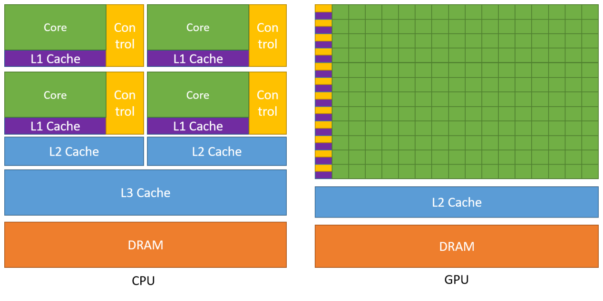

两边最小执行单元的对照【推断·示意，GPU 侧依据 A Figure 7】：

```
 ┌─ CPU core ─────────────────────────────┐   ┌─ GPU sub-partition ────────────────────┐
 │ fetch → branch predict → OoO execute   │   │ L0 I$ → Warp Scheduler → Dispatch      │  ← 顺序发射、无分支预测 (C p.169)
 │   runs ONE OS thread at a time         │   │   issue 1 instr / clk                  │  ← 每拍 1 个 warp 的 1 条指令 (C p.170)
 │                                        │   │        ↓                               │
 │ regs = 1 thread's context              │   │ RegFile = 16 warps' contexts           │  ← 上下文常驻，切 warp 零开销 (C p.170); 16 = 64÷4 [换算]
 │      ↓                                 │   │    ↓      ↓       ↓        ↓           │
 │ ALU / FP / SIMD                        │   │ INT32   FP32    FP64    Tensor Core    │  ← 32 条 FP32 通道数 = warp 的 32 个 lane 数 [推断: 对应关系]
 │                                        │   │ LD/ST x8   SFU                         │
 └────────────────────────────────────────┘   └────────────────────────────────────────┘
```

- "CUDA core" 这个词的官方定义在 2009 年的 Fermi 白皮书里：**"A CUDA core executes a floating point or integer instruction per clock for a thread."**（[J 物理页 7](NVIDIA_Fermi_Compute_Architecture_Whitepaper.pdf#page=7)）【跨代】——它一拍执行一条指令、服务一个线程的通道，不是一个独占线程的 CPU 核。Fermi 的 CUDA core 内部同时有整数单元和浮点单元（[J 物理页 8](NVIDIA_Fermi_Compute_Architecture_Whitepaper.pdf#page=8) 放大图）；"CUDA Core" 的两个口径见 §6。
- SM 的官方定义见 §5；这里先记一句：**"A streaming multiprocessor or SM is designed to execute hundreds of threads concurrently."**（[C 物理页 169](cuda-programming-guide.pdf#page=169)）。
- C 指南对 SM 与 CPU 核的差异有一句总括：**"Unlike CPU cores, SMs issue instructions in order and do not perform branch prediction or speculative execution."**（[C 物理页 169](cuda-programming-guide.pdf#page=169)）——SM 用顺序执行换面积，把省下的晶体管堆通道数（C Figure 1 的含义）。

---

## 2. 线程层级与硬件的对应

**直答：编程模型是 Grid → Cluster → Thread Block → Warp → Thread 五层；落到硬件上分别是"整颗 GPU → 一个 GPC → 一个 SM → 子分区的调度器 → 子分区执行列里的一条通道"。**

编程模型到硬件的两栏映射（依据见行尾）：

```
 programming model                       hardware (where it lives)
 ─────────────────                       ─────────────────────────────────────────────
 Grid                                    whole GPU: 8 GPC / 132 SM (H100 SXM5, A p.18)
  └─ Cluster (0-16 thread blocks)        1 GPC, concurrently scheduled (A p.29, C p.25)
      └─ Thread Block (<=1024 threads)   1 SM, runs to completion there (C p.25)
          └─ Warp (32 threads)           <=64 warps/SM (A p.41, C p.539); 16 per sub-part. [换算]
              └─ Thread                  1 lane; own PC + regs (C p.169)
```

GPU 与 GPC/SM 的层级：

C Figure 2（摘自 C 物理页 24）——GPU 由许多 SM 组成，GPC 是 SM 的集合：

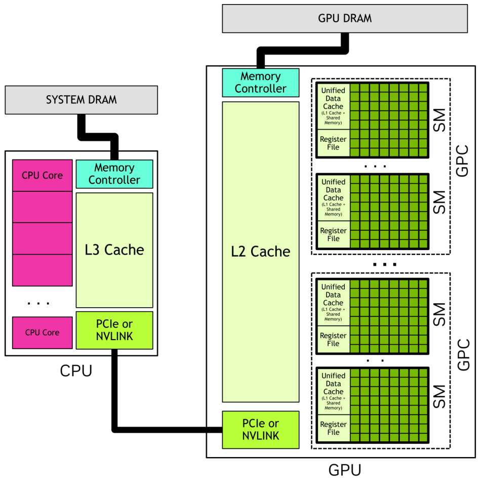

C Figure 3（摘自 C 物理页 24）——Grid 是线程块的网格，每格一个线程块：

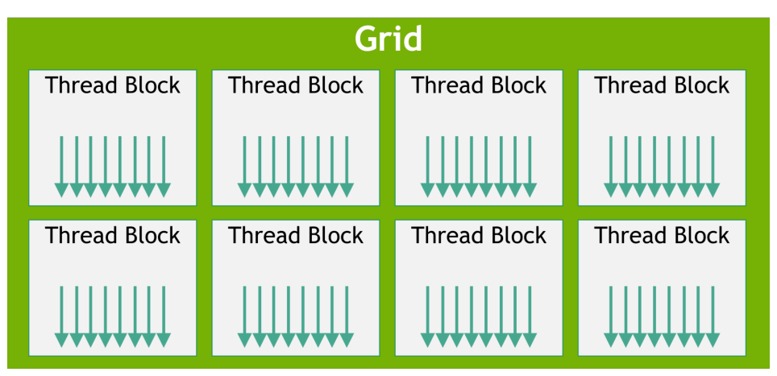

**线程块绑定一个 SM**【原文】：**"All threads of a thread block are executed by a single SM"**（[C 物理页 25](cuda-programming-guide.pdf#page=25)），"in most cases, run to completion on that SM"——脚注 1 给出唯一例外：CUDA Dynamic Parallelism 等特性可以把线程块挂起到显存（"This is similar to context swapping on CPUs. This is not common."，[C 物理页 25](cuda-programming-guide.pdf#page=25) 脚注 1）。

**块切 warp 的规则**【原文】：**"When an SM is given one or more thread blocks to execute, it partitions them into warps"**，切法固定：warp 包含线程号连续递增的 32 个线程，warp 数 = `ceil(线程数/32)`（[C 物理页 170](cuda-programming-guide.pdf#page=170)）。线程的多维索引先按 x 最快、再 y、再 z 线性化（[C 物理页 66](cuda-programming-guide.pdf#page=66)），然后线性号直接落进 warp。

以 256 线程的块为例【换算】：

```
 blockDim = (8, 32) → 256 threads → 8 warps（C p.170 公式 ceil(T/32)）
 线性 id：x 最快，再 y（C p.66）
 warp 0 = 线程 0..31 ｜ warp 1 = 32..63 ｜ … ｜ warp 7 = 224..255
```

C Figure 22（摘自 C 物理页 171）——一个线程块被切成若干个 32 线程的 warp：

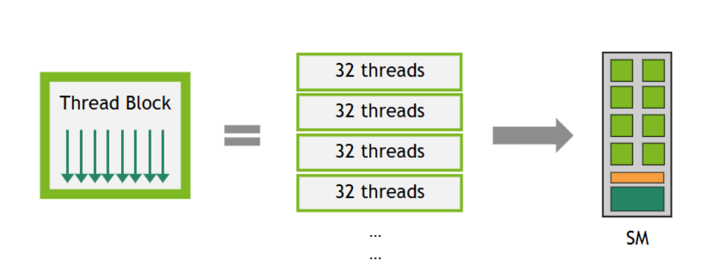

**Cluster（Hopper 新增的一层）**【原文】：**"A Cluster is a group of Thread Blocks that are guaranteed to be concurrently scheduled onto a group of SMs"**，并且 **"The Clusters in H100 run concurrently across SMs within a GPC"**（[A 物理页 29](nvidia-h100-tensor-core-gpu-architecture.pdf#page=29)）；C 侧同样说 **"all thread blocks in a cluster are executed in a single GPC"**（[C 物理页 25](cuda-programming-guide.pdf#page=25)）。每 Cluster 最多 16 个线程块（[A 物理页 41](nvidia-h100-tensor-core-gpu-architecture.pdf#page=41)）。

C Figure 6（摘自 C 物理页 28）——指定 cluster 后，同簇的线程块同时调度进一个 GPC 内的各 SM：

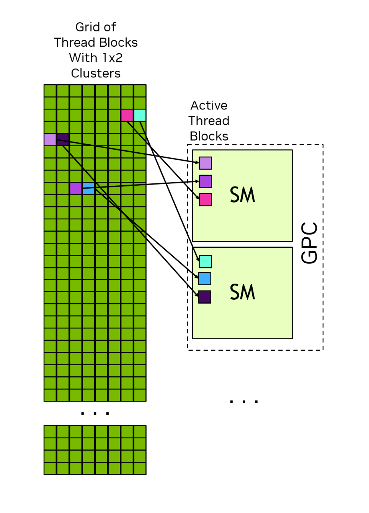

CC 9.0（H100）的硬上限，两份资料互证【原文】：

| 项目 | A Table 4（[A 物理页 41](nvidia-h100-tensor-core-gpu-architecture.pdf#page=41)） | C Table 33（[C 物理页 539](cuda-programming-guide.pdf#page=539)，9.0 列） |
|---|---|---|
| 每 warp 线程数 | 32 | 32（Warp size） |
| 每 SM 驻留 warp | 64 | 64 |
| 每 SM 驻留线程 | 2048 | 2048 |
| 每 SM 驻留线程块 | 32 | 32 |
| 每 Cluster 线程块 | 16 | —（[C 物理页 25](cuda-programming-guide.pdf#page=25) "The maximum size of a cluster is hardware dependent and varies between devices."） |
| 每 SM 32 位寄存器 | 65,536 | 64 K（[C 物理页 540](cuda-programming-guide.pdf#page=540) Table 34） |
| 每线程寄存器上限 | 255 | 255 |
| 每块线程上限 | 1024 | 1024 |

整颗 GH100 的位置感（SM 是最底层的执行单元）：

A Figure 6（摘自 A 物理页 19）——GH100 全芯 144 SM（SXM5 产品 132 SM）：

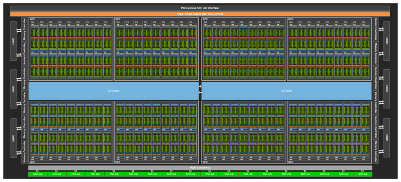

---

## 3. 调度分三层：调度单位是什么

**直答：GPU 的调度分三层——线程块由芯片级分发器放到 SM（分发/驻留单位），warp 由 SM 内四个子分区各一个硬件调度器逐拍发射（发射单位），warp 内 32 个线程各有自己的 PC 与寄存器（状态与编程单位）。**

三层总览【推断·示意，依据见行尾】：

```
┌─ Layer 1: thread block -> SM ──────────────────────────────────────────────┐
│ distributor: chip-level work distribution engine (J p.18; A p.19 label)    │  ← GigaThread【跨代】
│ unit: thread block; no ordering guarantee (C p.25)                         │  ← 单位 = 线程块
│ admission: regs + smem + resident limits (C p.170, A p.41)                 │
└────────────────────────────────────────────────────────────────────────────┘
                         │ places blocks
                         ▼
┌─ Layer 2: warp scheduling inside SM ───────────────────────────────────────┐
│ 4 sub-partitions, 1 Warp Scheduler each (A Fig.7; D p.17)                  │  ← 数量靠读图，结构见 Volta【跨代】
│ each clk: pick 1 eligible warp -> issue 1 instr (C p.170)                  │  ← 单位 = warp
│ in-order, no branch prediction (C p.169); switch = 0 cost (C p.170)        │
└────────────────────────────────────────────────────────────────────────────┘
                         │ issues instructions
                         ▼
┌─ Layer 3: inside a warp ───────────────────────────────────────────────────┐
│ 1 instr applied to active lanes; divergence serializes (C p.169)           │  ← 单位 = 线程(lane)
│ ITS: per-thread PC + call stack (C p.169-170, D p.31-33)                   │
└────────────────────────────────────────────────────────────────────────────┘
```

### 3.1 第一层：线程块 → SM（调度单位 = thread block）

- **谁在分发**：Fermi 白皮书给了名字和职责——**"The GigaThread global scheduler distributes thread blocks to SM thread schedulers."**（[J 物理页 7](NVIDIA_Fermi_Compute_Architecture_Whitepaper.pdf#page=7)）、**"At the chip level, a global work distribution engine schedules thread blocks to various SMs"**（[J 物理页 18](NVIDIA_Fermi_Compute_Architecture_Whitepaper.pdf#page=18)）【跨代】。Hopper 白皮书正文没有描述这个部件，唯一线索是整芯图顶条的图内标签 **"GigaThread Engine with MIG Control"**【读图，[A 物理页 19](nvidia-h100-tensor-core-gpu-architecture.pdf#page=19)】：

  A Figure 6 顶条裁图（摘自 A 物理页 19，局部）——整芯图顶端的分发部件标签：

  

- **顺序无保证**【原文】：**"There is no guarantee of scheduling between thread blocks, so a thread block cannot rely on results from other thread blocks"**（[C 物理页 25](cuda-programming-guide.pdf#page=25)）；C 在占用率一节再次强调调度细节"cannot be controlled or queried by the application"（[C 物理页 92](cuda-programming-guide.pdf#page=92)）。
- **准入条件**【原文】：SM 有空闲资源就继续放块——**"As long as SMs have sufficient hardware resources unoccupied by other thread blocks, the scheduler will continue assigning thread blocks to SMs."**（[C 物理页 92](cuda-programming-guide.pdf#page=92)）；驻留块/warp 数由内核用的寄存器与共享内存量加硬上限决定（[C 物理页 170](cuda-programming-guide.pdf#page=170)、[A 物理页 41](nvidia-h100-tensor-core-gpu-architecture.pdf#page=41)）。

  C Figure 4（摘自 C 物理页 26）——每个 SM 同时驻留一到多个线程块，放置顺序无保证：

  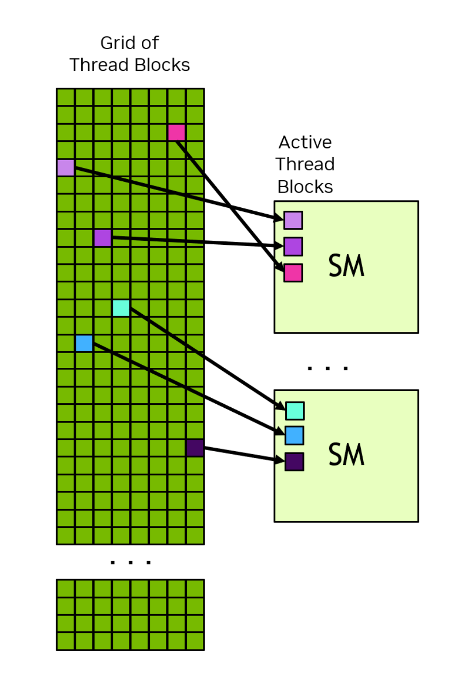

- **块的生命周期**【推断·示意，各步依据行内标注】：

```
 kernel launch（grid 维度 + block 维度，C §2.3.7 p.92）
    │
    ▼
 排队：某个 SM 上凑齐资源了吗？（寄存器 + 共享内存 + 驻留块槽，C p.170 / A p.41）
    ├─ 否 → 继续排队（块间调度顺序无保证，C p.25）
    ▼
 驻留：块切成 warp（C p.170 公式），warp 分给 4 个子分区【映射方式文档未说明】
    │
    ▼
 运行：各子分区的调度器逐拍发射本块的 warp，直到块内全部线程退出
    │
    ▼
 退出：释放寄存器/共享内存槽位，排队的块才有机会进场【推断：C p.92 "SMs are free to accept more work"】
```

- **流优先级不抢占正在运行的任务**【原文】："a priority of a stream is only a hint to the runtime and generally applies primarily to kernel launches ... Stream priorities will not preempt already executing work, or guarantee any specific execution order."（[C 物理页 136](cuda-programming-guide.pdf#page=136)）；C 在流优先级一节写得更明确：**"Higher-priority tasks do not preempt already running lower-priority tasks. The GPU does not reassess work queues during task execution, and increasing a stream’s priority will not interrupt ongoing work."**（[C 物理页 161](cuda-programming-guide.pdf#page=161)）。块粒度的"抢占"因此表现为高优先级内核的块在低优先级内核的块**完成后**进场——**"The GPU scheduler can start executing a higher-priority kernel ... by scheduling its thread blocks as thread blocks of the lower-priority kernel complete."**（[C 物理页 423](cuda-programming-guide.pdf#page=423)）。
- **但 GPU 并非"没有抢占"**【原文】：PTX 在 `%warpid` 的说明里承认抢占存在——**"Note that %warpid returns the location of a thread at the moment when read, but its value may change during execution, e.g., due to rescheduling of threads following preemption."**（[H 物理页 901](ptx_isa_9.5.pdf#page=901)）。也就是说 warp 可以被抢占并在之后重新调度；抢占的粒度（指令级/块级/上下文级）、触发条件与保存恢复机制，所列文档未展开【文档未说明】。
- 更主动的工作窃取（Cluster Launch Control）是更新一代的机制：PTX 的 `clusterlaunchcontrol.try_cancel` **"Requires sm_100"**（[H 物理页 519-520](ptx_isa_9.5.pdf#page=519)），属 Blackwell，不是 Hopper 的机制；C 的用法章节见 [C 物理页 423-429](cuda-programming-guide.pdf#page=423)。

C Figure 54（摘自 C 物理页 424）——Cluster Launch Control 的工作窃取流程：

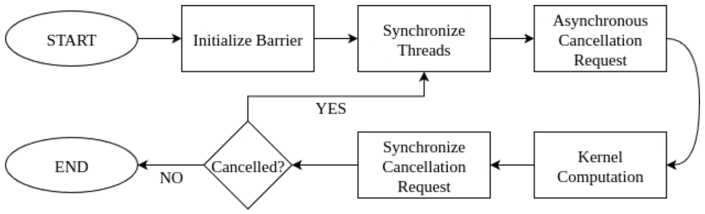

### 3.2 第二层：SM 内的 warp 调度（调度单位 = warp）

- **每 SM 四个子分区、每子分区一个调度器**：Hopper 的依据是 Figure 7——四个相同子分区各带一个 **"Warp Scheduler (32 thread/clk)"** 与一个 **"Dispatch Unit (32 thread/clk)"**【读图】；"每个处理块一个 warp scheduler + 一个 dispatch unit"的官方正文在 Volta：**"The GV100 SM is partitioned into four processing blocks, each with ... one warp scheduler, one dispatch unit, and a 64 KB Register File."**（[D 物理页 17](volta-architecture-whitepaper.pdf#page=17)）【跨代】。C 只说 "a warp scheduler"，不说数量（[C 物理页 170](cuda-programming-guide.pdf#page=170)）。
- **每拍做什么**【原文】：**"At each instruction issue cycle, a warp scheduler selects a warp with threads ready to execute its next instruction (the active threads of the warp) and issues the instruction to those threads."**（[C 物理页 170](cuda-programming-guide.pdf#page=170)）——图内标签 "(32 thread/clk)"【读图】的含义是本文的解读：一拍内该指令作用于一个 warp 的 32 个线程【推断，与 C p.170 "a warp scheduler selects a warp ... and issues the instruction to those threads" 相符】；标签本身的官方解释文档未说明。
- **切换零开销**【原文】：**"The execution context (program counters, registers, etc.) for each warp processed by an SM is maintained on-chip throughout the warp’s lifetime. Therefore, switching between warps incurs no cost."**（[C 物理页 170](cuda-programming-guide.pdf#page=170)）。
- **顺序发射、无分支预测**【原文】：见 §0.1 第 2 行（[C 物理页 169](cuda-programming-guide.pdf#page=169)）。
- **每个子分区平均 16 个 warp 槽位**【换算】：每 SM 上限 64 warp（[A 物理页 41](nvidia-h100-tensor-core-gpu-architecture.pdf#page=41)、[C 物理页 539](cuda-programming-guide.pdf#page=539)；I 也确认 **"warps per SM remains the same as in NVIDIA Ampere GPU architecture (that is, 64)"**，[I 物理页 8](Hopper_Tuning_Guide.pdf#page=8)）÷ 4 个子分区 = 16。这是上限的平均值；warp 怎样分到子分区、各子分区的槽位是否严格均分，**文档未说明**。
- 一个子分区的发射时间线【推断·示意】（`·` = 该拍没发射）：

```
clk:        1     2     3     4     5     6     7     8
warp A:    FMA   ·     ·     FMA   ·     ·     FMA   ·     ← A 在等一条 LD 的结果
warp B:    ·     ADD   ·     ·     LD    ·     ·     ADD
warp C:    ·     ·     MUL   ·     ·     FMA   ·     ·
warp D:    LD    ·     ·     ·     ·     ·     FMA    ·
每拍：调度器在"就绪"的 warp 里选 1 个发 1 条指令（C p.170）；
某拍全为 · = 就绪集合为空，算力闲置——驻留越多 warp，空拍越少【推断：延迟隐藏原理】
```

- warp 的状态流转【推断·示意，状态名自拟】：

```
        ┌───────────┐   each clk: scheduler picks ONE eligible warp (C p.170)
        │ eligible  │◀──────────────────────────────────────────────────────┐
        └─────┬─────┘                                                       │
              │ operand ready?                                              │ data arrived / barrier
        no    │    yes                                                      │ phase done / dep cleared
      ┌───────▼──────┐   ┌───────────┐                                  │
      │ issue 1 instr│   │ stalled   │──────────────────────────────────┘
      └───────┬──────┘   └───────────┘   ← waiting: memory, barrier, reg dep【文档未说明】
              │ all 32 lanes retired
              ▼
        ┌───────────┐
        │  retired  │   ← 块内全部 warp 退出后，块占用的资源才释放【推断：C p.92】
        └───────────┘
```

### 3.3 第三层：warp 之内（调度单位 = 线程/lane）

- **一条指令作用于 32 个 lane**【原文】：**"A warp executes one common instruction at a time, so full efficiency is realized when all 32 threads of a warp agree on their execution path."**；分支发散时 warp 逐条执行各分支、屏蔽不在该分支上的线程（[C 物理页 169](cuda-programming-guide.pdf#page=169)）。

  C Figure 7（摘自 C 物理页 29）——偶数号线程执行 if 体，奇数号被掩码：

  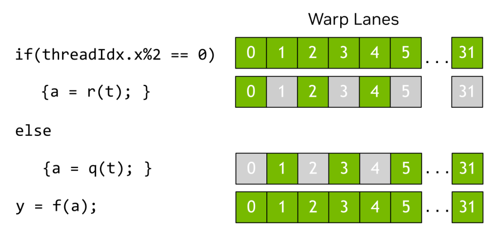

- **独立线程调度（ITS，CC 7.0 起）**【原文】：**"In GPUs of compute capability 7.0 and later, independent thread scheduling allows full concurrency between threads, regardless of warp. With independent thread scheduling, the GPU maintains execution state per thread, including a program counter and call stack"**（[C 物理页 169-170](cuda-programming-guide.pdf#page=169)）。Volta 白皮书的对照图最直观【跨代】：

  D Figure 20（摘自 D 物理页 31）——Pascal 及更早：整个 warp 共享一个 PC + 活跃掩码：

  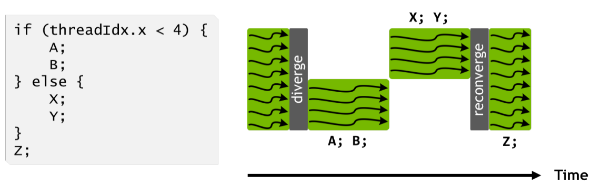

  D Figure 21（摘自 D 物理页 32）——Volta 起：每线程自己的 PC 与调用栈，外加汇合优化器：

  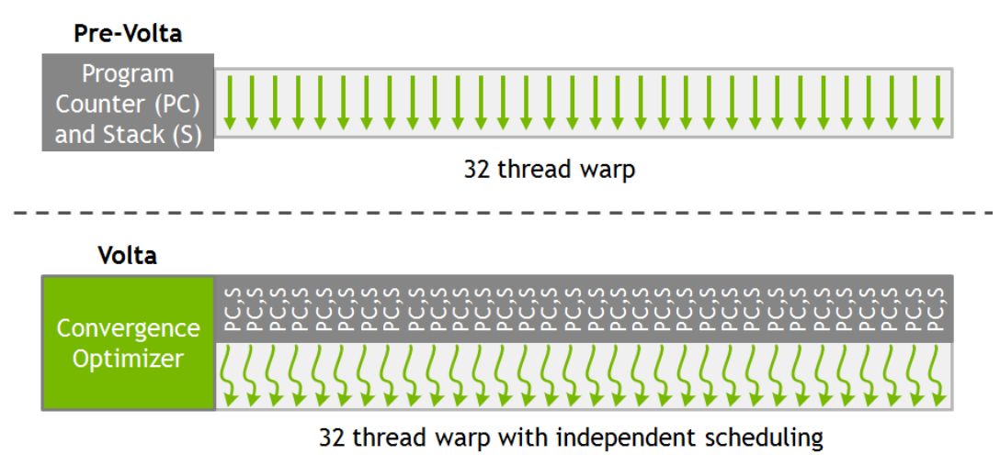

  D Figure 22（摘自 D 物理页 33）——独立线程调度允许两个分支的语句在时间上交错：

  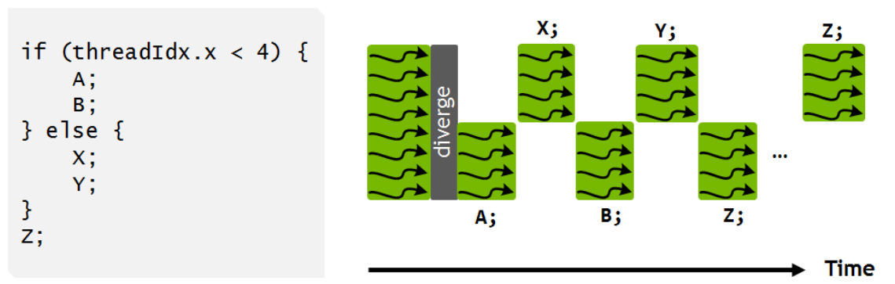

  D Figure 23（摘自 D 物理页 33）——需要汇合时用 `__syncwarp()` 显式同步：

  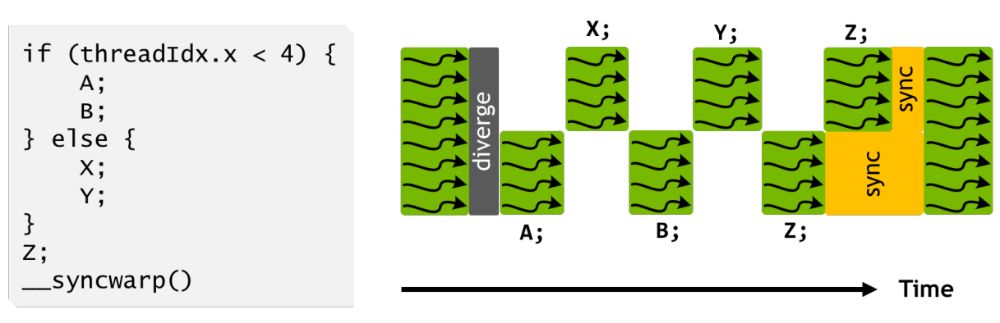

- **但执行仍是 SIMT**【原文】：**"execution is still SIMT: at any given clock cycle, CUDA cores execute the same instruction for all active threads in a warp just as before"**（[D 物理页 32](volta-architecture-whitepaper.pdf#page=32)）——ITS 改变"谁能参加每条指令"，不改变"每拍一条指令一串 lane"的发射形态。

三个调度单位各管什么【推断·归纳】：

```
 thread block : 放置与驻留单位 —— 1 块 = 1 SM（C p.25），由芯片级分发器放置，凑资源进场
 warp         : 发射单位     —— 每拍 1 个 warp × 1 条指令 (C p.170)，指令作用于 warp 的活跃线程 (C p.169)
 thread       : 状态与编程单位 —— 每线程 PC/寄存器/调用栈（C p.169 ITS）
```

| 层 | 调度者 | 单位 | 切换触发 | 时间尺度 | 出处 |
|---|---|---|---|---|---|
| 块→SM | 芯片级分发器（J p.7/p.18【跨代】；A p.19 标签【读图】） | thread block | 资源凑齐/块退出 | 一次 kernel 的全程 | [C 25/92](cuda-programming-guide.pdf#page=25) |
| warp | 每子分区 1 个 Warp Scheduler（A p.21【读图】；D p.17【跨代】） | warp | 每个发射周期 | 1 拍 | [C 170](cuda-programming-guide.pdf#page=170) |
| warp 内 | 硬件（ITS）+ `__syncwarp` | thread/lane | 分支/汇合 | 指令级 | [C 169-170](cuda-programming-guide.pdf#page=169)、[D 31-33](volta-architecture-whitepaper.pdf#page=31) |

---

## 4. GPU 线程与操作系统线程

**直答：CUDA 线程不是操作系统线程——它没有 `task_struct`、不被内核调度、warp 之间切换零开销；它只是"SM 寄存器堆里的一份执行状态 + warp 里的一条通道"。操作系统的线程是内核对象，调度、阻塞、迁移、退出全有内核参与。抢占问题两边都要说清：OS 线程可被随时抢占；GPU 上流优先级不抢占正在运行的任务（C p.161），但 warp 层面存在抢占（H p.901），粒度与机制文档未说明。**

逐项对比（OS 侧行号在本地 7.1.3 树实测）：

| 维度 | 操作系统线程（arm64 + Linux 7.1.3） | CUDA 线程（Hopper） |
|---|---|---|
| 产生 | `kernel_clone()`（[kernel/fork.c:2669](../../000.SOURCE_CODE/003.LINUX-7.1.3/000.LINUX-7.1.3/kernel/fork.c)）→ `copy_thread()`（arch/arm64/kernel/process.c:448）搭好入口栈帧 | 块进 SM 时按固定公式切成 warp 隐式产生（[C p.170](cuda-programming-guide.pdf#page=170)），编程模型里只有 `threadIdx` |
| 身份 | `struct task_struct`（include/linux/sched.h:820）、PID | `threadIdx/blockIdx` 内建变量（[C p.66](cuda-programming-guide.pdf#page=66)） |
| 状态 | `__state` + 内核栈 + `struct cpu_context`（arch/arm64/include/asm/processor.h:133） | 寄存器份额 + 每线程 PC 与调用栈（[C p.169](cuda-programming-guide.pdf#page=169)） |
| 调度者 | 内核 `sched_class`（kernel/sched/fair.c:14207） | 硬件 warp scheduler（[C p.170](cuda-programming-guide.pdf#page=170)） |
| 调度算法 | EEVDF 按任务挑选（`pick_eevdf`，kernel/sched/fair.c:1136；入口 `pick_next_task_fair` fair.c:9234） | 每拍在就绪 warp 里选 1 个，规则文档未说明 |
| 时间片 | 有（tick 驱动） | 无时间片概念；靠大量驻留 warp 隐藏延迟（选择规则【文档未说明】） |
| 切换 | `__schedule()`（kernel/sched/core.c:7045）→ `context_switch()`（core.c:5338）→ `__switch_to()`（process.c:766），保存/恢复 `cpu_context` | **零开销**：上下文常驻片上，无保存/恢复（[C p.170](cuda-programming-guide.pdf#page=170)） |
| 周期性驱动 | 定时器 PPI → `arch_timer_handler_phys()`（drivers/clocksource/arm_arch_timer.c:587）→ `sched_tick()`（kernel/sched/core.c:5645）置 `TIF_NEED_RESCHED`（arch/arm64/include/asm/thread_info.h:64） | 无定时器、无中断概念 |
| 阻塞 | 睡眠队列，`try_to_wake_up()`（kernel/sched/core.c:4155）唤醒 | warp 变 stalled 等数据/屏障，由硬件在条件满足后回到就绪【推断：C p.170 机制】 |
| 抢占/迁移 | 可抢占、可在核间迁移 | 流优先级不抢占正在运行的任务（[C p.161](cuda-programming-guide.pdf#page=161)）；warp 层面存在抢占（[H p.901](ptx_isa_9.5.pdf#page=901)），粒度【文档未说明】；块绑定单 SM 跑到完（[C p.25](cuda-programming-guide.pdf#page=25)） |
| 退出 | `do_exit()`（kernel/exit.c:896） | warp 全部 lane 退出 → 块资源释放（【推断】[C p.92](cuda-programming-guide.pdf#page=92)） |
| 数量级 | 活跃任务数千 | 每 SM 2048 × 132 SM ≈ 27 万活跃线程/GPU【换算】 |

两条"切换"链路并排（一个真实事件的两面：都是"换一个执行流"）：

```
CPU 侧（arm64 + Linux 7.1.3，一次线程切换的链路，行号实测）：
  定时器 PPI → arch_timer_handler_phys (drivers/clocksource/arm_arch_timer.c:587)
    → tick 路径 sched_tick (kernel/sched/core.c:5645) 置 TIF_NEED_RESCHED (thread_info.h:64)
    → __schedule (kernel/sched/core.c:7045)
    → pick_next_task_fair (kernel/sched/fair.c:9234) 挑下一个任务
    → context_switch (kernel/sched/core.c:5338) 换地址空间
    → __switch_to (arch/arm64/kernel/process.c:766) 保存/恢复 cpu_context (processor.h:133)
  代价：微秒级，有真实的保存/恢复动作【换算/常识】

GPU 侧（SM 子分区，一次"warp 切换"的链路）：
  每个发射周期：调度器在就绪 warp 里选 1 个（C p.170）
  代价：零 —— "switching between warps incurs no cost"（C p.170），
        因为 PC/寄存器/调用栈本来就常驻寄存器堆，没有保存/恢复这一步
```

切换时各自要保存什么：

```
 OS 线程：cpu_context（x19~x28/fp/sp/pc，processor.h:133）+ 地址空间等，
          由 __switch_to (process.c:766) 完成真实的保存/恢复
 GPU warp：什么都不保存 —— 状态常驻片上 (C p.170)
```

切换粒度从粗到细：

```
 应用上下文切换（CPU 程序 ↔ GPU 程序）：驱动 + 硬件配合，Fermi 时已 <25 µs (J p.18 "below 25 microseconds")【跨代】
 OS 线程切换：__schedule → __switch_to，µs 级，内核软件做
 warp 切换：每个发射周期都发生，硬件做，零开销 (C p.170)
```

GPU 侧唯一的"换出"例外【原文】：CUDA Dynamic Parallelism 可把线程块挂起到显存、释放 SM——**"This is similar to context swapping on CPUs. This is not common."**（[C 物理页 25](cuda-programming-guide.pdf#page=25) 脚注 1）。

---

## 5. SM 是什么、怎么执行

**直答：SM（Streaming Multiprocessor）是 GPU 的最小完整执行单元——自带取指、四个带调度器的子分区、寄存器堆和一级缓存；一个 SM 同时驻留最多 2048 个线程的上下文，靠四个调度器每拍各发一条指令来喂饱里面的通道。**

- **定义**【原文】："A streaming multiprocessor or SM is designed to execute hundreds of threads concurrently."（[C 物理页 169](cuda-programming-guide.pdf#page=169)）。
- **SM 版本号 = 计算能力**【原文】："The compute capability directly corresponds to the version number of the SM. For example, the SMs within a GPU of CC 12.0 have SM version sm_120."（[C 物理页 33](cuda-programming-guide.pdf#page=33)）——H100 是 CC 9.0 / sm_90（[A 物理页 41](nvidia-h100-tensor-core-gpu-architecture.pdf#page=41)）。
- **在芯片里的位置**：GH100 = 8 GPC、72 TPC（9 TPC/GPC）、每 TPC 2 个 SM、满配 144 SM；H100 SXM5 = 132 SM（[A 物理页 18](nvidia-h100-tensor-core-gpu-architecture.pdf#page=18)）。SM 全图见 §6 的 Figure 7。

**一条指令的一生**【推断·示意，部件出处行内标注】：

```
 L1 I$ (SM 级) → L0 I$ (每子分区, A Fig.7) → Warp Scheduler 选 warp (C p.170)
     → Dispatch Unit (A Fig.7) → RegFile 取操作数 (A Fig.7)
     → 执行列：INT32 / FP32 / FP64 / Tensor Core / LD/ST / SFU (A Fig.7)
     → 写回 RegFile
 取指流水线的级数、双发射与否【文档未说明】
```

**一条访存指令的路径**【原文+推断·示意】：

```
 LD/ST 单元 → L1 Data Cache / SMEM（256 KB, SM 级）→ L2（50 MB, 芯片级）→ HBM3（80 GB, 3352 GB/s）
 全局/本地内存即 "device memory"，常量内存走常量缓存、纹理走纹理缓存（A p.36 原文）；
 L2 服务全 SM 的访存请求（A p.36）；HBM3 架构见下图。
```

A Figure 21（摘自 A 物理页 37）——HBM3 带宽演进图（P100→V100→A100→H100，官方图题"首款 HBM3 架构、2× 交付带宽"）：

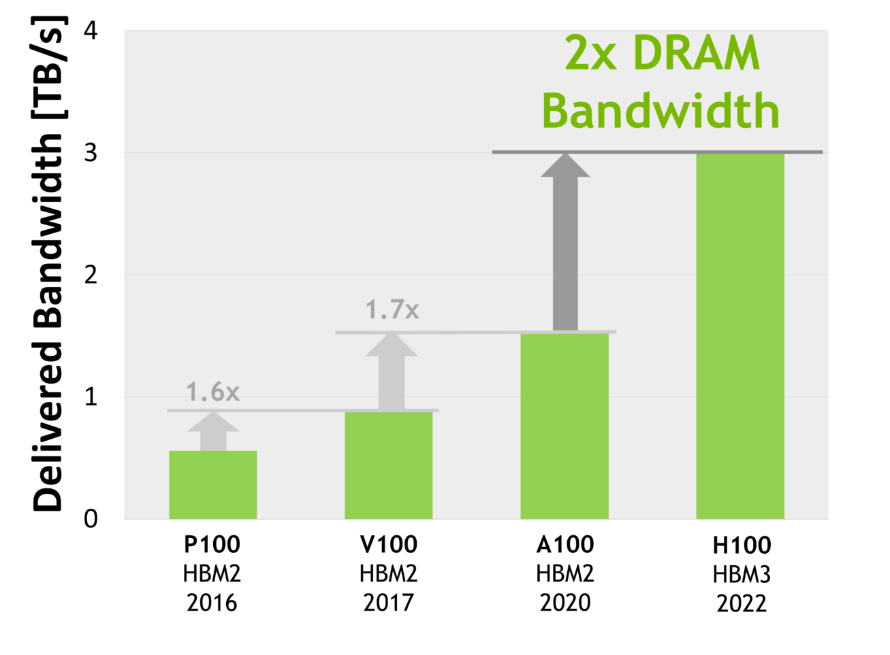

**资源与占用率**：

- C 的定义【原文】："The occupancy of a CUDA kernel is the ratio of the number of active warps to the maximum number of active warps supported by the SM."（[C 物理页 92](cuda-programming-guide.pdf#page=92)）。
- SM 资源上限（CC 9.0）：65,536 寄存器、2048 线程槽、64 warp 槽、32 块槽（[A 物理页 41](nvidia-h100-tensor-core-gpu-architecture.pdf#page=41)、[C 物理页 539-540](cuda-programming-guide.pdf#page=539) Table 33/34）。
- 共享内存口径：SM 统一数据缓存 256 KB，其中共享内存可配到 228 KB、档位 0/8/16/32/64/100/132/164/196/228（[C 物理页 541](cuda-programming-guide.pdf#page=541) Table 35；[A 物理页 22](nvidia-h100-tensor-core-gpu-architecture.pdf#page=22) "256 KB of combined shared memory and L1 data cache"）；每块保留 1 KB（[I 物理页 11](Hopper_Tuning_Guide.pdf#page=11) "CUDA reserves 1 KB of shared memory per thread block."）。
- 算例【换算】：kernel 用 64 寄存器/线程、256 线程/块、动态共享内存 0——

```
 SM 资源上限（CC 9.0）：65536 regs | 2048 线程槽 | 64 warp 槽 | 32 块槽（A p.41 / C Table 33-34）
 算例 kernel：64 regs/线程，256 线程/块
   寄存器口径：256 × 64 = 16384 regs/块 → 65536 / 16384 = 4 块
   线程口径：4 块 × 256 = 1024 线程 = 2048 的 50%（占用率 50%）
   warp 口径：4 × 8 = 32 ≤ 64 ✓；块槽：4 ≤ 32 ✓ → 瓶颈在寄存器
   寄存器分配的取整粒度【文档未说明】；驻留块数可用 `cudaOccupancyMaxActiveBlocksPerMultiprocessor` 计算（[C 物理页 750](cuda-programming-guide.pdf#page=750)）
```

- 编译期可用 `nvcc --resource-usage` 查每个 kernel 的寄存器/共享内存用量（[C 物理页 92](cuda-programming-guide.pdf#page=92)）。

---

## 6. Figure 7 逐块精读

官方原图：

A Figure 7（摘自 A 物理页 21）——GH100 的一个 SM，四个相同子分区 + 底部共享条：

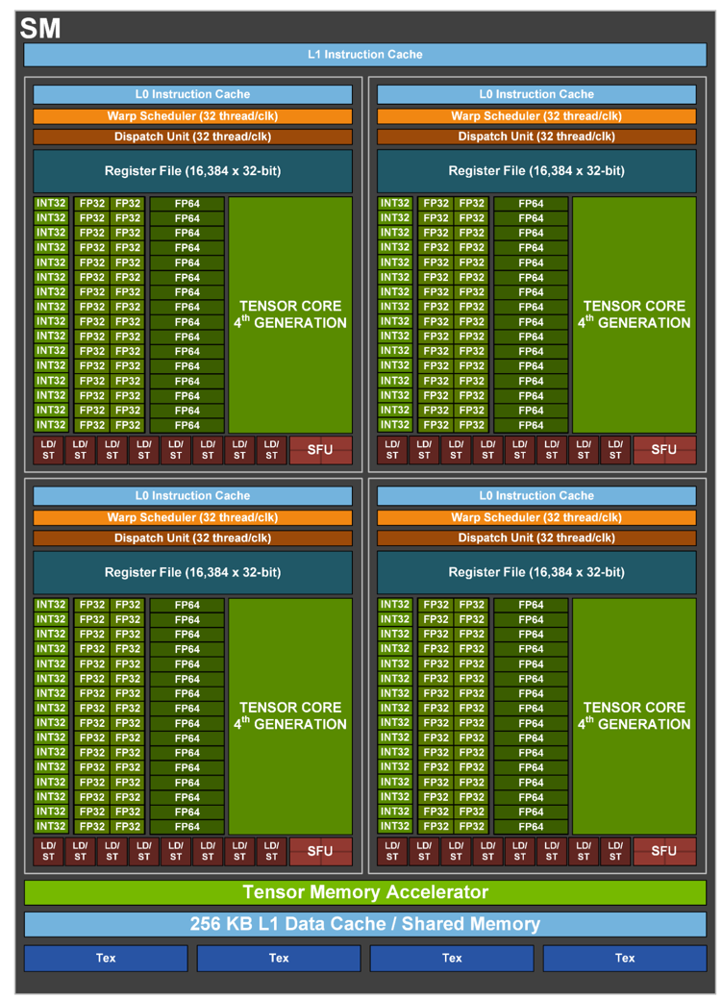

三张局部裁图（手工裁，用于逐格核对）：

左上子分区（摘自 A 物理页 21，局部）：

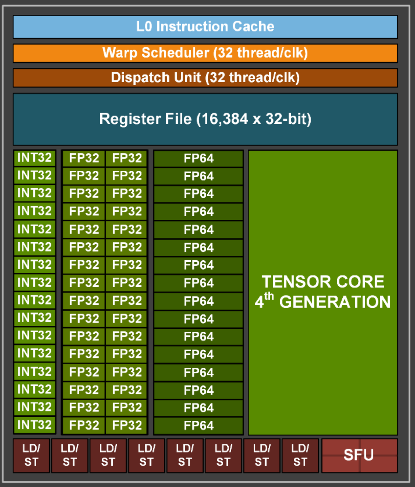

子分区底部的访存/特殊函数行（摘自 A 物理页 21，局部）：


底部共享条（摘自 A 物理页 21，局部）：


ASCII 重绘（框线内只写原图英文标签；每行 `←` 后是中文说明；**对照裁图逐格核对过**）：

```
┌─────────────────────────────── SM ────────────────────────────────┐
│ 1  L1 Instruction Cache                                           │  ← ① 指令缓存，整个 SM 共用这一条
├───────────────────────────────────────────────────────────────────┤
│ ┌─────────────────────────────┐   ┌─────────────────────────────┐ │  ← 四个子分区完全相同，只标注上面两个
│ │ 2 L0 Instruction Cache      │   │ 2 L0 Instruction Cache      │ │  ← ② 指令缓存，本子分区私有
│ ├─────────────────────────────┤   ├─────────────────────────────┤ │
│ │ 3 Warp Scheduler 32 thr/clk │   │ 3 Warp Scheduler 32 thr/clk │ │  ← ③ warp 调度器：每拍挑 1 个就绪 warp，发 1 条指令
│ ├─────────────────────────────┤   ├─────────────────────────────┤ │
│ │ 4 Dispatch Unit 32 thr/clk  │   │ 4 Dispatch Unit 32 thr/clk  │ │  ← ④ 分发单元：把选中的指令送往执行部件
│ ├─────────────────────────────┤   ├─────────────────────────────┤ │
│ │ 5 Register File 16,384x32   │   │ 5 Register File 16,384x32   │ │  ← ⑤ 寄存器堆：存操作数和结果，16,384 个 32 位寄存器
│ ├──────────────┬──────────────┤   ├──────────────┬──────────────┤ │
│ │ 6a INT32 x16 │ 7  TENSOR    │   │ 6a INT32 x16 │ 7  TENSOR    │ │  ← ⑥a INT32 Core，整数通道；Fermi 时与 FP32 同在一个 CUDA core 里
│ │ 6b FP32  x16 │ 7  CORE      │   │ 6b FP32  x16 │ 7  CORE      │ │  ← ⑥b CUDA Core（规格表口径），单精度通道，两列共 32 条
│ │ 6b FP32  x16 │ 7  4TH GEN   │   │ 6b FP32  x16 │ 7  4TH GEN   │ │  ← ⑦ Tensor Core，做矩阵乘加
│ │ 6c FP64  x16 │ 7  x1        │   │ 6c FP64  x16 │ 7  x1        │ │  ← ⑥c FP64 Core，双精度通道
│ ├──────────────┴──────────────┤   ├──────────────┴──────────────┤ │
│ │ 8 LD/ST x8      9 SFU x1    │   │ 8 LD/ST x8      9 SFU x1    │ │  ← ⑧ 访存单元 ×8      ⑨ 特殊函数单元 ×1
│ └─────────────────────────────┘   └─────────────────────────────┘ │
├───────────────────────────────────────────────────────────────────┤
│ ┌─────────────────────────────┐   ┌─────────────────────────────┐ │
│ │ 2 L0 Instruction Cache      │   │ 2 L0 Instruction Cache      │ │
│ ├─────────────────────────────┤   ├─────────────────────────────┤ │
│ │ 3 Warp Scheduler 32 thr/clk │   │ 3 Warp Scheduler 32 thr/clk │ │
│ ├─────────────────────────────┤   ├─────────────────────────────┤ │
│ │ 4 Dispatch Unit 32 thr/clk  │   │ 4 Dispatch Unit 32 thr/clk  │ │
│ ├─────────────────────────────┤   ├─────────────────────────────┤ │
│ │ 5 Register File 16,384x32   │   │ 5 Register File 16,384x32   │ │
│ ├──────────────┬──────────────┤   ├──────────────┬──────────────┤ │
│ │ 6a INT32 x16 │ 7  TENSOR    │   │ 6a INT32 x16 │ 7  TENSOR    │ │
│ │ 6b FP32  x16 │ 7  CORE      │   │ 6b FP32  x16 │ 7  CORE      │ │
│ │ 6b FP32  x16 │ 7  4TH GEN   │   │ 6b FP32  x16 │ 7  4TH GEN   │ │
│ │ 6c FP64  x16 │ 7  x1        │   │ 6c FP64  x16 │ 7  x1        │ │
│ ├──────────────┴──────────────┤   ├──────────────┴──────────────┤ │
│ │ 8 LD/ST x8      9 SFU x1    │   │ 8 LD/ST x8      9 SFU x1    │ │
│ └─────────────────────────────┘   └─────────────────────────────┘ │
├───────────────────────────────────────────────────────────────────┤
│ 10 Tensor Memory Accelerator                                      │  ← ⑩ TMA：在全局内存和共享内存之间成块搬运
├───────────────────────────────────────────────────────────────────┤
│ 11 256 KB L1 Data Cache / Shared Memory                           │  ← ⑪ L1 数据缓存，和共享内存共用这块 256 KB
├───────────────────────────────────────────────────────────────────┤
│ [12 Tex]         [12 Tex]         [12 Tex]         [12 Tex]       │  ← ⑫ 纹理单元 ×4
└───────────────────────────────────────────────────────────────────┘
```

**相对原图的三处简化**：每列 16 行通道压成 4 行并以 `x16` 标注；"(32 thread/clk)" 缩写为 "32 thr/clk"；SFU 格内的细分线含义白皮书未说明，按一格画。

**编号表**：

| 编号 | 图内标签 | 是什么 | 每子分区 / 每 SM | 依据 |
|---|---|---|---|---|
| ① | L1 Instruction Cache | SM 级指令缓存，横跨四个子分区；正文没有解释它 | — / 1 | 【读图】 |
| ② | L0 Instruction Cache | 子分区私有指令缓存，比 L1 更靠近调度器 | 1 / 4 | 【读图】；D p.17 有 Volta 的说明【跨代】 |
| ③ | Warp Scheduler (32 thread/clk) | warp 调度器：每拍从本子分区就绪 warp 中选 1 个发 1 条指令 | 1 / 4 | 【读图】；职能见 [C p.170](cuda-programming-guide.pdf#page=170)；"每块一个"见 [D p.17](volta-architecture-whitepaper.pdf#page=17)【跨代】 |
| ④ | Dispatch Unit (32 thread/clk) | 分发单元，紧跟调度器；正文只出现名字未定义 | 1 / 4 | 【读图】；[D p.17](volta-architecture-whitepaper.pdf#page=17) 只列名【跨代】 |
| ⑤ | Register File (16,384 x 32-bit) | 子分区寄存器堆，放 warp 的操作数与结果 | 16,384 个 / 65,536 个 | 【读图】；×4 = [A p.41](nvidia-h100-tensor-core-gpu-architecture.pdf#page=41) 上限；= 256 KB/SM【换算】 |
| ⑥a | INT32 | 整数标量计算通道。按 Fermi 的定义属于 CUDA core（核内的整数单元）；Hopper 规格表另列为 "INT32 Cores" | 16 / 64 | 【读图】；[A p.39](nvidia-h100-tensor-core-gpu-architecture.pdf#page=39) "INT32 Cores / SM 64"；[J p.7-8](NVIDIA_Fermi_Compute_Architecture_Whitepaper.pdf#page=8)【跨代】 |
| ⑥b | FP32（两列） | **单精度标量计算通道；Hopper 规格表口径的 "CUDA Cores" 只数这两列** | 32 / 128 | 【读图】；[A p.18](nvidia-h100-tensor-core-gpu-architecture.pdf#page=18) "128 FP32 CUDA Cores per SM" |
| ⑥c | FP64 | 双精度标量计算通道；Fermi 的 CUDA core 里浮点单元同样执行双精度运算，Hopper 规格表另列为 "FP64 Cores" | 16 / 64 | 【读图】；[A p.39](nvidia-h100-tensor-core-gpu-architecture.pdf#page=39) "FP64 Cores / SM (excl. Tensor) 64"；[J p.8](NVIDIA_Fermi_Compute_Architecture_Whitepaper.pdf#page=8)【跨代】 |
| ⑦ | TENSOR CORE 4TH GENERATION | 第四代 Tensor Core，矩阵乘加（MMA），不是 CUDA Core | 1 / 4 | 【读图】；[A p.18 / p.22](nvidia-h100-tensor-core-gpu-architecture.pdf#page=22) 原文 |
| ⑧ | LD/ST | 访存单元：计算源/目的地址，并按地址在缓存或显存之间读写数据；Hopper 白皮书未定义 | 8 / 32 | 【读图】；跨代定义 [J p.8](NVIDIA_Fermi_Compute_Architecture_Whitepaper.pdf#page=8) "load/store units, allowing source and destination addresses to be calculated for sixteen threads per clock"【跨代】 |
| ⑨ | SFU | 特殊函数单元：执行 sin、cos、倒数、开方这类超越函数；Hopper 白皮书未定义 | 1 / 4 | 【读图】；跨代定义 [J p.9](NVIDIA_Fermi_Compute_Architecture_Whitepaper.pdf#page=9) "Special Function Units (SFUs) execute transcendental instructions such as sin, cosine, reciprocal, and square root"【跨代】 |
| ⑩ | Tensor Memory Accelerator | TMA：全局内存 ↔ 共享内存的成块异步搬运 | — / 1 条 | 【读图】；[A p.32](nvidia-h100-tensor-core-gpu-architecture.pdf#page=32) 原文 |
| ⑪ | 256 KB L1 Data Cache / Shared Memory | 一级数据缓存与共享内存共用 256 KB，SMEM 可配至 228 KB | — / 256 KB | 【读图】；[A p.22](nvidia-h100-tensor-core-gpu-architecture.pdf#page=22)；[C p.541](cuda-programming-guide.pdf#page=541) Table 35 |
| ⑫ | Tex | 纹理单元 | — / 4 | 【读图】；[A p.40](nvidia-h100-tensor-core-gpu-architecture.pdf#page=40) 528 ÷ 132 SM = 4【换算】 |

**直答：哪些是 CUDA Core，哪些是 Tensor Core**

- **Tensor Core 是 ⑦**：每子分区 1 个、每 SM 4 个，做整块矩阵乘加；图上没有独立的取指部件，挂在 Warp Scheduler / Dispatch Unit 之下【读图，推断见 §7】。
- **⑥a INT32、⑥b FP32、⑥c FP64 三组是同一类东西**：都是"为一个线程一拍执行一条标量指令"的通道。
- **"CUDA Core" 这个词在官方文档里有两个口径，图上要分开说**：

| 口径 | 出处 | ⑥a INT32 | ⑥b FP32 | ⑥c FP64 |
|---|---|---|---|---|
| 按 Fermi 的定义【跨代】 | [J p.7](NVIDIA_Fermi_Compute_Architecture_Whitepaper.pdf#page=7) "A CUDA core executes a floating point or integer instruction per clock for a thread."；[J p.8](NVIDIA_Fermi_Compute_Architecture_Whitepaper.pdf#page=8) "Each CUDA processor has a fully pipelined integer arithmetic logic unit (ALU) and floating point unit (FPU)." | 是（核内的整数单元） | 是（核内的浮点单元） | 是（Fermi 提供单、双精度两种 FMA 指令，同页） |
| 按 Hopper 规格表的计数 | [A p.18](nvidia-h100-tensor-core-gpu-architecture.pdf#page=18) "128 FP32 CUDA Cores per SM"；[A p.39](nvidia-h100-tensor-core-gpu-architecture.pdf#page=39) "INT32 Cores / SM"、"FP64 Cores / SM (excl. Tensor)" | 另列，叫 INT32 Cores | 是，"CUDA Cores" 的数字只数这两列 | 另列，叫 FP64 Cores |

- **为什么说 ⑥a 也是 CUDA core**：Fermi 的放大图里，一个 CUDA Core = Dispatch Port → Operand Collector → **FP Unit 和 INT Unit** → Result Queue，整数单元和浮点单元在同一个核里：

  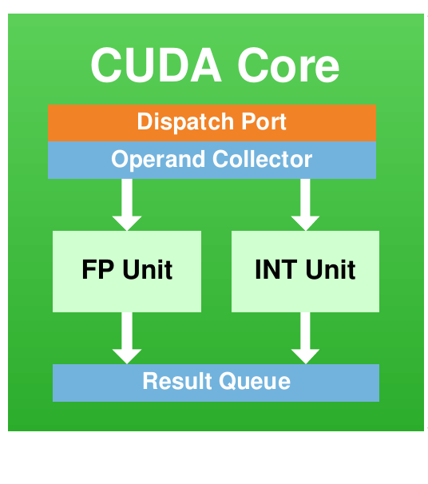

- **图里没有任何一格写着 "CUDA Core"**。Volta 起官方图把整数通道和单精度通道分开画（D Figure 5 的图内标签是 INT / FP32，见本节末），正文分别叫 "16 INT32 Cores" 和 "16 FP32 Cores"（[D p.17](volta-architecture-whitepaper.pdf#page=17)）；Hopper 的 Figure 7 同样分列 INT32 / FP32 / FP64，并且正文只把 FP32 通道叫 "FP32 CUDA Cores"（[A p.18](nvidia-h100-tensor-core-gpu-architecture.pdf#page=18)，每 SM 128 个，对应 ⑥b 两列、每个子分区 32 格、与一个 warp 的 32 个 lane 数量吻合）。为什么分列，文档未说明。
- 其余都不是 core：③④ 是调度部件，⑤ 是存储，⑧⑨ 是访存与特殊函数单元，⑩⑪⑫ 是 SM 级共享资源。

**数字自洽校验表**（Figure 7 读图 × A 表 × C 表三方互证）：

| 项目 | Figure 7 读图（每子分区 ×4） | A Table 3（[p.39-40](nvidia-h100-tensor-core-gpu-architecture.pdf#page=39)） | C（CC 9.0） | 结论 |
|---|---|---|---|---|
| FP32 通道 | 16 × 2 列 × 4 = 128 | 128（FP32 Cores / SM） | — | 一致 |
| INT32 通道 | 16 × 4 = 64 | 64 | — | 一致 |
| FP64 通道 | 16 × 4 = 64 | 64（excl. Tensor） | — | 一致 |
| Tensor Core | 1 × 4 = 4 | 4 | — | 一致 |
| 寄存器堆 | 16,384 × 4 = 65,536 个 | RegFile 256 KB/SM = 65,536 × 32-bit【换算】 | 64 K（[C p.540](cuda-programming-guide.pdf#page=540) Table 34） | 一致 |
| 驻留 warp / 线程 | 图不画 | — | 64 / 2048（[C p.539](cuda-programming-guide.pdf#page=539)；[I p.8](Hopper_Tuning_Guide.pdf#page=8)） | 平均每子分区 16 / 512【换算】；是否严格均分【文档未说明】 |
| Tex | 4 | 528 ÷ 132 SM = 4 | — | 一致【换算】 |
| L1/SMEM | 256 KB（图内标签） | — | unified 256 KB、SMEM ≤ 228 KB（[C p.541](cuda-programming-guide.pdf#page=541)） | 一致 |
| FP32 峰值（反推） | 128 条通道 | 66.9 TFLOPS ÷ 1.98 GHz ÷ 132 SM ÷ 128 通道 = 2 FLOP/通道/拍【换算】 | — | 一致；即每个 FP32 通道每拍 1 条 FMA，与 Fermi 定义【跨代】相符 |

**图里没画但存在的部件**：

| 部件 | 依据 |
|---|---|
| warp/线程的 PC 与调度状态 | [C p.169-170](cuda-programming-guide.pdf#page=169) 要求每线程 PC，硬件必有存储；位置与形态【文档未说明】 |
| warp 间依赖跟踪（通常称记分板） | 名称与机制【文档未说明】 |
| 常量缓存 / 纹理缓存 | [A p.36](nvidia-h100-tensor-core-gpu-architecture.pdf#page=36) "cached in the constant cache" / "cached in texture cache"；每 SM 常量工作集 8 KB（[C p.540](cuda-programming-guide.pdf#page=540) Table 34） |
| 异步屏障等待的硬件加速 | [A p.33](nvidia-h100-tensor-core-gpu-architecture.pdf#page=33) "the H100 SM adds hardware to accelerate these asynchronous barrier wait operations" |
| DSMEM 的 SM-to-SM 网络接口 | [A p.29](nvidia-h100-tensor-core-gpu-architecture.pdf#page=29) "A dedicated SM-to-SM network for SMs in a GPC provides fast data sharing" |
| Cluster Launch Control | 工作窃取机制，`Requires sm_100`（[H p.519-520](ptx_isa_9.5.pdf#page=519)），属更新一代；Hopper 的 SM 图未画 |

**与 Volta Figure 5 对照**：

D Figure 5（摘自 D 物理页 18）——Volta GV100 的 SM，同为四处理块：

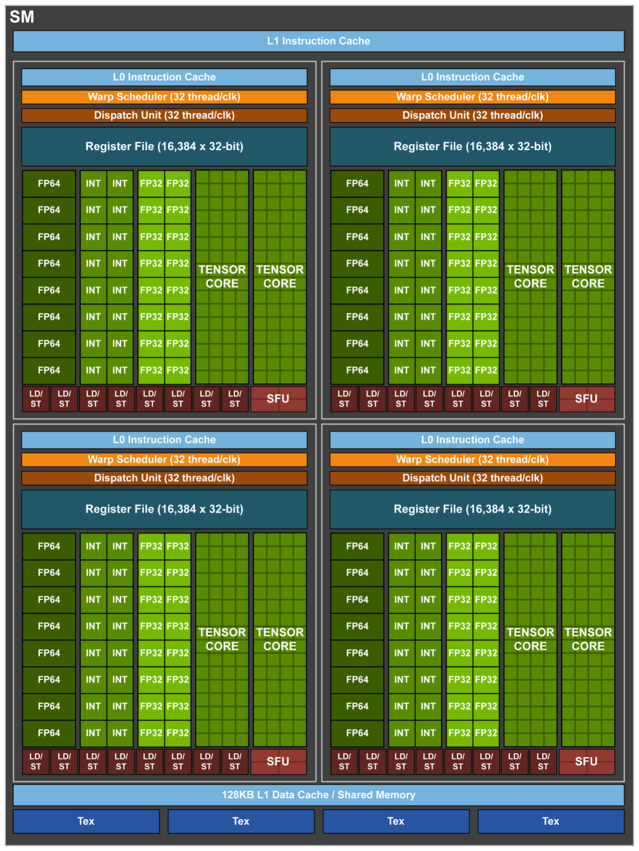

| 每处理块 | Volta（[D p.17](volta-architecture-whitepaper.pdf#page=17) 正文【跨代】） | Hopper（Figure 7 读图 + [A p.39](nvidia-h100-tensor-core-gpu-architecture.pdf#page=39)） |
|---|---|---|
| FP32 | 16 | 32（两列） |
| FP64 | 8 | 16 |
| INT32 | 16 | 16 |
| Tensor Core | 2（第 1 代，每 SM 共 8） | 1（第 4 代，每 SM 共 4） |
| L0 I$ / warp scheduler / dispatch | 各 1 | 各 1 |
| 寄存器堆 | 64 KB | 64 KB（16,384 × 32-bit） |

结论【跨代】：**四处理块、每块独立取指（L0 I$）+ 调度 + 寄存器堆的组织自 Volta 起就是官方正文**；Hopper 图上同构，白皮书正文只给每 SM 总量，不给每块明细——所以块级数字全部标【读图】。

**再往前一代：Fermi 的 SM 图是同一个骨架**

J 物理页 8 整页（正文与图绕排，整页截取以保证正文与图形都完整；CUDA Core 放大图经连接线指向 SM 图左侧的 Core 列；该白皮书的图没有编号）：

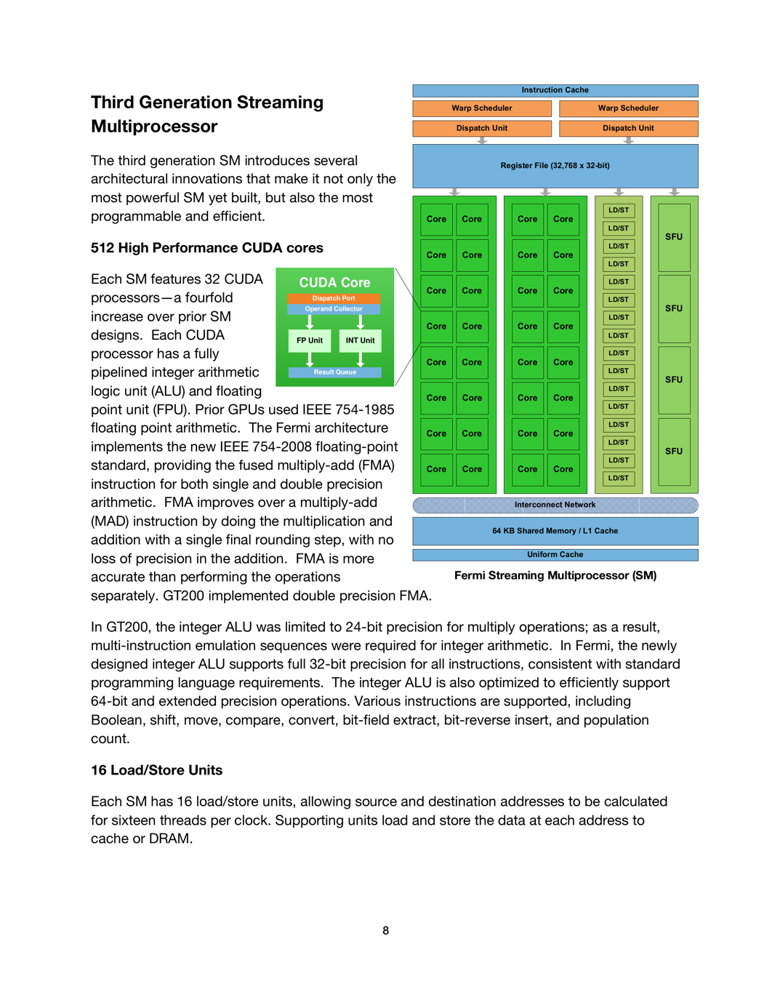

| 部件 | Fermi SM（[J p.8](NVIDIA_Fermi_Compute_Architecture_Whitepaper.pdf#page=8) 图 + 正文）【跨代】 | Hopper SM（Figure 7【读图】+ [A p.39](nvidia-h100-tensor-core-gpu-architecture.pdf#page=39)） |
|---|---|---|
| 顶部指令缓存 | Instruction Cache，SM 级一条 | L1 Instruction Cache 一条，每子分区另有 L0 Instruction Cache |
| 处理块数 | 2（图内两组 Warp Scheduler / Dispatch Unit） | 4 |
| 寄存器堆 | 全 SM 一条 Register File (32,768 x 32-bit)（图内标签，横跨两个处理块） | 每子分区一条 Register File (16,384 x 32-bit)（图内标签） |
| 计算通道 | 全部标 "Core"，一核内含 Integer Unit 与 FP Unit；正文每 SM 32 个 | 分列 INT32 ×16 / FP32 ×32 / FP64 ×16（每子分区） |
| Tensor Core | 无 | 每子分区 1 个 |
| LD/ST | 图中一列；正文每 SM 16 个（[J p.8](NVIDIA_Fermi_Compute_Architecture_Whitepaper.pdf#page=8)） | 每子分区 8 个 |
| SFU | 4 个（[J p.9](NVIDIA_Fermi_Compute_Architecture_Whitepaper.pdf#page=9) "Four Special Function Units"） | 每子分区 1 个 |
| 底部 | 64 KB Shared Memory / L1 Cache + Uniform Cache | 256 KB L1 Data Cache / Shared Memory + Tensor Memory Accelerator + Tex ×4 |

图内格子数是示意的【读图·逐格计数】：Core 为两个子块、每块 2 列 × 7 行，全图共 28 格；LD/ST 一列 14 格、SFU 4 格——与正文的"每 SM 32 个 CUDA processor、16 个 load/store 单元、4 个 SFU"不一致，数量以正文为准。

---

## 7. CUDA Core 与 Tensor Core 怎样参与执行

**直答：CUDA Core 是被 warp 指令逐拍驱动的标量通道，由子分区的 warp scheduler 每拍选中的 warp 来喂；Tensor Core 是同一个 warp（Hopper 上是 4 个 warp 组成的 warpgroup）发出的矩阵指令的执行部件。两者在 Figure 7 里都挂在 Warp Scheduler / Dispatch Unit 之下，图上没有独立的取指部件【读图】。差别在于一条指令算多少：标量指令是每个通道为一个线程算（Fermi 定义【跨代】），MMA 指令是一条指令算一整块矩阵（[C p.681](cuda-programming-guide.pdf#page=681) warp 级 D=A*B+C）。至于"一条 warp 的 FP32 指令是否恰好一拍铺满子分区的 32 条 FP32 通道"——32 条通道 × 32 个 lane 数量吻合，但发射占用几拍文档未说明，属【推断】。**

**CUDA Core 侧**（这里按 Hopper 规格表口径，指 ⑥b 的 FP32 通道；INT32 与 FP64 通道是同类的标量通道，见 §6 的两个口径）：

```
 warp lane:      0    1    2   ...  31
 FP32 通道:      0    1    2   ...  31    ← 子分区 FP32 两列各 16 条共 32 条，与 warp 的 32 lane 数量吻合【对应关系为推断】
 每 lane 一拍:   1 FMA（J p.7 "A CUDA core executes a ... instruction per clock for a thread"【跨代】）
 每 SM 每拍:     128 lane × 2 FLOP = 256 FLOP【换算：按每通道每拍 1 条 FMA 计】
```

INT32/FP64 每子分区只有 16 条通道，一条 32-lane 的 warp 指令怎么走【文档未说明，仅列可能性】：两条半 warp 各占 16 通道分两拍；或与 FP32 通道拼成 32 宽通路（Blackwell 把 FP32/INT32 完全统一是 [B p.12](nvidia-rtx-blackwell-gpu-architecture.pdf#page=12) 原文，Hopper 未说明）。

**Tensor Core 侧**：

- 接口是 warp 级的 `D = A×B + C`：**"C++ warp matrix operations leverage Tensor Cores to accelerate matrix problems of the form D=A*B+C. ... This requires co-operation from all threads in a warp."**（[C 物理页 681](cuda-programming-guide.pdf#page=681)；操作数分片 fragment 的布局架构相关、不公开，[C 物理页 682](cuda-programming-guide.pdf#page=682)；001 §8.2 有完整展开）。
- Hopper 的原生命令是 warpgroup 级的 `wgmma.mma_async`：**"Perform matrix multiply-and-accumulate operation across warpgroup"**（[H 物理页 693](ptx_isa_9.5.pdf#page=693)）；**"A warpgroup is a set of four contiguous warps such that the warp-rank of the first warp is a multiple of 4."**（[H 物理页 664](ptx_isa_9.5.pdf#page=664)），即 4 个 warp 协同一条指令。wgmma 系列需架构专属目标 sm_90a：各小节的 **"Target ISA Notes / Requires sm_90a."**（如 [H 物理页 713](ptx_isa_9.5.pdf#page=713)）。它与 TMA 一样建模为异步代理里的异步操作（[C 物理页 172](cuda-programming-guide.pdf#page=172)，见 §0.1 末行）。
- 第一代的硬件原语是 4×4 矩阵乘加【跨代】：

  D Figure 8（摘自 D 物理页 20）——Tensor Core 的 4×4 D=A×B+C：

  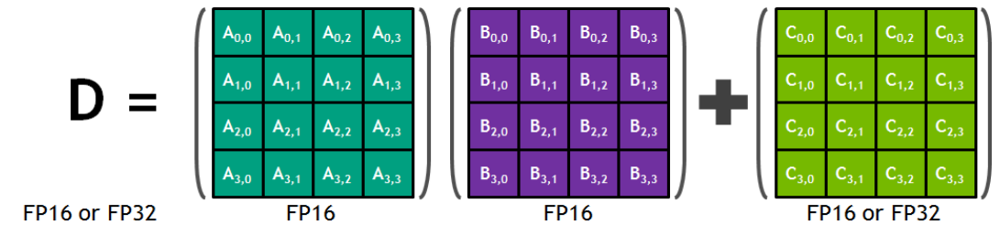

**供数与协作（Hopper 的异步执行家族）**——一次 GEMM 里各部件的分工【推断·示意，部件出处行内标注】：

```
 HBM3 ──TMA──▶ SMEM(≤228KB) ──lds/ldst──▶ RegFile ──▶ Tensor Core (MMA) ──▶ RegFile/SMEM ──▶ 下一步
        1 线程发 copy descriptor (A p.33)           warp/warpgroup 发 MMA (C p.681; H p.693)
 CUDA Core 侧：地址计算、预处理/后处理 (A p.17 原文)、epilogue（激活/偏置等逐元素）【推断】
```

- TMA 定位就是喂 Tensor Core：**"To help feed the powerful new H100 Tensor Cores, data fetch efficiency is improved with a new Tensor Memory Accelerator (TMA) that can transfer large blocks of data and multi-dimensional tensors from global memory to shared memory and vice-versa."**（[A 物理页 32](nvidia-h100-tensor-core-gpu-architecture.pdf#page=32)）。
- CUDA Core 在 AI 管线里的角色【原文】：**"most other CUDA threads can be focused on general-purpose computations, such as pre-processing and post-processing data for the new generation of Tensor Cores"**（[A 物理页 17](nvidia-h100-tensor-core-gpu-architecture.pdf#page=17)）。

Hopper 异步执行家族四图：

A Figure 17（摘自 A 物理页 32）——异步执行的重叠：搬运、计算、独立工作三线并行；H100 新增 TMA 与"等待可睡眠"：

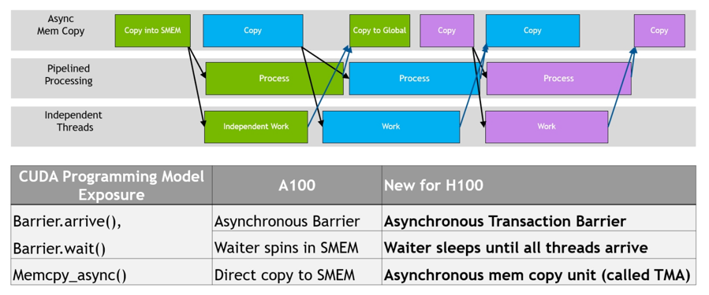

A Figure 18（摘自 A 物理页 33）——TMA 用 copy descriptor（张量维度 + 块坐标）生成地址：

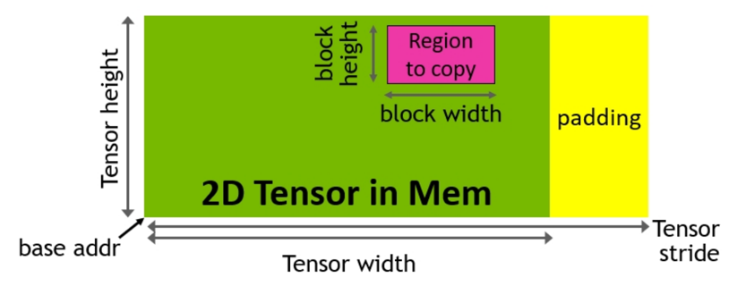

A Figure 19（摘自 A 物理页 34）——A100 用 LDGSTS 时地址由线程算；H100 由 TMA 硬件算：

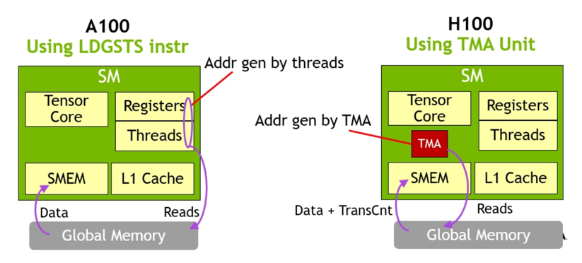

A Figure 20（摘自 A 物理页 35）——异步屏障（A100）对异步事务屏障（H100，多计一个"事务字节数"）：

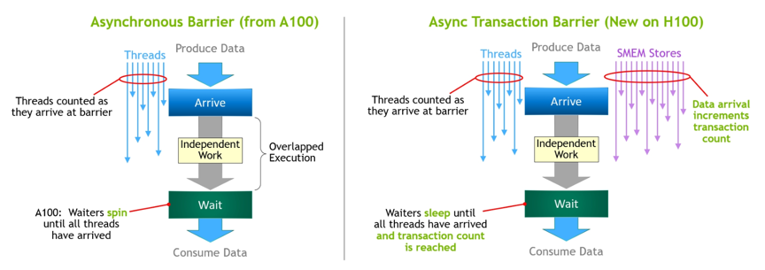

生产者-消费者 warp 的时间线【推断·示意，机制依据 A p.34-35 与 [C p.317](cuda-programming-guide.pdf#page=317)】：

```
 producer warp:  发 TMA(copy desc) ──▶ 干别的活 ────────────▶ arrive(barrier)
 consumer warp:  ──────── wait(事务字节达标) ──▶ MMA 消费数据 ──▶ arrive
 Hopper 增强：wait 可睡眠（A p.34-35 "“Waiting” threads to sleep"，不再自旋）；
              事务屏障计字节数（A p.34 "counts transactions"）
```

**算力差距**【换算，峰值锚点见 001 §3.5】：

```
 每 SM 每拍（H100 SXM5，稠密）：
 CUDA FP32 向量  ██                            256 FLOP/拍   = 128 lane × 2
 TC FP16         ████████████████████████████████ 4096 FLOP/拍  = 4 TC × 512 FMA × 2   → 16×
 TC FP8          （FP8 又是 FP16 的 2×：A p.23 "doubles throughput"）
 峰值互验：FP32 66.9 TFLOPS = 16896×2×1.98G；TC FP16 989.4 = 528×1.83G×1024 FLOP
```

- 单条 MMA 指令的矩阵形状（WMMA 16×16×16 等）与三代接口粒度（warp → warpgroup → Tensor Memory）见 [001.GPU核心调研.md §8.2](001.GPU核心调研.md)，不重抄。

---

## 8. CPU 与 GPU 的数据交互

**直答：CPU 与 GPU 之间的显式数据拷贝由 DMA 拷贝引擎（Copy Engine）承担；物理链路是 PCIe Gen5（128 GB/s）或 NVLink / NVLink-C2C（900 GB/s）。软件上 GPU"看到" host 数据有四种方式——显式拷贝、mapped 直访、Unified Memory 按需迁移、Grace Hopper 的 ATS 单一页表；拷贝能否异步，取决于 host 缓冲是否 page-locked。要注意：四种方式里只有显式拷贝是"引擎替 SM 搬"；mapped 直访是 GPU 线程自己发访存指令，走的正是 SM 的 LD/ST。**

总览泳道图（官方没有一张"数据交互"总图，此为依据行内引证拼装的示意【推断·示意】；框内为英文原图标签，中文说明在行尾）：

```
┌─ host ───────────────────────────────────┐        ┌─ device ───────────────────────────────┐
│ CUDA runtime / NVIDIA driver             │        │ Copy Engines (DMA)                     │
│ system DRAM                              │        │ SMs: LD/ST -> L1 -> L2 -> HBM3 80 GB   │
└──────────────────────────────────────────┘        └────────────────────────────────────────┘
        │                                                   │
        │ 1. cudaMemcpyAsync  (explicit copy)               │
        ├────────────── pinned host buffers ───────────────▶│  ← 真异步的前提 (C p.126)
        │                                                   │
        │ 2. mapped access  (zero-copy)                     │
        │◀────────── GPU thread reads host memory ──────────│  ← over PCIe/NVLink, high latency (C p.145)
        │                                                   │
        │ 3. unified memory  (cudaMallocManaged)            │
        │◀──────────── pages migrate on demand ────────────▶│  ← prefetch: cudaMemPrefetchAsync (C p.144)
        │                                                   │
        │ 4. Grace Hopper ATS  (one page table)             │
        │◀───────── coherent NVLink-C2C 900 GB/s ──────────▶│  ← no page migration (E p.3-6)
        │                                                   │
```

**物理通路**：

| 链路 | 带宽 | 原文 | 出处 |
|---|---|---|---|
| PCIe Gen5 x16 | 128 GB/s（双向各 64） | "H100 incorporates a PCI Express Gen 5 x16 lane interface, providing 128 GB/sec total bandwidth (64 GB/sec in each direction)" | [A 物理页 49](nvidia-h100-tensor-core-gpu-architecture.pdf#page=49) |
| PCIe 原子操作 | — | "...native PCIe atomic operations like atomic CAS, atomic exchange, and atomic fetch add for 32-and 64-bit data types, accelerating synchronization and atomic operations between CPU and GPU" | [A 物理页 49-50](nvidia-h100-tensor-core-gpu-architecture.pdf#page=49) |
| NVLink4 | 900 GB/s | 001 §5.2 已有表，不重抄 | [A 物理页 47](nvidia-h100-tensor-core-gpu-architecture.pdf#page=47) |
| NVLink-C2C | 900 GB/s，硬件一致 | 001 §8.5 已有表，不重抄 | [E 物理页 3](NVIDIA_Grace_Hopper_Architecture_v4.pdf#page=3) |

**GPU 怎么"看到" host 数据——四种方式**：

1. **显式拷贝**：`cudaMemcpy()` 同步；`cudaMemcpyAsync()` 进 stream 后立即返回（[C 物理页 126](cuda-programming-guide.pdf#page=126)）。**异步的前提是 host 缓冲 pinned 且 page-locked**——否则退化成同步拷贝【原文】："In order for memory copies involving CPU memory to be carried out asynchronously, the host buffers must be pinned and page-locked. cudaMemcpyAsync() will function correctly if host memory which is not pinned and page-locked is used, but it will revert to a synchronous behavior which will not overlap with other work."（[C 物理页 126](cuda-programming-guide.pdf#page=126) Note）。page-locked 内存本身也是一类 host 分配【原文】："Page-locked host memory is required for asynchronous copies between the CPU and GPU. Page-locked host memory also improves performance of synchronous copies. Page-locked memory can be mapped to the GPU for direct access from GPU kernels."（[C 物理页 144](cuda-programming-guide.pdf#page=144)）；分配 API：`cudaMallocHost` / `cudaHostAlloc` / `cudaHostRegister`（把第三方库的内存页锁）。
2. **Mapped（零拷贝）**：kernel 直接访 host 内存【原文】："accessing mapped memory in a kernel requires transactions across the CPU-GPU interconnect, PCIe, or NVLink C2C. These operations have higher latency and lower bandwidth compared to accessing device memory. Mapped memory should not be considered a performant alternative to unified memory or explicit memory management for the majority of a kernel’s memory needs."（[C 物理页 145](cuda-programming-guide.pdf#page=145)）；C p.33 脚注 2 同义（"mapped access occurs over the PCIe or NVLINK connection"）。
3. **Unified Memory**：`cudaMallocManaged()`【原文】："A CUDA feature called unified memory allows applications to make memory allocations which can be accessed from CPU or GPU. The CUDA runtime or underlying hardware enables access or relocates the data to the correct place when needed."（[C 物理页 33](cuda-programming-guide.pdf#page=33)）；迁移可用提示与预取控制：`cudaMemAdvise` / **"cudaMemPrefetchAsync allows the programmer to suggest an asynchronous migration of a specific allocation to a different location be started."**（[C 物理页 144](cuda-programming-guide.pdf#page=144)）。
4. **Grace Hopper 的 ATS**：无迁移——CPU 的 `malloc()` 经单一系统页表可被 GPU 直接访问；对照无 ATS 的传统 PCIe 系统，两套页表独立，CPU-resident 页对 GPU 线程不可达（E p.5 原文："system-allocated memory is not directly accessible from the GPU. When a program allocates memory with the system allocator but the page entry is not available in the GPU’s page table, then accessing the memory from a GPU thread fails."）：

E Figure 4（摘自 E 物理页 5）——无 ATS 的系统：CPU 页表（system malloc）与 GPU 页表（GPU malloc）各自独立：

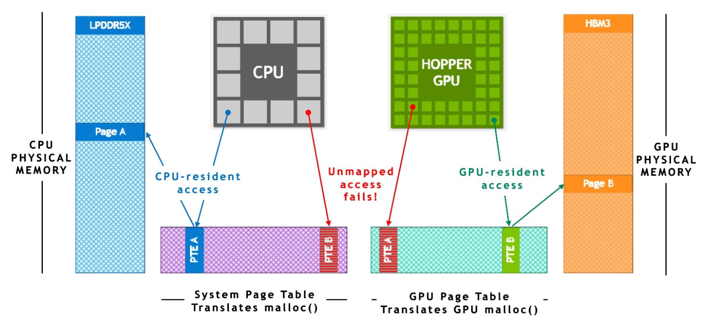

**谁搬**：

- **谁搬，因路径而异**：显式拷贝走 Copy Engine（DMA 引擎）——Grace/ATS 场景的原文是 "NVLink-C2C with Address Translation Services (ATS) leverages the NVIDIA Hopper Direct Memory Access (DMA) copy engines for accelerating bulk transfers of pageable memory across host and device."（[E 物理页 3](NVIDIA_Grace_Hopper_Architecture_v4.pdf#page=3)，见 §0.1）；mapped 直访则是 GPU 线程自己发 load/store，占用的是 SM 的 LD/ST 单元（[C p.145](cuda-programming-guide.pdf#page=145) "accessing mapped memory in a kernel requires transactions across the CPU-GPU interconnect"）。
- **CE 与 SM 的关系**【原文，仅 Tegra 语境】："On Tegra platforms one has the choice of using SMs or Copy Engines (CEs) to perform transfers. ... using the CEs may result in a slower transfer but overall higher application performance, since it leaves the SMs free to perform other work."（[C 物理页 164](cuda-programming-guide.pdf#page=164)）——这说明 CE 与 SM 是两类可分别承担搬运的部件；但该句明确限定 Tegra，H100 上拷贝是否一律走 CE、是否占用 SM，所列文档未说明【文档未说明】。
- H100 数据中心卡上 CE 的数量与单引擎速率【文档未说明】（§11）。

**同步语义**【原文】：

- 主机与设备可以并发："CUDA allows concurrent, or overlapping, execution of multiple tasks, specifically: ▶ computation on the host ▶ computation on the device ▶ memory transfers from the host to the device ▶ memory transfers from the device to the host ..."（[C 物理页 124](cuda-programming-guide.pdf#page=124)）。
- **stream 是工作队列**："A stream operates like a work-queue into which programs can add operations, such as memory copies or kernel launches, to be executed in order."（[C 物理页 125](cuda-programming-guide.pdf#page=125)）——同一 stream 内严格按入队顺序执行，多 stream 由运行时按 GPU 资源状态调度。
- 收口三式：阻塞（`cudaStreamSynchronize` / `cudaDeviceSynchronize`）、轮询（`cudaStreamQuery`）、回调（[C 物理页 124-126](cuda-programming-guide.pdf#page=124)）。

与 [001.GPU核心调研.md §8.5](001.GPU核心调研.md) 的 Grace Hopper 供数表互补，不重抄；ATS 细节的另一面见 E Figure 5（001 §8.5 已嵌入）。

## 9. 从启动到执行

**直答：CUDA C++ 经 nvcc 分离编译，设备代码生成 PTX（虚拟 ISA）；PTX 再由离线或 JIT 编译工具变成可执行的二进制 GPU 代码。主机侧由"作为 GPU 操作系统的"驱动管理设备；kernel 发射后线程块被分发到 SM 驻留；主机用流/事件做异步同步。分发器内部与驱动内核态细节官方未公开。**

A Figure 33（摘自 A 物理页 66）——NVCC 的分离编译模型（设备侧 + 主机侧编译器配对）：

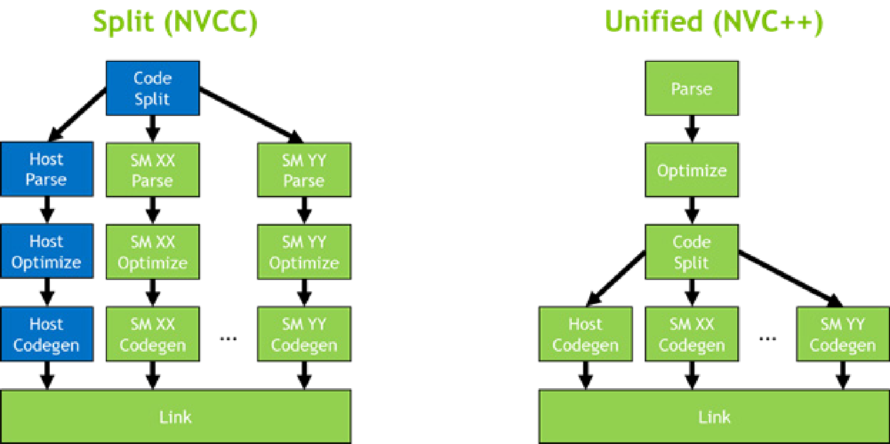

- 编译【原文】：NVVM IR（基于 LLVM 7）→ PTX；**"PTX, the virtual ISA of NVIDIA GPUs, is a public ISA"**，可离线或运行时汇编（[A 物理页 65](nvidia-h100-tensor-core-gpu-architecture.pdf#page=65)）。PTX 与机器码的关系，C 的说法是：**"PTX provides an abstraction layer over the physical ISA of real GPU hardware."**，编译工具"generate PTX code as an intermediate representation (IR) and then use NVIDIA’s offline or just-in-time (JIT) compilation tools to produce executable binary GPU code."（[C 物理页 34](cuda-programming-guide.pdf#page=34)）。
- 驱动【原文】："The NVIDIA Driver can be thought of as the operating system of the GPU."（[C 物理页 33](cuda-programming-guide.pdf#page=33)）。
- 前端【读图】：整芯图顶条 "GigaThread Engine with MIG Control"（[A 物理页 19](nvidia-h100-tensor-core-gpu-architecture.pdf#page=19)，见 §3.1 裁图）。
- 发射与驻留：调度器持续把块放进有空资源的 SM（[C p.92](cuda-programming-guide.pdf#page=92)）。
- 主机同步：kernel 发射对主机异步，流/事件/`cudaDeviceSynchronize` 管序（[C §2.5 起，物理页 124](cuda-programming-guide.pdf#page=124)）；完整语义见 §8。

```
 CUDA C++ ──nvcc(split)──▶ PTX（虚拟 ISA, A p.65）──offline/JIT──▶ 可执行二进制 GPU 代码（C p.34）──▶ 驱动装载【文档未说明】
 host 端：runtime / driver（C p.33 "operating system of the GPU"）
 GPU 前端：GigaThread Engine with MIG Control（A Fig.6 标签【读图】）→ 放置线程块 → SM 驻留（C p.92）
 主机同步：kernel 异步发射，stream/event 同步（C §2.5, p.124 起）
```

驱动内核态如何管理上下文、页表与抢占【文档未说明】——C p.33 只说驱动"必须装在宿主操作系统里"。

---

## 10. FAQ

**Q1：一个 CUDA Core 是不是像 CPU 核一样独占跑一个线程？**
不是。按 Fermi 的定义，它一拍为一个线程执行一条指令（[J p.7](NVIDIA_Fermi_Compute_Architecture_Whitepaper.pdf#page=7)【跨代】），而线程是按 warp 整组被调度的（[C p.170](cuda-programming-guide.pdf#page=170)）——硬件里没有"这个核属于这个线程"的绑定，一个通道在不同拍服务的是哪条线程取决于调度器选中了哪个 warp【推断】。至于一个 warp 的 32 个线程与子分区 32 条 FP32 通道怎样一一对应，文档未说明（§11 第 11 条）。

**Q2：warp 是操作系统线程吗？**
不是。warp 不是内核对象，没有 `task_struct`，不参与 Linux 调度；它是 SM 的**发射单位**（每拍 1 个 warp 的 1 条指令，[C p.170](cuda-programming-guide.pdf#page=170)）。操作系统甚至不知道它的存在。

**Q3：网格里有几百万个线程块，SM 只有 132 个，怎么办？**
排队。C 原文："A grid may consist of millions of thread blocks, while the GPU executing the grid may have only tens or hundreds of SMs."（[C p.25](cuda-programming-guide.pdf#page=25)）——跑完一批块、释放资源，再放下一批。

**Q4：为什么要驻留 2048 个线程这么多？**
为了隐藏延迟。调度器每拍只发 1 条指令；某 warp 等访存时就发别的 warp（§3.2 时间线）。驻留越多，"全部 warp 都在等"的空拍越少——所以 C 说 "In general, it’s a good practice to have occupancy as high as possible which hides latency and increases performance."（[C p.92](cuda-programming-guide.pdf#page=92)）；每 SM 的 warp 上限 64 见 [I p.8](Hopper_Tuning_Guide.pdf#page=8)。

**Q5：线程块会像 OS 线程一样被抢占或迁移吗？**
不会像 OS 线程那样被随时抢占、在核间迁移。块绑定单 SM 跑到完，顺序无保证（[C p.25](cuda-programming-guide.pdf#page=25)）；流优先级只是提示，"Higher-priority tasks do not preempt already running lower-priority tasks."（[C p.161](cuda-programming-guide.pdf#page=161)），所以高优先级内核的块要等低优先级的块完成后才进场（[C p.423](cuda-programming-guide.pdf#page=423)）。但要留意两点：①唯一类似换出的情形是 CUDA Dynamic Parallelism 可把块挂起到显存（C p.25 脚注 1，"not common"）；②warp 层面确实存在抢占——PTX 说 `%warpid` "may change during execution, e.g., due to rescheduling of threads following preemption"（[H p.901](ptx_isa_9.5.pdf#page=901)），粒度与机制文档未说明。

**Q6：CPU 的数据必须先拷进显存才能算吗？**
不必。mapped 直访、Unified Memory、Grace 的 ATS 都能让 GPU 直接访问 host 内存（§8）；但 mapped 直访的每次访问都要跨 CPU-GPU 互联出卡，C 明说它 "should not be considered a performant alternative to unified memory or explicit memory management for the majority of a kernel’s memory needs"（[C p.145](cuda-programming-guide.pdf#page=145)），所以大块数据通常仍是显式拷贝 + pinned 缓冲（C p.126/p.144）。

---

## 11. 缺口清单（官方没写的问题）

以下问题在 A/C/D/H/I 各文档里都没有答案（C 是抽读，已覆盖 §0.1 与正文引用页）：

1. warp 调度器在多个就绪 warp 之间的仲裁策略。
2. warp → 4 个子分区的映射规则。
3. 发射宽度：每子分区每拍固定 1 条，还是可双发射。
4. FP16/BF16 非张量路径由哪类通道执行（[A p.39-40](nvidia-h100-tensor-core-gpu-architecture.pdf#page=39) "Peak FP16 TFLOPS (non-Tensor)" = 2 × FP32 峰值，执行单元未说明）。
5. "GigaThread Engine" 在 Hopper 上的职能与内部结构（只有图 6 顶条的图内标签）。
6. 线程块分发时 GPC 内怎样选 SM。
7. warp 间依赖跟踪硬件（记分板）的名称与机制。
8. 寄存器分配的取整粒度（影响占用率计算的精确值）。
9. H100 数据中心卡上 Copy Engine 的数量与单引擎速率（C 只在 Tegra 语境讨论 SM/CE 选择；E 只说 DMA copy engines 加速 pageable 传输）【文档未说明】。
10. warp 级抢占的粒度、触发条件与保存恢复机制（PTX 只在 `%warpid` 说明里承认 "rescheduling of threads following preemption" 存在，[H p.901](ptx_isa_9.5.pdf#page=901)；流优先级层面明确不抢占正在运行的任务，[C p.161](cuda-programming-guide.pdf#page=161)）【文档未说明】。
11. 一条 warp 的标量指令占满子分区 32 条 FP32 通道要几拍；INT32/FP64 只有 16 条通道时一条 warp 指令怎样执行（§7 仅列可能性）【文档未说明】。
12. 各子分区的 warp 槽位是否严格均分（64 ÷ 4 = 16 是上限的平均值，分配规则未说明）【文档未说明】。

第三方微基准可以补一部分（指令级延迟、TMA 吞吐等）：arXiv:2402.13499《Benchmarking and Dissecting the Nvidia Hopper GPU Architecture》（[摘要](https://arxiv.org/abs/2402.13499)、[代码](https://github.com/HPMLL/NVIDIA-Hopper-Benchmark)）【论文，非官方文档，本文未引用其数据】。

---

*整理：2026-11-28。全部论断带标签与出处，数字经 §6 校验表互证；摘录图逐张与 PDF 原图核对，ASCII 框线图行宽经脚本校验。*
