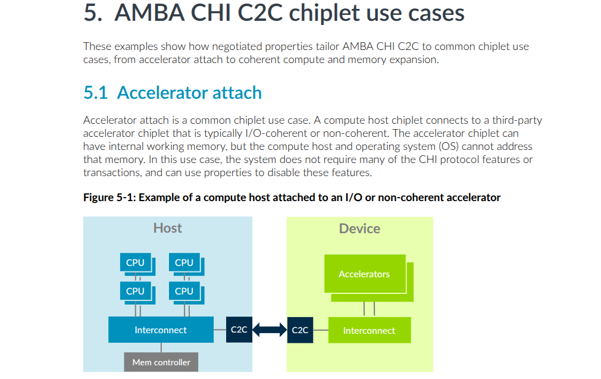

# NVIDIA
|技术项|说明|参考|
|-|-|-|
|- Unified and System Memory|- 即CPU 和 GPU各有自己独立的物理内存，但是共用一个虚拟地址空间|- [2.6. Unified and System Memory](https://docs.nvidia.com/cuda/cuda-programming-guide/02-basics/understanding-memory.html#memory-unified-virtual-address-space)   -  [007.BOOKs/098.NVIDIA/cuda-programming-guide.pdf#2.6. Unified and System Memory](../../007.BOOKs/098.NVIDIA/cuda-programming-guide.pdf)  - 看这个，绝对有收获:[NVIDIA_Grace_Hopper_Architecture_CN.pdf](../../007.BOOKs/098.NVIDIA/NVIDIA_Grace_Hopper_Architecture_CN.pdf)|
|-|-|-|
|- Address Translation Service (ATS) |- ATS 允许完全访问所有 CPU 与 GPU 内存分配；无需迁移——迁移更少。ATS 为整个系统创建单一页表；NVLink-C2C允许在不迁移的情况下访问所有物理内存。|- [Accelerating Scientific Workflows with the  NVIDIA Grace Hopper Platform#P14](../../007.BOOKs/098.NVIDIA/Accelerating_Scientific_Workflows_with_the_NVIDIA_Grace_Hopper_Platform_SC23.pdf)|
|-|-|-|
|-|-|-|
|-|-|-|

---

## Accelerators (加速器)
GPU就是图中的加速器: 

> 加速器 [Learn the architecture - Introduction to AMBA®CHI C2C property negotiatio#P21](../../007.BOOKs/learn_the_architecture_introduction_to_amba_chi_c2c_property_negotiation_112071_0100_01_en.pdf)