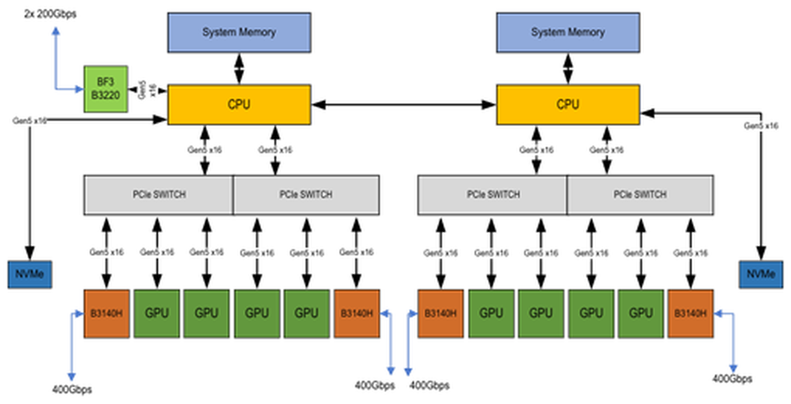

# RTX PRO AI Factory：2-8-5-200 服务器拓扑（官方 Figure 3 解读）

- 官方文档: [NVIDIA Enterprise Reference Architectures — RTX PRO AI Factory / Components](https://docs.nvidia.com/enterprise-reference-architectures/rtx-pro-ai-factory/latest/components.html)，"NVIDIA-Certified Systems and 2-8-5-200 Configuration" 一节
- 原图: [rtx-pro-ai-factory-03.png](https://docs.nvidia.com/enterprise-reference-architectures/rtx-pro-ai-factory/latest/_images/rtx-pro-ai-factory-03.png)
- 图题（原文）: *"Example of a 2-8-5-200 system configuration as adopted in an NVIDIA-Certified RTX PRO Server."*
- 一张图画的是**一台服务器**：左右两个半区各是一个 CPU socket（各带 1 组内存、2 颗 PCIe Switch、4 张 GPU、2 张 B3140H、1 块 NVMe），两颗 CPU 之间用一根双向箭头相连。

## 原图摘录



> 上图 = 原图合成到白底、放大 2 倍，线条和文字未改动；原始文件见 [rtx-pro-ai-factory-03-original.png](./rtx-pro-ai-factory-03-original.png)（510×261，透明背景）。
>
> 读原图有两个坑: ① 连线是深色、背景透明，深色主题下（或被渲染成黑底时）连线基本看不见；② 左上角 `2x 200Gbps` 和 BF3 右侧**竖排**的 `Gen5 x16` 是图上最小、最容易漏掉的两处文字。

## ASCII 重绘（左右结构，与原图同布局）

```text
   ^ 2x 200Gbps                   +-----------------------+                                      +-----------------------+
   |                              |     System Memory     |                                      |     System Memory     |
   |                              +-----------------------+                                      +-----------------------+
   |                                          ^                                                              ^
   |                                          |                                                              |
   |                                          v                                                              v
   |    +---------+              +-------------------------+                                    +-------------------------+
   +--->|BF3 B3220|<--Gen5 x16-->|                         |                                    |                         |
        +---------+              |           CPU           |<---------------------------------->|           CPU           |
   +-Gen5 x16------------------->|                         |                                    |                         |<-----Gen5 x16---+
   |                             +-------------------------+                                    +-------------------------+                 |
   |                                  ^               ^                                              ^               ^                      |
   |                                  |               |                                              |               |                      |
   |                              Gen5|x16        Gen5|x16                                       Gen5|x16        Gen5|x16                   |
   |                                  |               |                                              |               |                      |
   |                                  v               v                                              v               v                      |
   |                +------------------------+ +------------------------+          +------------------------+ +------------------------+    |
   |                |      PCIe SWITCH       | |      PCIe SWITCH       |          |      PCIe SWITCH       | |      PCIe SWITCH       |    |
   |                +------------------------+ +------------------------+          +------------------------+ +------------------------+    |
   v                   ^        ^        ^        ^        ^        ^                 ^        ^        ^        ^        ^        ^        v
+-----+                |        |        |        |        |        |                 |        |        |        |        |        |     +-----+
| NVMe|            Gen5|x16 Gen5|x16 Gen5|x16 Gen5|x16 Gen5|x16 Gen5|x16          Gen5|x16 Gen5|x16 Gen5|x16 Gen5|x16 Gen5|x16 Gen5|x16  | NVMe|
+-----+                |        |        |        |        |        |                 |        |        |        |        |        |     +-----+
                       v        v        v        v        v        v                 v        v        v        v        v        v
                    +------+ +------+ +------+ +------+ +------+ +------+          +------+ +------+ +------+ +------+ +------+ +------+
                +-->|B3140H| | GPU  | | GPU  | | GPU  | | GPU  | |B3140H|<--+  +-->|B3140H| | GPU  | | GPU  | | GPU  | | GPU  | |B3140H|<--+
                |   +------+ +------+ +------+ +------+ +------+ +------+   |  |   +------+ +------+ +------+ +------+ +------+ +------+   |
                |                                                           |  |                                                           |
                v 400Gbps                                           400Gbps v  v 400Gbps                                           400Gbps v
```

读图说明:
- 图上所有连线都是**双向箭头**；黑色 = PCIe 链路，带 `400Gbps` / `2x 200Gbps` 标签的 = 网络上行。
- `Gen5|x16`、`<--Gen5 x16-->`: 标签中间那根线就是箭头本身（标签骑在箭头上）。
- CPU ◄──► CPU: 原图**没有标注**类型和速率；它是双路 CPU 之间的片间互连（Intel 平台为 UPI、AMD 平台为 xGMI——这句是补充的背景，图上没有）。
- 左上角 `2x 200Gbps`: BF3 B3220 的上行（N/S 网络）。
- NVMe 各自在最外侧，直连所属 CPU 的外侧边缘，不经过 PCIe Switch。
- 参考:
  + [GIGABYTE-gigabyte-server_manual_e_G493-ZB4_v3.0.pdf#P14](../../007.BOOKs/GIGABYTE-gigabyte-server_manual_e_G493-ZB4_v3.0.pdf)
  + [Accelerate AI outcomes with modular, automated and proven enterprise AI. NVIDIA 2-8-5-200, ERA configuration endorsed for the Dell AI Factory with NVIDIA](../../007.BOOKs/098.NVIDIA/nvidia-2-8-5-200-era-configuration-endorsed-for-the-dell-ai-factory-with-nvidia-brief-en-dl11113p-original.pdf) -> 有更清晰的图
    + [NVIDIA Reference Architectures](https://docs.nvidia.com/reference-architectures/index.html#nvidiatab-overview)
    + [G493-ZB4-AAP1](https://www.gigabyte.cn/Enterprise/GPU-Server/G493-ZB4-AAP1-rev-3x#Support-Manual)
## 逐线对照

| 起点 | 终点 | 图上标注 | 数量 |
|---|---|---|---|
| System Memory | CPU | （无标注） | 2 |
| BF3 B3220 | CPU0 | Gen5 x16（竖排） | 1 |
| BF3 B3220 | N/S 网络 | 2x 200Gbps | 1 |
| CPU0 | CPU1 | （无标注） | 1 |
| CPU | NVMe（各半区外侧） | Gen5 x16 | 2 |
| CPU | PCIe Switch | Gen5 x16 | 4（每 CPU 2 条） |
| PCIe Switch | GPU / B3140H | Gen5 x16 | 12（每颗 Switch 3 条） |
| B3140H | E/W 网络 | 400Gbps | 4 |

图上 19 条带标签的 PCIe 链路**全部是 Gen5 x16**，没有 Gen4。

## "2-8-5-200" 是什么

原文定义: *"This NVIDIA Enterprise RA is based on a 2-8-5-200 infrastructure configuration (2 CPUs, 8 GPUs, 5 NICs at 200 Gbps each) with NVIDIA RTX PRO Servers, including NVIDIA BlueField-3 and NVIDIA Spectrum-X Ethernet networking."*

- 即 **2 CPU / 8 GPU / 5 张网卡**：4 张 BlueField-3 B3140H 做 E/W（计算网络），1 张 BlueField-3 B3220 做 N/S（管理与存储网络）。
- 流量方向（原文）: E/W = *"Traffic between RTX PRO Servers within the cluster"*；N/S = *"Traffic between RTX PRO Servers and external resources"*。
- 带宽口径，图和文字不一致:
  - 文字定义写的是 "5 NICs at 200 Gbps each"。
  - Figure 3 上 4 张 B3140H 每张标 `400Gbps`（合计 1600 Gbps，平均到 8 张 GPU 正好每张 200 Gbps——这个对应关系是我的理解，文档没有明说）。
  - 文档带宽表照录原文: Total Minimum Compute Network Bandwidth = `200 GB/s (4x 200 Gb/s or 2x 400 Gb/s NICs)`；Total Recommended Compute Network Bandwidth = `400 GB/s (4x 400 Gb/s NICs)`。这两行的数字和单位自相矛盾（4×400 Gb/s = 1600 Gb/s），不做换算；只确定一点：图上每张 B3140H 的 400Gbps 与其中 "4x 400 Gb/s NICs" 的写法一致。

## 单节点组成

| 部件 | 数量 | 说明 |
|---|---|---|
| CPU | ×2 | Table 1 列了 Intel Emerald/Sapphire/Granite Rapids、Sierra Forest，AMD Genoa、Turin；每 GPU 至少 7 个物理核 |
| System Memory | — | 每 GPU 至少 128 GB，在各 CPU 间均匀分布，1DPC |
| PCIe Switch | ×4 | Gen5，每颗 CPU 下 2 颗 |
| GPU | ×8 | RTX PRO 6000 Blackwell Server Edition，96 GB GDDR7；每 GPU 一条 Gen5 x16 |
| BlueField-3 B3140H | ×4 | E/W SuperNIC；HHHL PCIe Gen5 x16，单口 400GbE |
| BlueField-3 B3220 | ×1 | N/S DPU；FHHL PCIe Gen5 x16，双口 200GbE |
| NVMe | ×2 | 每 CPU 插座至少 1 TB（DL 服务器 2 TB） |

备选型号（Table 3/4）: E/W 可用 B3220L（FHHL，双口 200GbE），N/S 可用 B3240（FHHL，双口 400GbE）。

## 设计要点（Table 1 及 Networking 一节原文）

- *"8 GPUs are balanced across CPU sockets and root ports."* → 图上每个半区正好 4 张 GPU。
- *"Minimum of one Gen5 x16 link per GPU for optimal performance"*
- *"NIC and NVMe drives should be under the same PCIe switch or PCIe root complex as the GPUs. Note that a PCIe switch may not be needed for low-cost inference servers; direct-attach to the CPU is best if possible."* → 图上 NVMe 就是直连 CPU。
- *"Partners are recommended to accommodate NICs for the maximum 2:1 GPU to NIC ratio."* → 所以每颗 PCIe Switch 下挂 2 张 GPU + 1 张 B3140H，B3140H 落在每个半区设备排的两端。

→ 8 张 GPU 之间没有任何直连线（图上如此；[官方产品页](https://www.nvidia.com/en-us/data-center/rtx-pro-6000-blackwell-server-edition)规格里也只列 PCIe Gen 5、没有 NVLink），节点内 GPU 互访走 PCIe，跨节点走 Spectrum-X 以太网。
